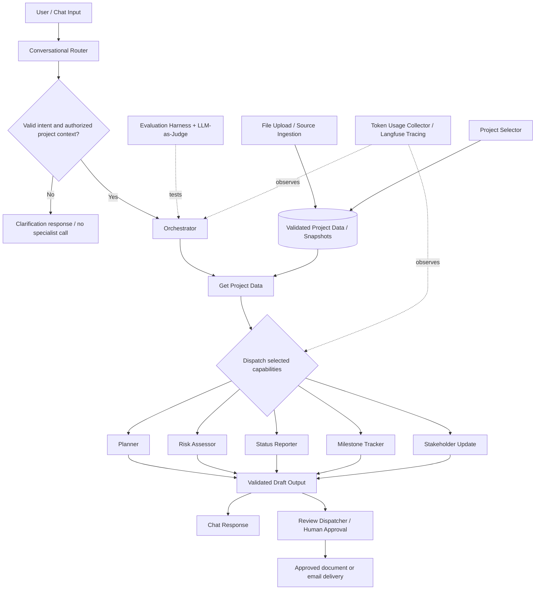

Chat Interface URL- https://agentic09.app.n8n.cloud/webhook/fabb30ae-272a-437c-b37a-c485f6e01e71/chat,
Mira Project data upload URL- https://agentic09.app.n8n.cloud/form/mira-project-upload

MIRA — AI-Powered Project Intelligence Assistant
Applied Agentic AI for PMs/TPMs | Capstone Project | Nexora / ABCDE Ltd. AI Adoption (training scenario)

MIRA is a multi-agent project intelligence prototype built in n8n to help project managers and technical program managers turn approved project documents and task-board records into traceable plans, risk assessments, status reports, milestone analyses, and stakeholder updates. The design emphasizes delivery governance, evidence-based reporting, predictable escalation, observability, and human review—not simply AI-generated text.
Project status: Capstone prototype, evaluated against 12 predefined baseline scenarios. Not production-deployed. Source-data freshness, third-party integrations, and model costs are constrained as described below.

1. The TPM problem and intended value
In the supplied Nexora/ABCDE Ltd. scenario, PMs/TPMs spend significant time drafting project plans (3–4 hours), compiling weekly status updates (1–2 hours), and managing inconsistently recorded risks and milestones. MIRA addresses these processes through a consistent workflow while preventing unsupported project details from being presented as facts.
TPM responsibility	MIRA capability	Output / control
Scope and delivery planning	Planner	Project phases, activities, deliverables, milestones; evidence gaps
Risk and issue governance	Risk Assessor	Categorized risks, mitigation strategies, source references; unknown scores left unknown
Execution visibility	Status Reporter	Sprint/project task counts, statuses, blockers, draft updates; reconciliation
Schedule governance	Milestone Tracker	Milestones, dependencies, blocker alerts; no invented dates
Executive communication	Stakeholder Update	Audience-appropriate draft updates requiring human approval before distribution

Primary users: PMs, TPMs, program leaders, project sponsors and stakeholders reviewing AI adoption delivery.
2. Architecture and orchestration decision
Pattern: intent-based Router/Dispatcher with orchestration of selected specialist workflows. Project questions have different intents (plan, risk, status, milestone, stakeholder update); running all specialists for every request would add cost and irrelevant output. A conversational routing layer selects the smallest sufficient capability set and checks that a valid project snapshot can be used. The Orchestrator retrieves the approved data and invokes applicable agents. Separate evaluation and tracing paths assess behavior. Human review is a governance step for deliverables that are distributed.

The evaluation harness is an independent assurance workflow; it is not a mandatory serial step on every interactive user request. Clarification requests may finish before specialist execution.
Guardrails and governance
- Project selection and context authorization: Select actual, eligible project snapshots; do not invent project IDs or use irrelevant context.
- Grounded generation: Use approved project descriptions, timelines, risk registers and task-board sources; provide references and acknowledge missing evidence.
- Structured validation: Validate required output fields, source references, relevant counts and report scope.
- Clarification gate: When details are insufficient, ask targeted questions instead of fabricating a report.
- Human-in-the-loop: Draft review and approval workflow for reports intended for distribution.
- Observability: Collect execution traces, latency, actual model-usage records when available, and estimated model cost.
3. Implementation and technology decisions
Component	Technology	Why selected
Orchestration and UI	n8n	Visual, modular specialist workflows; executable business process and API integrations
Model inference	OpenAI models via n8n	Structured extraction/reasoning/report generation; model choice can be changed in credentials/nodes
Project evidence	n8n Data Tables + uploaded files	Snapshot-scoped document retrieval for grounded agent context
Evaluation	n8n Evaluation Harness + LLM-as-Judge	Repeatable baseline scenarios with structured scoring, grounding checks and task reconciliation
Telemetry	Langfuse via OTEL; n8n execution data	Agent-level tracing and observed token consumption, with incomplete coverage disclosed
Review and outputs	Google Docs / Drive / Gmail	Human review, document production and approved distribution

Ingestion: File-upload and Google Drive import paths exist. SharePoint, Jira, Trello and Confluence connector nodes are present in the upload workflow but disabled in the supplied export; they must not be represented as tested live integrations.
4. Baseline evaluation — evidence, not a blanket accuracy claim
Regression run: 5814 · Date: November 18, 2026 · Harness verdict: 12 of 12 tests passed (overall_eval_pass = true).

The baseline set covers:
Tests	Scenario	Expected outcome
T1, T3, T5	Detailed plan, risks and Sprint 3 status	Structured, source-grounded outputs
T2, T4, T6, T9	Vague or insufficient inputs	Clarification; no specialist report generated
T7	Top project risks	Use recorded risk IDs from approved register
T8	Blocker/deadline analysis	Identify blocked security task T024
T10	Whole-board status summary	Reconcile task counts with source task board
T11	Upcoming milestones	Use documented timeline; do not invent calendar dates
T12	Sprint 2 stakeholder communication	Professional draft restricted to Sprint 2 evidence

Test artifacts to place in /testing/: evaluation-history workbook, T1–T12 input/expected/actual-output records, chat-output history and screenshots of the harness, workflow execution and Langfuse traces. Link these artifacts from this section when added.
Interpreting the results correctly
- 12/12 is the recorded verdict for one named regression batch—not proof of production reliability or zero hallucination in all future inputs.
- Some specialist results carry PARTIAL validation because approved source files lack owners, likelihoods, completed mitigations, individual milestone dates or freshness evidence. Missing information is disclosed rather than fabricated.
- The independent judge has warnings that factual grounding was not fully verified against original documents for certain evaluations.
- Clarification-path tests T2/T4/T6/T9: no specialist/tool workflow run was recorded for those chat paths. The conversational router may still incur model usage, so a blank specialist-token field is not a zero-total-cost assertion.
- Chat vs harness evidence: The chat output history and batch evaluation history are separate tests/runs; they may have different run IDs and wording. Chat clarification messages should be compared directly against the rubric's required follow-up questions.
5. Usage, costs and measurement plan
The evaluation records include latency, model token counts, estimated per-case cost, source coverage, warnings, task reconciliation and scope checks.

Illustrative recorded values from regression run 5814:
- T1 detailed plan: 11,229 input tokens + 2,250 output tokens = 13,479 model tokens; recorded estimated model cost ≈ $0.00731.
- Batch: recorded generation-token total 97,724; sum of recorded per-test estimated costs ≈ $0.03974. These figures are partial coverage, not a complete accounting of all chat routing, judge calls, retries, external services or infrastructure.
Cost-per-user projection: For planning purposes, take the observed T1 model-cost estimate as a reference, specify an assumed number of similar plans per user per day, and multiply. For example, 5 similar plans/day × $0.00731 ≈ $0.0366/day in recorded-model-cost-equivalent, before routing, judging, overhead, other request types and any pricing differences. This is a scenario estimate, not measured operational spend.

Production metrics to monitor (targets, not claims of achieved production outcomes):
1. Grounding / unsupported-claim rate: Report claims traceable to approved evidence; separate verified facts from acknowledged unknowns.
2. Task-count reconciliation accuracy: Match done/in-progress/to-do/blocked totals against the approved task-board scope.
3. Milestone and blocker detection accuracy: Recall/precision of recorded blocked and at-risk items, measured against labeled records.
4. Operational efficiency and adoption: Report preparation time saved vs manual baseline; PM/TPM acceptance and corrections.
5. Reliability / cost: p95 latency, model tokens and fully attributed cost per completed report.
6. Workflow inventory
The implementation is organized into 15 exported n8n workflows:

Interaction / orchestration: Mira_10_Chat_Interface, Mira_00_Orchestrator, Mira_Project Selector.

Specialists: Mira_01_Planner_Agent, Mira_02_Risk_Assessor_Agent, Mira_03_Status_Reporter_Agent, Mira_04_Milestone_Tracker_Agent, Mira_Stakeholder_Update_Agent.

Ingestion / retrieval: MIRA_Data_Upload, MIRA_Get_Project_Data.

Evaluation / observability: Mira_99_Evaluation_Harness, Mira_07_Evaluator — LLM-as-Judge, Mira_08_Langfuse_Trace_Exporter, Mira_10_TokenUsageCollector.

Governance: Mira_12_ReviewDispatcher.
Important: The previously assembled sanitized ZIP contained only 12 workflows. The Data Upload, Get Project Data and Token Usage Collector exports need to be sanitized and added separately before claiming the repository includes all 15.

7. Repository layout and evidence map
mira-ai-project-intelligence/
├── README.md
├── flows/                         # Sanitized n8n JSON (15 exports when complete)
├── data/                          # Synthetic/example input files only
├── docs/
│   ├── architecture.md            # 1–2-page Q2 design and tool rationale
│   ├── program-charter.md         # Q3
│   ├── reflection-next-steps.md   # Q4
│   ├── ideation.md                # Q1
│   ├── cost-analysis.md           # Cost assumptions + per-plan/per-user estimates
│   └── setup.md                   # Reconnection/import instructions
├── testing/
│   ├── baseline-evaluation.xlsx   # T1–T12, actual responses, score history
│   └── evaluation-summary.md     # Run 5814 + limitations
├── screenshots/
│  ### Implementation Screenshots and Execution Evidence

MIRA's implementation is documented through 39 screenshots capturing n8n workflows, successful executions, project-data management, evaluation infrastructure, observability, and human-in-the-loop approval.

**Core architecture**
- [MIRA Orchestrator Workflow](Screenshots/06_MIRA_Orchestrator_Workflow.png)
- [MIRA Chat Interface](Screenshots/05_MIRA_Chat_Interface_Workflow.png)
- [MIRA Project Selector](Screenshots/04_MIRA_Project_Selector_Workflow.png)
- [MIRA Data Upload](Screenshots/01_MIRA_Data_Upload_Overview.png)

**Specialized AI agents**
- [Planner Agent](Screenshots/11_MIRA_Planner_Agent_Execution.png)
- [Risk Assessor](Screenshots/12_MIRA_Risk_Assessor_Agent_Execution.png)
- [Status Reporter](Screenshots/13_MIRA_Status_Reporter_Agent_Execution.png)
- [Milestone Tracker](Screenshots/14_MIRA_Milestone_Tracker_Agent_Execution.png)
- [Stakeholder Update](Screenshots/15_MIRA_Stakeholder_Update_Agent_Execution.png)

**Evaluation, observability, and governance**
- [LLM-as-Judge](Screenshots/16_MIRA_LLM_As_Judge_Evaluator_Execution.png)
- [Langfuse Trace Exporter](Screenshots/17_MIRA_Langfuse_Trace_Exporter_Execution.png)
- [Token Usage Collector](Screenshots/18_MIRA_Token_Usage_Collector_Execution.png)
- [Review Dispatcher](Screenshots/19_MIRA_Review_Dispatcher_Execution.png)
- [Evaluation Harness](Screenshots/20_MIRA_Evaluation_Harness_Workflow.png)

For additional workflow details, execution evidence, approved reports, and data-table screenshots, see the [complete Screenshots directory](Screenshots/).

The screenshots demonstrate the implementation and selected successful executions. They do not independently establish production readiness or universal accuracy.
└── presentation/                 # Summary slide deck for the submission
This tree is the intended submission organization. Files are not considered included until uploaded to those paths.
Rubric navigation
Assignment	Points	Where evaluator should look
Q1 — Ideation	15	docs/ideation.md: 2–3 use cases, pain points, inputs/outputs, metrics and knowledge bases
Q2 — Build MIRA	45	flows/, architecture, baseline evidence, trace screenshots, cost analysis
Q3 — Program Charter	25	docs/program-charter.md: vision, scope, timeline, stakeholders, governance, risks, rollout
Q4 — Reflection & Next Steps	15	docs/reflection-next-steps.md: findings, prompt improvements, privacy, rollout for 10 PMs/TPMs

8. Reproducing the prototype
1. Obtain a compatible n8n environment. Import the sanitized JSON workflows in flows/.
2. Create and connect your own OpenAI, Langfuse, Google Drive/Docs/Gmail and n8n API credentials as applicable. Never commit secrets.
3. Configure MIRA_Project_Data Data Table and document its schema; update the Data Table references.
4. Reconnect Execute Workflow nodes to the newly imported subworkflow IDs. Exported workflow IDs from the author's n8n instance are not portable.
5. Supply authorized or synthetic project description, risk CSV, timeline CSV and task-board CSV. Upload them through the ingestion workflow and verify snapshot readiness.
6. Run one detailed-plan and one clarification-path smoke test, then run the 12-case evaluation harness. Compare the outcome with testing/ evidence.
7. Configure the approval flow before testing email delivery; use sandbox/test recipients and do not send live stakeholder communications during a demo.
Limitations: The repository is a technical demonstration, not a turnkey hosted service. Importing sanitized JSON alone does not provision accounts, credentials, Data Tables, document templates, subscriptions or external data. External connectors marked disabled must be configured and tested separately.
9. Privacy, governance and ethical considerations
- Use only synthetic or approved training data in the public repository; avoid production/client records and private emails.
- Remove API keys, credential IDs, internal n8n URLs, personal identifiers, webhook IDs, Drive folder IDs and project-specific resource identifiers from shared exports.
- Human approval is required before distributing generated reports externally.
- Present generated documents as drafts unless and until review/approval is evidenced.
- Do not assert a source-grounded decision when source evidence is missing, contradictory or stale.
10. Reflection and roadmap
What worked: Modular routing, testable specialist contracts, project-scoped evidence, accurate Sprint 3 reconciliation on the sample scenario, handling of insufficient context, and a repeatable evaluation framework.

Observed limitations: Incomplete source metadata for quantitative risk scoring and milestone dates; independent grounding verification warnings; incomplete end-to-end token attribution on clarification requests; some variability between conversational and harness-run clarification details; optional external connectors not yet enabled.

Next steps: Strengthen exact baseline keyword acceptance at the chat surface, add evidence-level citation verification, complete cost attribution across router/judge/retry calls, automate regression evidence exports, benchmark latency and user time savings, and pilot with a small controlled PM/TPM cohort before broader rollout.
