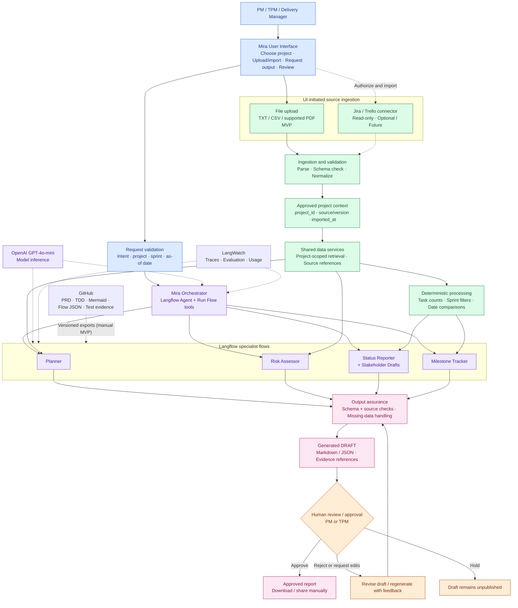

# Mira – Solution Architecture

**Version:** 1.3 (proposed)  
**Status:** Architecture design for no-code MVP  
**Based on:** Mira PRD v1.1 and Technical Design v1.2  
**Stack:** Langflow · OpenAI GPT-4o-mini · LangWatch · GitHub

> **Scope clarification:** Users initiate data imports through Mira's user interface. The MVP supports file uploads; Jira/Trello read-only import is an optional future integration. A unified Mira UI, deterministic calculations, and an embedded approval control are **target architecture capabilities** and must be validated or implemented; they are not assumed to be built-in Langflow Playground functions.

## Diagram 1 — Target logical solution architecture

**Architectural boundaries:** The project files and connectors are alternative inputs to the same ingestion/normalization process; they are not independent agent interfaces. The approved project context is a logical data service, not necessarily a new database. LangWatch and GitHub are supporting systems, not part of the report approval decision. Only validated, reviewed outputs may be distributed externally.

## Diagram 2 — Data input, report generation and human-in-the-loop approval

### Human-in-the-loop implementation note

The **approval decision is a required business checkpoint in the target design**. For the no-code capstone MVP, a PM/TPM may review the generated draft and approve it **manually** before sharing. Do not represent the `APPROVED` status, reviewer audit log, or automatic return-to-generation loop as implemented until you configure and test those functions. If a Langflow human-input/pause mechanism is used, confirm it works in the parent flow; do not assume a specialist invoked through Run Flow can pause for approval.

### MVP vs. future capabilities

| Capability | MVP design | Future enhancement |
|---|---|---|
| UI file ingestion | Required, subject to supported Langflow UI/upload flow | Full self-service upload portal |
| Jira/Trello | Not required; static CSV export can substitute | Authorized read-only connector |
| Data processing | Deterministic counts/date rules; feasibility gate required | Reusable managed data service |
| Human approval | Manual PM/TPM review before distribution | In-app approval workflow and audit trail |
| Distribution | User manually exports/shares approved output | Controlled integration with Docs, email or Slack |
| Versioning | Manual Langflow JSON export to GitHub | Automated deployment and synchronization |

### Acceptance evidence

- Uploaded dataset is parsed and validated, with source version recorded.
- Status reports reconcile to actual task-board counts; blocked task **T024** is identified.
- Specialist outputs are grounded in the selected project only.
- Reports remain drafts until PM/TPM approval.
- Rejected reports are not shared.
- All 12 capstone baseline tests and relevant execution traces are documented.
