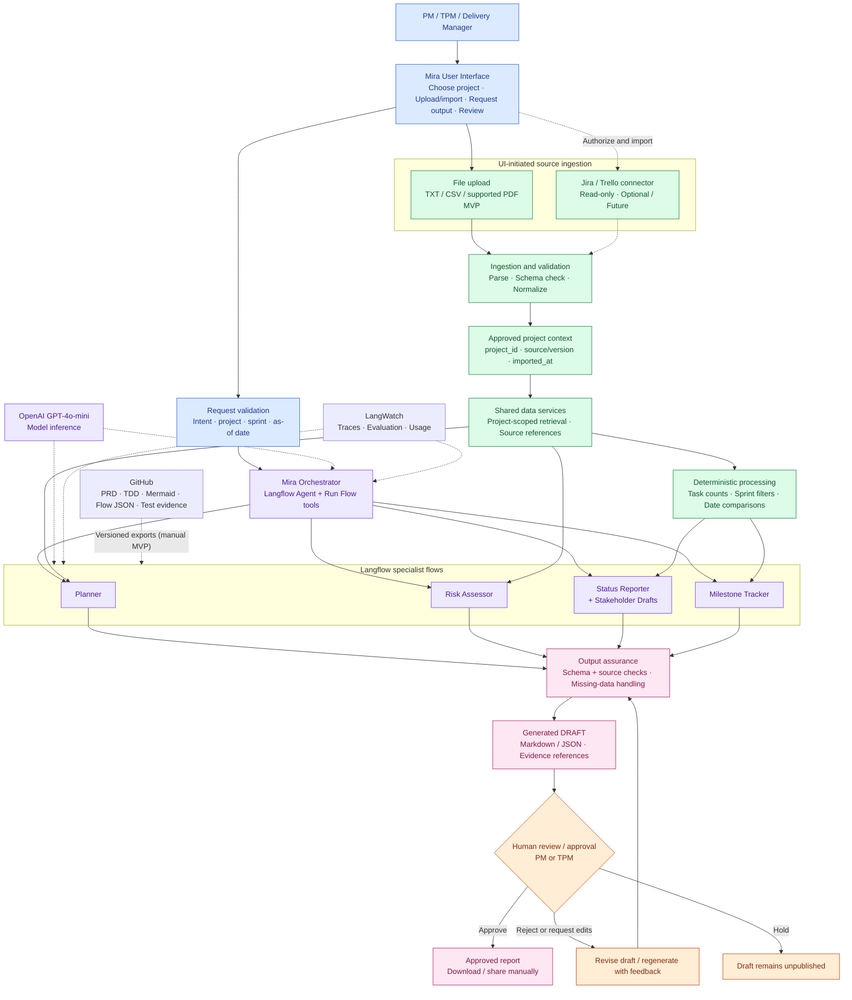
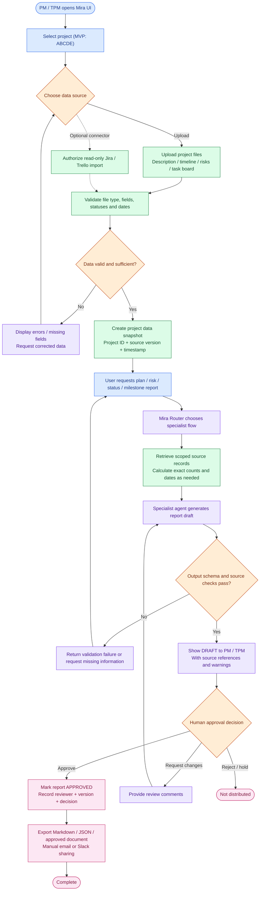
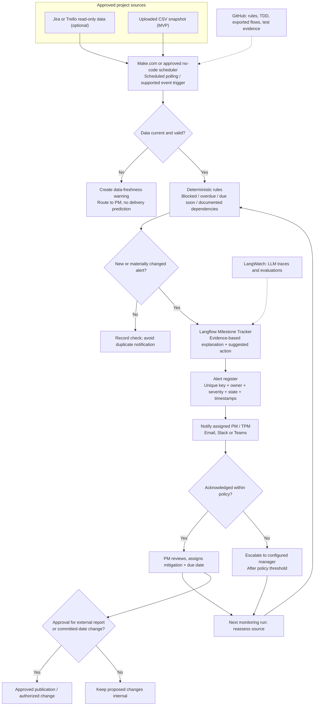
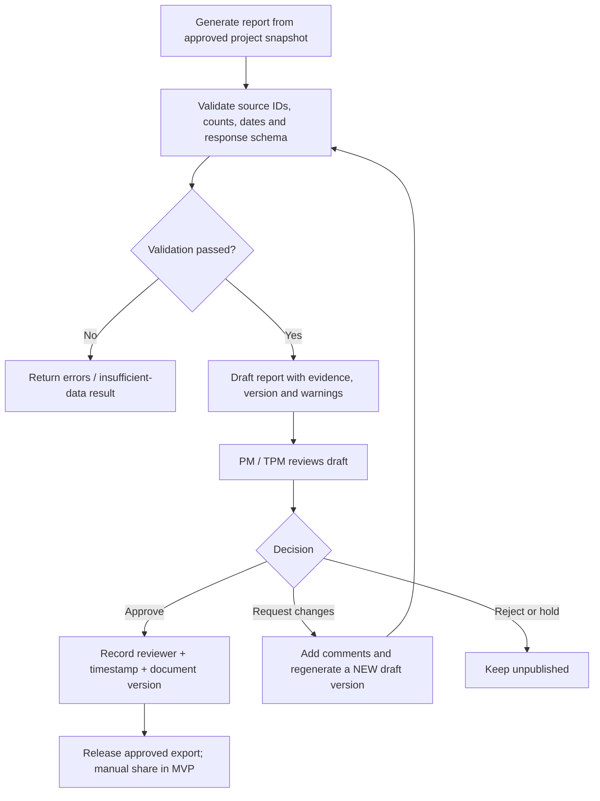
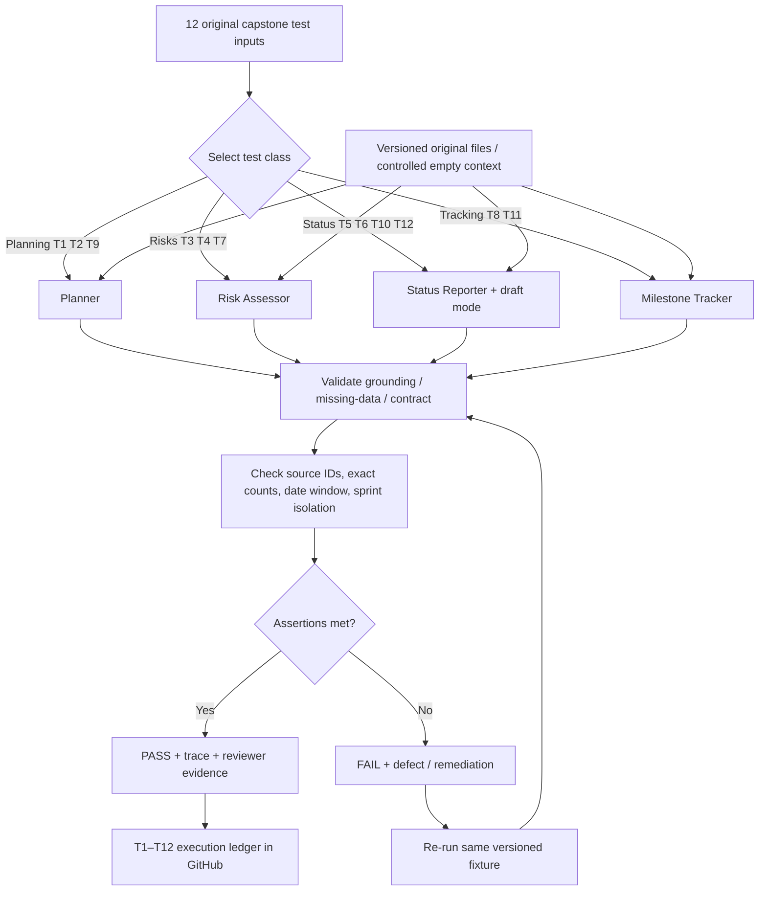

# Mira – Solution Architecture

**Version:** 1.5 (proposed)  
**Status:** Architecture design for no-code MVP  
**Based on:** Mira PRD v1.1, proposed FR-019–FR-026 change request, and TDD v1.4  
**Stack:** Langflow · OpenAI GPT-4o-mini · LangWatch · GitHub

> **Scope clarification:** The original two diagrams below are retained from v1.3. Diagram 3 adds the proposed proactive monitoring extension. **The extension is not part of the approved PRD v1.1 baseline until change control approves FR-019–FR-026.**

> **Scope clarification:** Users initiate data imports through Mira's user interface. The MVP supports file uploads; Jira/Trello read-only import is an optional future integration. A unified Mira UI, deterministic calculations, and an embedded approval control are **target architecture capabilities** and must be validated or implemented; they are not assumed to be built-in Langflow Playground functions.

## Diagram 1 — Target logical solution architecture

**Architectural boundaries:** The project files and connectors are alternative inputs to the same ingestion/normalization process; they are not independent agent interfaces. The approved project context is a logical data service, not necessarily a new database. LangWatch and GitHub are supporting systems, not part of the report approval decision. Only validated, reviewed outputs may be distributed externally.

## Diagram 2 — Data input, report generation and human-in-the-loop approval

### Human-in-the-loop implementation note

The **approval decision is a required business checkpoint in the target design**. For the no-code capstone MVP, a PM/TPM may review the generated draft and approve it **manually** before sharing. Do not represent the `APPROVED` status, reviewer audit log, or automatic return-to-generation loop as implemented until you configure and test those functions. If a Langflow human-input/pause mechanism is used, confirm it works in the parent flow; do not assume a specialist invoked through Run Flow can pause for approval.

### MVP vs. future capabilities

| Capability | MVP design | Future enhancement |
|---|---|---|
| UI file ingestion | Required, subject to supported Langflow UI/upload flow | Full self-service upload portal |
| Jira/Trello | Not required; static CSV export can substitute | Authorized read-only connector |
| Data processing | Deterministic counts/date rules; feasibility gate required | Reusable managed data service |
| Human approval | Manual PM/TPM review before distribution | In-app approval workflow and audit trail |
| Distribution | User manually exports/shares approved output | Controlled integration with Docs, email or Slack |
| Versioning | Manual Langflow JSON export to GitHub | Automated deployment and synchronization |

### Acceptance evidence

- Uploaded dataset is parsed and validated, with source version recorded.
- Status reports reconcile to actual task-board counts; blocked task **T024** is identified.
- Specialist outputs are grounded in the selected project only.
- Reports remain drafts until PM/TPM approval.
- Rejected reports are not shared.
- All 12 capstone baseline tests and relevant execution traces are documented.

## Diagram 3 — Proactive milestone monitoring, notification and escalation (proposed extension)

**Important:** Make.com, the alert register, outbound notifications and escalation are **proposed additions**; they are not implemented capabilities. The cloud scheduler must reach an authenticated Langflow endpoint; a local-only Desktop URL is insufficient. Detect-and-notify does **not** require a human approval delay, but mitigation commitments and external reports **do** require approval. Rules and notification policies need business sign-off.

## Diagram 4 — Human-in-the-loop report review and disposition

**MVP control:** Review and external sharing are manual. Reviewer-state storage, automatic approval buttons, and release blocking are target features that need a persistent UI/workflow integration before being claimed as automated.

## Diagram 5 — T1–T12 baseline test and evidence pathway

### Traceability for all twelve baseline cases

| Test | Flow / capability | Required input and isolation | Pass criteria | Failure guard |
|---|---|---|---|---|
| **T1** – Detailed ABCDE project plan | Planner | project_description.txt + project_timeline.csv | Use actual objectives, six-month duration, phases, activities, deliverables and approved milestones; label unsupported proposals | No invented goals, phase names or dates |
| **T2** – “We want to build a chatbot” | Planner | Only one-sentence user request; do not silently inject ABCDE context | INSUFFICIENT_DATA; request scope, timeline and team size | No full implementation plan |
| **T3** – ABCDE risk assessment | Risk | Project description + project_risks.csv | Categorized logistics/AI-relevant risks with documented impacts and mitigations; source IDs | No unrelated generic risks presented as source facts |
| **T4** – “New project starting soon” | Risk | Only vague request; no project risk file specified | INSUFFICIENT_DATA; ask for project details | No invented project-specific risk register |
| **T5** – Sprint 3 weekly status | Status | sample_task_board.csv filtered exactly to Sprint 3 | Real task names and status groups; accurate Sprint 3 counts | No cross-sprint leakage or invented tasks |
| **T6** – “Things are going fine” | Status | No task board provided for that request | Explicitly state no task data; request board/sprint | No fabricated progress, tasks or percentages |
| **T7** – Top 3 ABCDE risks | Risk | project_risks.csv | Return three actual risk records with IDs and transparent source ranking or declared derived priority | No newly fabricated risks; do not claim unsupported ranking certainty |
| **T8** – Blocked/at-risk tasks | Tracker | sample_task_board.csv + as-of date | Identify T024 Security review as BLOCKED; check other deadlines against actual statuses | Do not invent due dates, dependencies or blocker cause |
| **T9** – Two-week project, no further detail | Planner | Only two-week duration | INSUFFICIENT_DATA; ask for scope, goals and deliverables | No detailed plan based on duration alone |
| **T10** – Count current tasks | Status | Full sample_task_board.csv, no sprint filtering | 25 total: 3 Done, 3 In Progress, 18 To Do, 1 Blocked; verify against CSV | Counts reconcile; no unknown statuses silently coerced |
| **T11** – Upcoming milestones in 2 weeks | Tracker | project_timeline.csv + explicit as-of date | Actual milestone names and dates within inclusive [as-of, as-of + 14 days] | No invented milestones; empty truthful result if none |
| **T12** – Sprint 2 stakeholder email | Status / email mode | Only Sprint 2 tasks from sample_task_board.csv | Professional draft with Sprint 2-only facts, issues and next actions when documented | No Sprint 3+ tasks; no automatic sending |

**Status:** All twelve cases are **addressed in the design**, but none should be claimed as executed or passed until original project files and recorded output evidence are available. Negative tests T2/T4/T6/T9 require isolated no-data context. T10 expects 25 tasks (3 Done, 3 In Progress, 1 Blocked, 18 To Do), to be verified from the original CSV. T11 uses a fixed explicit as-of date; T12 is a draft requiring approval before distribution. Proactive-monitoring CR-001 tests are **additional**, not replacements for these tests.

## Architecture change log

| Version | Change | Baseline impact |
|---|---|---|
| 1.3 | Two diagrams: user-initiated ingestion and draft approval | PRD v1.1 MVP |
| 1.4 | Retained diagrams 1–2; added proactive monitor and explicit HITL state flow | **Proposed scope extension** FR-019–FR-026; not automatically approved |
| 1.5 | Preserved prior four diagrams; added baseline test/evidence pathway and detailed T1–T12 traceability | Strengthens PRD v1.1 acceptance coverage; no scope expansion |

## Implementation and operational decisions

- **Input interface:** MVP uses ABCDE fixed project and user-supplied files. A multi-project selector and Jira/Trello integration are optional pilot functionality, with project authorization required before use.
- **Snapshot freshness:** Uploaded CSV files provide only snapshot-based monitoring. Scheduled checks against an unchanged snapshot cannot detect newly emerging blockers. For a genuinely proactive pilot, arrange scheduled fresh exports or an authorized read-only API connection.
- **Monitoring schedule:** Proposed daily business-day checks, with event-driven runs if source integration supports them. No fixed monitoring interval is confirmed in PRD v1.1.
- **Alert state:** `DETECTED → NOTIFIED → ACKNOWLEDGED → ACTION_ASSIGNED → MONITORING → RESOLVED/ESCALATED`. Assign owner and timestamps; deduplicate using `(project_id, source_item_id, alert_type)` and reopen when severity changes.
- **Approval policy:** PM notification on a risk is immediate once validation passes. Only corrective commitments, customer-facing communications and final reports require approval.
- **Observability:** LangWatch captures LLM activity; monitor scheduler run success, source freshness, delivery success and acknowledgement status separately, because LLM traces do not prove notifications were delivered.
- **PRD change:** FR-019–FR-026 and acceptance criteria must be reviewed/approved for proactive alerts before claiming the expanded scope is part of the MVP.
