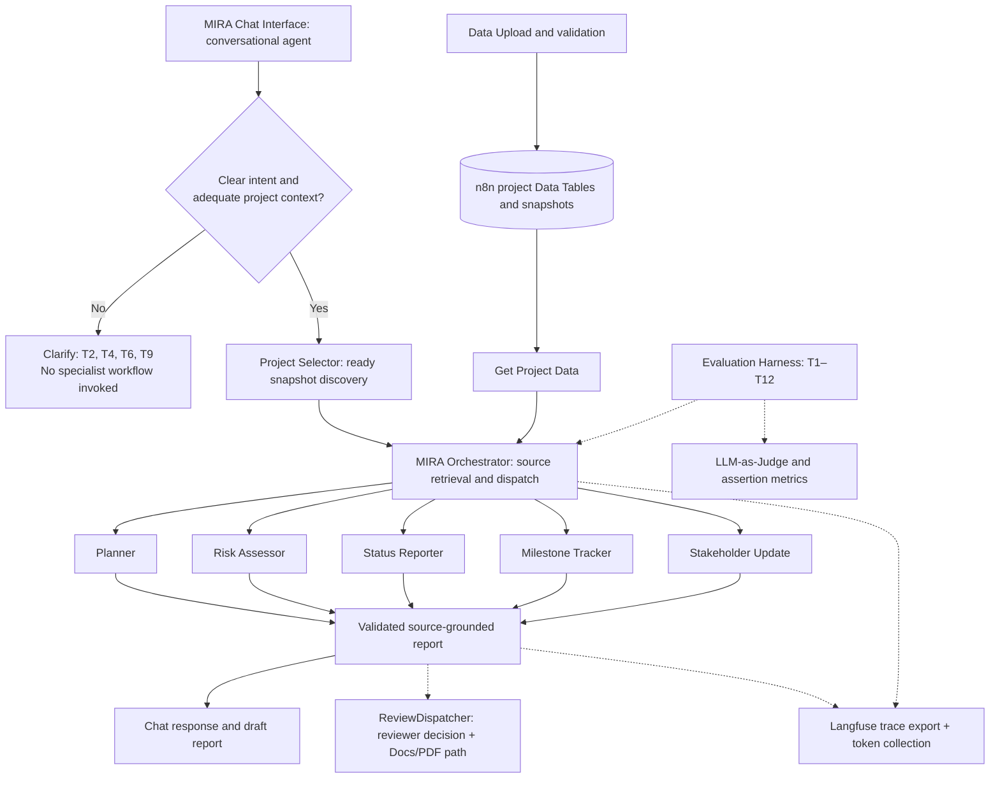

# Product Requirements Document (PRD)

# Mira – AI-Powered Project Intelligence Assistant

| Document control | Value |
|---|---|
| **Version** | **1.4 — As-Built Capstone Product Baseline** |
| **Updated** | November 19, 2026 |
| **Status** | **Implemented capstone prototype; recorded baseline evaluation complete; formal enterprise/product and production approval pending** |
| **Project** | Applied Agentic AI for PMs/TPMs — Capstone |
| **Business scenario** | Nexora Pvt. Ltd. delivering the ABCDE Ltd. AI Adoption Project (instructional/synthetic data) |
| **Product owner** | AI PM/TPM; named sponsor/product decision maker not verified |
| **Implementation approach** | **Low-code**, source-grounded, modular multi-agent workflows (n8n visual and JavaScript Code nodes) |
| **Orchestration** | **n8n** as primary platform; OpenAI, n8n Data Tables, Langfuse, Google Workspace and GitHub as supporting services |
| **Evidence baseline** | 15 supplied workflow exports; evaluation run **#5814** on November 18, 2026; 12/12 overall verdicts passed |
| **Requirements retained** | Original PRD v1.1 **FR-001–FR-018**, **T1–T12**, and original Nexora/ABCDE business case |
| **Controlled companions** | [Architecture v2.3](Architecture.md) · [Technical Design v2.3](Technical_Design_Document.md) · [Project Charter v1.3](Project_Charter.md) |
| **Architecture decision** | ADR-014 — n8n-only orchestration selected for prototype; enterprise ratification not documented |
| **Deferred production baseline** | PRD v2.0 / CR-PROD-001 / CR-001; proposed **FR-019–FR-026** and production verification **P01–P15** |

> **Reader's guide.** This document keeps the original product requirements and acceptance assertions, while replacing superseded *“to be built”* status statements with documented implementation and evaluation evidence. **12/12** is the evaluation harness's overall verdict for a specific regression batch—not a claim of independent fact certification, zero total LLM expense, production-ready security, authorized deployment, or proven labor savings. Workflow export ≠ live integration ≠ signed business acceptance.

---

## 1. Executive Summary

**MIRA** is a project intelligence assistant that helps Project Managers (PMs) and Technical Program Managers (TPMs) turn approved project information into actionable, reviewable planning and delivery artifacts. The capstone uses Nexora's six-month ABCDE Ltd. AI Adoption case across demand forecasting, route optimization, inventory management and customer support.

**Delivered prototype:** A conversational MIRA chat interface qualifies project requests; Project Selector identifies available ready snapshots; the Orchestrator retrieves scoped evidence and dispatches **five** specialist n8n workflows—**Planner, Risk Assessor, Status Reporter, Milestone Tracker, and Stakeholder Update**. Ingestion/validation and Data Tables support snapshots and provenance. An Evaluation Harness, LLM-as-Judge, Langfuse Trace Exporter and TokenUsageCollector collect quality and operational evidence; ReviewDispatcher supports human review and preparation of approved Google Docs/PDF artifacts. All business facts must remain attributable to the supplied sources, not generated intuition.

**Evaluation result:** Regression run **#5814** dated **November 18, 2026** logged **12/12 overall evaluation passes**, along with recorded generation token usage, latency, cost estimates, judge judgments, and input/output evidence. Four incomplete-input tests (T2/T4/T6/T9) were handled through early clarification **without calling a specialist**. The chat history demonstrates clarification but uses a shorter wording than the harness for some rubric-specific questions; these are distinct test surfaces.

**TPM value:** MIRA standardizes artifact preparation and controls for missing evidence, date ambiguity, source reconciliation, report quality, and stakeholder governance. The course's 3–4-hour planning and 1–2-hour reporting baselines are *problem assumptions*, not time savings measured with MIRA. Likewise ABCDE's 15% delivery-delay and 10% operating-cost objectives describe its AI Adoption program, not MIRA gains.

**Release distinction:** This PRD describes an **implemented capstone** and a **separately gated production target**. Identity and per-tenant authorization, live Jira/Trello sync, immutable approval/audit, reliable scheduled alerts, measured SLAs, and a proposed ten-PM/TPM pilot require Phase B funding, security review, and signed authorization.

### Executive snapshot

| Decision area | Current evidence | Still pending |
|---|---|---|
| Core product | Five specialist exports plus conversational project routing and source retrieval | Business UAT and production ownership |
| Baseline quality | 12/12 overall pass, run #5814; structured evaluator warnings retained | Independent source-fact review of all assertions; broader negative/scale testing |
| Source correctness | Sample board 25 tasks: **5 Done, 3 In Progress, 1 Blocked, 16 To Do**; source task T024 blocked | Fresh authenticated project data and per-project access enforcement |
| Operational visibility | Recorded 97,724 generation tokens and ~$0.03974 summed estimated batch model cost | Reconcile unpriced calls and T10's $0 cost; hosting/telemetry costs |
| Human oversight | ReviewDispatcher workflow and sample approved report artifacts | Identity-bound, immutable production approval and dispatch enforcement |
| Extended capability | On-demand milestone/blocker identification and stakeholder draft workflow | Scheduled proactive alert lifecycle, escalation policy and SLAs |

**Decision requested:** Accept v1.4 as the reviewed *as-built capstone documentation baseline* and validate its linked evidence for submission. Do **not** infer or grant production authorization from its existence.

### 1.1 Explicit product problem statement

> **Nexora's PMs and TPMs currently spend 3–4 hours preparing project plans and 1–2 hours each reporting cycle producing status updates, while project risk identification is inconsistent and blocked tasks or threatened milestones may be discovered late. With limited delivery-management capacity across concurrent projects, these manual and fragmented processes reduce time available for proactive intervention. Nexora needs a trustworthy, repeatable assistant that transforms approved project records into actionable plans, risks, reports and milestone signals—without inventing facts, compromising source integrity, or bypassing human accountability.**

**Who is affected:** PMs, TPMs, delivery managers and the stakeholder recipients of their reports.  
**Why the problem matters:** Administrative effort, uneven governance, delayed awareness and decision-making from incomplete or inaccurate information.  
**What success means:** Less manual preparation time, correct source-derived facts, standardized outputs, earlier issue visibility, accountable review and evidence demonstrating reliability.  
**What this PRD does not claim:** Achieved time savings, live client-data operations, proactive production alerts, real-time project tracking, independent certification or production authorization.

### 1.2 Business problem statement and the two distinct outcome layers (source-validated)

**Original capstone problem (unchanged):** Nexora PMs/TPMs managing concurrent projects spend approximately **3–4 hours building a plan** and **1–2 hours preparing a weekly report**; risk assessments vary in quality, blocked tasks and missed milestones are surfaced late, and project governance is inconsistent. Mira addresses this *project-management workflow problem* through a low-code, source-grounded, multi-agent assistant.

**ABCDE client program (not Mira's own impact claim):** `project_description.txt` identifies four AI adoption domains—demand forecasting, route optimization, inventory management and customer support—and business ambitions of **15% fewer delivery delays**, **10% lower operational costs** and improved responsiveness. These are **ABCDE's intended AI adoption outcomes**, not results delivered or guaranteed by Mira. Mira's value is measured separately: PM/TPM hours saved, factual accuracy, blocked-work visibility, provenance, and consistent governance documents. Benefits must be measured in the proposed pilot rather than asserted as achieved.

**Scope guard:** The core capstone requires project planning, risk matrix, weekly status reports, **at least one extended capability** (selected: milestone/blocker alerts), Router/Dispatcher multi-agent pattern, grounding, prompt engineering, trace/evaluation evidence and T1–T12. A scheduled autonomous alert service, live connectors, enterprise SSO, full production deployment and 10-user pilot remain separately proposed only.

## 2. Business Problem and Opportunity

### 2.1 Current state and pain points

| ID | Business problem | Current impact / baseline | Expected product response |
|---|---|---|---|
| **BP-01** | Manual project plan creation | **3–4 hours per plan**, as supplied in the assignment | Grounded plan with phases, deliverables and milestones |
| **BP-02** | Inconsistent risk assessments | Varying categorization, priorities and mitigations | Source-backed, standardized risk matrix and documented proposals |
| **BP-03** | Manual weekly reporting | **1–2 hours per reporting cycle**, as supplied in the assignment | Validated task summaries plus a draft status narrative |
| **BP-04** | Late blocker/milestone visibility | Reactive tracking and late awareness of delays | **On-demand** blocked/due-date detection in MVP; proactive monitoring only after change approval |
| **BP-05** | Inconsistent governance artifacts | Nonstandard plans, registers and stakeholder updates | Standard structured outputs, evidence and review status |
| **BP-06** | Limited PM/TPM capacity | Less time for cross-team risk resolution and stakeholders | Reusable workflows; time savings to be measured in a pilot |

The time estimates above are **assignment-reported baselines**; a pre/post PM time study is still required to verify realized impact.

### 2.2 Business opportunity

Provide a governed decision-support assistant that handles repetitive preparation while preserving the PM/TPM's judgment over commitments, communications and escalations. The product's value is **evidence-based project intelligence**, not merely fast generative text.

### 2.3 Business-value hypotheses and verification

| Hypothesis | Proposed measure | Source / evidence |
|---|---|---|
| Planning can be faster | Human preparation + review minutes per accepted plan | Before/after time study; T1 quality gate |
| Status preparation can be faster | Human preparation + review minutes per accepted weekly report | Before/after time study; T5/T10/T12 |
| Reports can be factually reliable | Record reconciliation and unsupported-fact count | Deterministic assertions against pinned snapshots |
| Issues can be surfaced earlier | Blocker/due-date identification, later alert detection-to-notification | T8/T11, then CR-001 pilot logs |
| Governance can be more consistent | Template field completeness and PM approval outcomes | Structured checks and reviewer feedback |

These are hypotheses/targets. No measured labor productivity improvement has yet been established.

## 3. Product Vision, Objectives and Success Measures

### 3.1 Product vision

Build an accessible, **low-code, modular AI project intelligence assistant** that turns authorized project records into accurate and explainable management artifacts and actionable issue visibility, while retaining human oversight and source traceability.

### 3.2 Objectives

| ID | Product objective | Acceptance direction |
|---|---|---|
| **OBJ-01** | Generate plans from approved description and timeline | Grounded milestones/phases; clarify missing scope |
| **OBJ-02** | Standardize risk assessment and mitigation | Registered risk IDs and transparent ranking logic |
| **OBJ-03** | Reduce reporting preparation effort | Accurate sprint and full-board counts; measured review time |
| **OBJ-04** | Identify blocked tasks and potentially threatened milestones | Deterministic status/date rules; no unsupported dependencies |
| **OBJ-05** | Prevent unsupported project facts | Source-linked assertions and negative-data behavior |
| **OBJ-06** | Make outputs explainable and testable | Reproducible requests, source snapshots and execution evidence |
| **OBJ-07** | Provide usable PM/TPM interaction | Capstone form/test interface; production portal only if approved |

### 3.3 Measured capstone evidence vs. proposed service targets

| Measure | Recorded evidence or acceptance | Remaining qualification |
|---|---|---|
| Baseline run #5814 | **12/12** overall evaluation passes (November 18, 2026) | Harness result; source-level independent review remains an evaluation limitation |
| Unsupported claims | Judge recorded zero hallucinations in the batch | Not universal or independently verified against every original source fact |
| Task count | Full board **25 = 5 Done + 3 In Progress + 1 Blocked + 16 To Do**; Sprint 3 = 4 tasks | Dataset-specific, historical fixture; do not hardcode counts in generic logic |
| Token accounting | **97,724** captured generation tokens for the batch | Clarification paths lack specialist tokens; some calls/cost categories can be excluded |
| Model cost estimates | **~$0.03974** summed captured per-test estimates; T1 plan **~$0.00731** | T10 has 15,859 tokens with $0 logged; no end-to-end billing assertion |
| Latency | Per-test `latency_ms` recorded | Proposed p95 under 30 seconds **not certified**; assess full-run distribution and sample size |
| Human review | Workflow and example approved artifacts evidenced | Production authorization, identity and immutable audit **not certified** |
| Productivity | Manual baseline: 3–4h plan / 1–2h weekly report | Conduct controlled review-time study; intended targets ≤30m plan and ≤15m report are unproven |

For capstone evidence, retain raw test-level verdicts, source/snapshot IDs, warnings, LLM-as-Judge fields, execution/trace identifiers, model pricing assumptions and data freshness. See the `testing/` evaluation workbook and linked screenshots when published.

## 4. Users, Stakeholders and Decision Rights

### 4.1 Primary personas

| Persona | Primary work | Mira need |
|---|---|---|
| Project Manager | Plan and report on delivery | Fast accurate plan, sprint report, stakeholder draft |
| Technical Program Manager | Manage dependencies and delivery risks | Cross-workstream blockers, evidence-based milestone watch |
| Delivery Manager | Standardize delivery governance | Consistent status and risk artifacts, evidence and review |
| Executive stakeholder | Review delivery outcomes | Concise, approved updates with defensible claims |

### 4.2 Stakeholder and governance assignments

| Role | Decision responsibility |
|---|---|
| Nexora CTO / architecture delegate | Approve ADR-014, design exceptions and technical release gates |
| AI PM/TPM / Product Owner | Own scope, backlog, prioritization, acceptance and report governance |
| n8n workflow implementer | Configure/maintain flows, schemas, mappings and credential integrations |
| QA / evaluation owner | Verify T1–T12, negative cases, telemetry and release evidence |
| ABCDE business/data owner | Approve dataset meaning, risk priority rules and source revisions |
| PM/TPM reviewer | Approve/revise stakeholder-facing drafts before use |
| Security/privacy/operations owners | Authorize production data, identity, audit, notification and resilience controls (Phase B) |
| Executive sponsor | Approve production change request, pilot funding and rollout |

Roles may be combined for a capstone demonstration; a future production approval process must enforce any required separation of duties.

## 5. Scope, Phasing and Boundaries

### 5.1 Phase A — Implemented capstone MVP (in scope)

1. Approved/sample ABCDE project source data: `project_description.txt`, `project_timeline.csv`, `project_risks.csv`, `sample_task_board.csv`, and twelve immutable baseline prompts in `eval_mira_inputs.txt`.
2. File upload/extraction and approved sample import via `MIRA_Data_Upload`; validated records and project snapshots maintained in **n8n Data Tables**. Some connector branches exist as disabled candidates; a node's presence is not proof of live sync.
3. Conversational Chat Interface, Project Selector, Project Data retrieval, and one Orchestrator with early clarification for incomplete/irrelevant requests; no silent substitution of ABCDE context.
4. Five separately exported specialist n8n workflows: Planner, Risk Assessor, Status Reporter, Milestone Tracker, and **Stakeholder Update**.
5. Source-grounded plan, registered risk assessment, sprint/project status, on-demand blocker/milestone tracking and period-scoped stakeholder draft; structured validation and reconciliation outside the model.
6. Evaluation Harness + LLM-as-Judge, Langfuse Trace Exporter, TokenUsageCollector, recorded evaluation ledger, and Chat Output History. A successful submitted trace must not be described as ingestion-confirmed unless verified.
7. Human ReviewDispatcher with Gmail-based response, persisted review decision fields and Google Docs/Drive PDF artifacts as implemented capstone paths; approval **before authorized external publication** remains required.
8. Sanitized workflow JSON, architecture, TDD, Charter, PRD, evaluation history, screenshots and README to demonstrate reproducibility and release governance.

**MIRA-001 test fixture:** 25 source tasks with 5 Done, 3 In Progress, 1 Blocked and 16 To Do; Sprint 2 = T004/T005 Done, T006 In Progress; Sprint 3 = T007/T025 In Progress, T008/T009 To Do; T024 (`Security review of AI infrastructure`) Blocked. This is the assignment CSV's observed data, not a reusable project-size rule.

**Scope clarification:** Dynamic **selection among ready sample snapshots** exists in the prototype; enterprise multi-tenant authorization does not. Technology is **low-code**, as the exported workflows include n8n JavaScript Code nodes.

### 5.2 Phase A – explicitly out of scope

- Autonomous Jira/Trello **writes**, schedule edits, risk-register commits or stakeholder email dispatch.
- Dynamic multi-project production portal, enterprise SSO/tenant isolation or real client data without authorization.
- Guaranteed scheduled alert delivery/acknowledgement/escalation or durable production audit store.
- High availability, disaster recovery, enterprise-scale load engineering or production service-level guarantees.
- Model fine-tuning, unnecessary vector DB/RAG, custom app development and complex ERP actions.
- Claiming n8n form/workspace permissions are equivalent to business-user authorization.

### 5.3 Phase B – proposed, subject to PRD v2.0 / CR-PROD-001 approval

Authorized multi-project portal and registry; verified identity and project-specific RBAC; approved read-only Jira/Trello import; encrypted/versioned source store; scheduled/event-driven milestone monitoring; persistent alert registry, deduplication, owner acknowledgement and escalation; audited durable human approval; secured notifications; reliability, recovery, retention, monitoring and a controlled pilot of up to ten PMs/TPMs. The detailed **proposed** FR-019–FR-026 remain outside this capstone requirements baseline (see §7.4).

### 5.4 Scope and change-control rule

A production-target component shown in [Architecture.md](Architecture.md) does **not** become an MVP commitment. Any Phase B scope, timing, budget, data policy or external integration requires sponsor/security/architecture review according to the [Charter](Project_Charter.md), **G8** authorization and **P01–P15** evidence before an operational go-live.

## 6. User Journeys and Use Cases

### UC-01 – Generate grounded project plan

**Actor:** PM. **Data:** `project_description.txt`, approved `project_timeline.csv`. **Route:** Chat qualification → Project Selector → Orchestrator → Planner. **Draft:** objectives, scope, phases, activities, deliverables, milestones, stated dependencies, assumptions, source references and clarification questions. **Guardrail:** With incomplete goals, scope, team or schedule, request details instead of filling in fictitious content (**T1/T2/T9**).

### UC-02 – Assess and prioritize project risks

**Actor:** PM/TPM. **Data:** project description + approved `project_risks.csv`. **Route:** Chat qualification → Orchestrator → Risk Assessor. **Draft:** real risk IDs, category, description, documented impact/mitigation, priority basis, proposed improvement (clearly marked), evidence. Existing/top risk requests cannot invent registered entries or scores (**T3/T4/T7**).

### UC-03 – Create weekly or sprint-specific report

**Actor:** PM. **Data:** `sample_task_board.csv`, requested sprint/reporting window; timeline for milestone statements. **Route:** Chat qualification → Orchestrator → scoped task retrieval/validation → Status Reporter. **Draft:** counts, actual task IDs/names/statuses, blockers, next activities and justified health (otherwise `UNKNOWN`). No input board → no fabricated progress. Filter **before** model invocation (**T5/T6/T10**).

### UC-04 – Identify blocked, overdue and upcoming milestones

**Actor:** TPM. **Data:** task board + approved timeline + fixed `as_of_date`. **Route:** Chat qualification → Orchestrator → task/timeline rules → Milestone Tracker. **Draft:** observed blockers (including source-backed **T024 Security review of AI infrastructure**), due-date conditions and relevant actual milestones; missing dependencies are *unknown*, not silently assumed. Blocked status does not automatically prove milestone delay (**T8/T11**).

### UC-05 – Draft an audience-appropriate stakeholder update

**Actor:** PM. **Data:** explicit sprint/period and that period's actual records. **Route:** Chat qualification → Orchestrator → Stakeholder Update specialist (or a source-scoped status draft where specifically configured). **Draft only:** achievements, blockers, next steps, missing-information note. **T12** requires Sprint 2-only activity; Sprint 3+ content must be excluded. External sending requires human authorization.

### UC-06 – Inspect output provenance and evaluate quality

**Actor:** QA/PM/Architect. **Data:** original source snapshot, request and recorded workflow/model versions. **Flow:** Evaluation Harness and LLM-as-Judge inspect expected/actual behavior and provenance; use Langfuse and TokenUsageCollector where recorded; ReviewDispatcher handles separately authorized draft decisions. Source-data availability is a precondition for any claim of accuracy.

## 7. Functional Requirements and Acceptance Criteria

### 7.1 Preserved requirements register (FR-001–FR-018)

| ID | Functional requirement (preserved) | Priority | Primary n8n responsibility | Evidence |
|---|---|---|---|---|
| **FR-001** | Ingest and validate approved TXT/CSV project data | P0 | Form/file input → `Extract From File`, schema checks | G2/G3 |
| **FR-002** | Classify request intent and dispatch to specialist | P0 | `Switch`/`IF` → `Execute Sub-workflow`; bounded fallback | Router test |
| **FR-003** | Grounded project plans with phases, deliverables and milestones | P0 | `Mira_01_Planner` | T1 |
| **FR-004** | Clarify missing critical planning information | P0 | Planner input-sufficiency gate | T2/T9 |
| **FR-005** | Project-specific, categorized risk assessments | P0 | `Mira_02_Risk_Assessor` | T3 |
| **FR-006** | Source-backed registered-risk selection and ranking | P0 | Risk workflow + deterministic selection policy | T7 |
| **FR-007** | Sprint-specific and project-wide status reports | P0 | Filter → `Mira_03_Status_Reporter` | T5/T6 |
| **FR-008** | Deterministically calculate task counts and percentages | P0 | Filter/Summarize/validated mappings | T10, G3 |
| **FR-009** | Detect blocked, overdue and potentially at-risk tasks | P0 | `Mira_04_Milestone_Tracker` + rules | T8 |
| **FR-010** | Find upcoming milestones for requested date windows | P0 | Timeline filter + fixed-date comparison | T11 |
| **FR-011** | Generate period-scoped stakeholder updates | P0 | Status Reporter email draft mode | T12 |
| **FR-012** | Validate generated project facts against approved sources | P0 | Grounding assertions outside LLM | Cross-cutting |
| **FR-013** | Handle missing, malformed, unknown or conflicting data | P0 | Validation errors, insufficient-data path | Negative tests |
| **FR-014** | Capture AI execution/evaluation and usage evidence | P0 | n8n executions/evaluation where supported; metadata | G6 |
| **FR-015** | Execute and document twelve baseline evaluation tests | P0 | `Mira_07_Evaluation_Runner` or controlled manual test ledger | T1–T12 |
| **FR-016** | Produce structured Markdown and JSON outputs | P0 | Standard output mapping + validation | Schema tests |
| **FR-017** | Support review before stakeholder-facing distribution | P1 | **Manual MVP review**; durable approval Phase B | Approval evidence |
| **FR-018** | Integrate with live Jira/Trello task boards | P2 | Authorized read-only connectors into canonical schema | Separate integration acceptance |

**Priority interpretation:** P0 is required for capstone functionality. FR-017's *automated approval workflow* remains P1, but **manual approval/non-publication is a mandatory governance safeguard** even during the capstone. FR-018 remains optional/deferred. Priority does not waive source privacy or safety controls.

### 7.2 Detailed functional acceptance criteria

**FR-001 — Ingestion and validation**
- Read approved assignment files with correct encoding and delimiter handling; confirm actual headers/types before configuring mappings.
- Reject blank IDs, required-field omissions, duplicate task IDs, malformed dates and unrecognized statuses; preserve source filename, row ID, timestamp/snapshot reference.
- Failure produces `VALIDATION_ERROR` with actionable missing/invalid fields—not a partial report represented as complete.

**FR-002 — Routing**
- Planning → Planner; risk → Risk Assessor; status/email → Status Reporter; blockers/milestones → Tracker.
- Rule-based dispatch for explicit intents; optional constrained LLM classification only if ambiguity requires it and cost/accuracy are measured.
- Unsupported or ambiguous requests return clarification or a documented bounded multi-specialist route; avoid firing all agents by default.

**FR-003/004 — Planning**
- A detailed request produces a structured plan with actual source phases/milestones and no invented objectives or dates.
- Vague “build a chatbot” and “two-week project” requests without sufficient details ask for scope/goals/deliverables/timeline/team; no ABCDE context silently inserted (**T2/T9**).

**FR-005/006 — Risks**
- Risk outputs use actual ABCDE risk register entries where requested; retain IDs/categories and documented impact/mitigation.
- Top-three ranking uses documented priority; if no authoritative ranking is supplied, apply an approved transparent derived policy or ask for ranking criteria. Never fabricate a numeric risk score.
- Generic new-project risk requests without context request necessary details (**T4**). Suggested new risks are labeled **PROPOSED**, not registered.

**FR-007/008 — Reporting and arithmetic**
- Preserve actual task names, statuses, IDs and sprint memberships; filter requested period **before** aggregation and generation.
- Count all valid records, reject unmatched status categories, verify no duplicated/missing IDs and `sum(status_counts) = valid_task_total`.
- T10 baseline snapshot: **25** tasks, **5 Done / 3 In Progress / 1 Blocked / 16 To Do** (source-verified fixture and evaluation/agent outputs recorded).
- Percentages, if displayed, use explicitly defined numerator/denominator; absent board → no counts or claims of progress (**T6**).

**FR-009/010 — Milestone and due-date intelligence**
- Identify `BLOCKED` from documented status; `OVERDUE` only when incomplete and due before a fixed, valid `as_of_date` in a declared project timezone.
- `UPCOMING` for T11 means actual approved milestones within inclusive **[as_of_date, as_of_date + 14 calendar days]** unless the request specifies otherwise.
- `AT_RISK` requires documented dependency/schedule evidence; due-soon without impact evidence is a **watch item**, not a proven delay.
- T024 must be identified by reading the source, not by hardcoding its ID; unknown dependency/ownership/date must remain unknown.

**FR-011 — Stakeholder update**
- Professional draft scoped to the explicit sprint/report period; T12 Sprint 2 draft excludes Sprint 3 and later work.
- Distinguish known progress from recommendations/risks; external distribution remains blocked until authorized review.

**FR-012/013 — Grounding, missing data and conflicts**
- Source-ground every project goal, actual task/risk ID, milestone and status; invalid IDs/counts must fail review.
- Empty or conflicting datasets produce an explicit warning/status; do not silently merge contradictory snapshots or infer missing owners/dependencies.
- Data-free scenarios T2, T4, T6 and T9 **must not** retrieve or inject the unrelated ABCDE fixtures (`allow_project_context=false`).

**FR-014/015 — Evidence and evaluation**
- Each test has input, pinned snapshot/date, workflow/model/prompt version, expected/actual, evidence link, reviewer, disposition and any defect.
- Record available n8n execution IDs, timings, error class and actual model tokens/usage where returned; clearly label estimates/unavailable metadata.
- Preserve rejected cases as failures; a plausible response is not a passing test without source assertions.

**FR-016 — Output schema**
- Human-readable Markdown and structured JSON where requested; required response fields validated separately from prose quality.
- Response includes result status, provenance, unresolved information, warnings and review state; `SUCCESS` cannot bypass fact checks.

**FR-017/018 — Review and optional integration**
- Approved business recipients cannot receive automated stakeholder reports from the capstone workflow.
- Jira/Trello access, if implemented later, is **read-only by default**, least-privileged and mapped through the same input validation; no connector bypass of project authorization.

### 7.3 Cross-cutting requirements and business rules

- User-selected or imported project identifiers are *claims* until a trusted access layer authorizes them (Phase B); capstone has a **ABCDE capstone acceptance snapshot**.
- Source text, issue comments and imported data are **untrusted content**, not executable system instructions or permission grants.
- Generated plans, risks and reports are **DRAFT** recommendations; source documents remain the systems of record.
- n8n workflow-builder roles are not equivalent to business-user per-project data authorization.

### 7.3A Source-derived acceptance controls (2026-10-25 input rebaseline)

These controls *clarify* FR-001–FR-018 rather than create new capstone scope:

- **FR-001/FR-013:** Validate the exact task, risk and timeline headers above; preserve source values and identifiers. Reject bad status spelling, duplicate task IDs, invalid `due_date`, missing required fields, and incomplete records. The **25-record assertion applies to this capstone fixture**, not any future project.
- **FR-007/FR-008:** Compute full-board counts with deterministic n8n nodes: `5 Done / 3 In Progress / 1 Blocked / 16 To Do = 25`; sprint filters must run before narrative generation.
- **FR-005/FR-006:** Risk ranking is not directly available in `project_risks.csv`. T7 must report source risk IDs and transparently state its selection or proposed risk-order method; no fabricated scoring.
- **FR-009/FR-010:** Report T024 as blocked using the complete task name, and treat overdue task dates and relative-week milestone windows as **different calculations**. A milestone-delay claim requires documented dependencies; when calendar context is missing, respond with a clarification request rather than inventing dates.
- **FR-011:** A Sprint 2 stakeholder *draft* may mention only T004–T006 as observed sprint activities; send is disabled pending PM approval.
- **FR-012/FR-014/FR-015:** Record `source_snapshot_id` or source checksum, `as_of_date` (when relevant), data freshness, test ID, workflow revision and decision outcome in the test evidence ledger.

### 7.4 Proposed production extensions — **not part of approved FR-001–FR-018 baseline**

The following are **proposed feature IDs only**, consistent with TDD v2.2, Architecture v2.2 and Charter v1.2; detailed acceptance policies require PRD v2.0/CR-001 approval.

| Proposed ID | Phase B capability | Prerequisite / release control |
|---|---|---|
| FR-019 | Scheduled/event-driven project health checks | Approved freshness cadence and source permissions |
| FR-020 | Controlled refresh of authorized Jira/Trello/source snapshots | RBAC and project-scoped immutable/versioned source record |
| FR-021 | Deterministic alert classification, owner/action context | Approved threshold/rulebook and no fabricated dependencies |
| FR-022 | Persistent deduplicated alert registry | Durable idempotency and safe replay |
| FR-023 | Internal owner notifications with verified delivery | Channel policy, consent/recipient restrictions, audit |
| FR-024 | Alert acknowledgement and action/mitigation tracking | Persistent state, owner identity |
| FR-025 | Timed escalation and resolution checks | Approved escalation matrix, clocks and exception handling |
| FR-026 | Monitoring SLOs, auditability and operating controls | Approved SLAs, operational readiness, P01–P15 |

*This table summarizes the proposed lifecycle; exact FR-019–FR-026 wording and thresholds must be reconciled and formally approved in the separate PRD v2.0 change baseline before development or contractual commitment.*

## 8. Implemented Low-Code Solution Architecture — n8n

### 8.1 End-to-end logical flow (as-built capstone)



**Reading note:** This shows logical relationships rather than every n8n node/branch. Eval Harness is a **separate test path**, not a required gate before each user reply. ReviewDispatcher is an optional reviewed publication path, not automatic delivery of every chat report. See [Architecture.md](Architecture.md) v2.3 for seven detailed diagrams, where P1/P2 and proactive monitoring remain **production targets**.

### 8.2 Router/Dispatcher and project-selection design

- The **chat-facing agent** interprets the request and may ask project/scoping questions. It can consume tokens; known negative cases T2/T4/T6/T9 show **no specialist workflow execution**, not necessarily zero conversational model usage.
- The **Project Selector** inspects available ready snapshot metadata. `MIRA_Get_Project_Data` returns approved source records by snapshot/file selection. A ready snapshot is a data-quality indicator, **not** verified enterprise authorization.
- The **Orchestrator** owns structured request eligibility, specialist dispatch, result collection and validation. It can route one or more capabilities; multi-agent here means modular specialist subworkflows, not proof of autonomous peer-agent negotiation.
- Preserve request context, source IDs, execution/trace IDs and handoff information for auditability. Missing/contradictory context must not default silently to ABCDE.

### 8.3 Actual exported workflow inventory (15)

| Component | Exported workflow | Principal responsibility |
|---|---|---|
| User entry | `Mira_10_Chat_Interface` | Chat Trigger, conversational agent, project tool, history, Orchestrator invocation |
| Project choice | `Mira_Project Selector` | Ready snapshot discovery from Data Table records |
| Ingestion | `MIRA_Data_Upload` | Form/manual/Drive paths, extract, schema checks, normalized project rows and snapshots |
| Retrieval | `MIRA_Get_Project_Data` | Scoped snapshot/source-file lookup |
| Dispatch | `Mira_00_Orchestrator` | Context handling, capability routing, subworkflow invocation and source validation |
| Plan specialist | `Mira_01_Planner_Agent` | Structured objectives, phases and milestones |
| Risk specialist | `Mira_02_Risk_Assessor_Agent` | Registered risks, mitigations and transparent qualitative prioritization |
| Status specialist | `Mira_03_Status_Reporter_Agent` | Sprint/project task counts, scoped statuses and draft narrative |
| Tracking specialist | `Mira_04_Milestone_Tracker_Agent` | On-demand blocked/overdue/milestone evidence and uncertainty |
| Stakeholder specialist | `Mira_Stakeholder_Update_Agent` | Period-scoped stakeholder draft |
| Quality evaluation | `Mira_07_Evaluator — LLM-as-Judge` | Structured report-quality judgments |
| Tracing | `Mira_08_Langfuse_Trace_Exporter` | Langfuse trace export (confirm ingestion separately) |
| Cost collection | `Mira_10_TokenUsageCollector` | Usage extraction and trace association |
| Regression | `Mira_99_Evaluation_Harness` | T1–T12 orchestration, assertions, judgment and history recording |
| Review | `Mira_12_ReviewDispatcher` | Gmail review handoff, review decision storage, Google Docs/Drive PDF artifacts |

The 15 entries are supplied JSON exports. They establish what is configured in the exported definitions—not that every external connector branch is enabled, supported by working credentials, or production-hardened. Low-code JavaScript nodes are present and should not be concealed under an exclusively no-code claim.

### 8.4 Selected technology stack and ownership

| Component | Capstone implementation | Limitations / role |
|---|---|---|
| Primary orchestration | **n8n**, subworkflows, Switch/IF, Code nodes, Chat Trigger | Low-code visual platform; not solely no-code |
| Language models | **OpenAI** models in specialist and chat workflows | Record actual model identifier and version from each execution; token-price rates require provenance |
| Evidence store | **n8n Data Tables** + approved TXT/CSV input fixtures | Ready snapshots; not independently a multi-tenant authorization service |
| File sources | Approved form/manual/Drive paths | Disabled Jira/Trello/Confluence/etc. branches are not live-sync guarantees |
| Observability/evaluation | **Langfuse** trace export, LLM-as-Judge, Eval Harness, TokenUsageCollector | Capture `submitted` vs `ingestion_confirmed` distinctly; judge does not replace independent source inspection |
| Human review | **Gmail + Google Docs/Drive + ReviewDispatcher** | Human approval example exists; enterprise authenticated reviewer policy and immutable audit remain future controls |
| Version and evidence | **GitHub**, n8n JSON, evaluation workbook, Markdown, screenshots | Exports require credential/ID remapping, sanitization and clean re-import tests |
| Deferred live integrations | Read-only Jira/Trello, production portal, SSO, reliable event/schedule monitoring | Phase B approval and P01–P15 verification required |

**Platform decision:** n8n is the *orchestration* platform. OpenAI, Langfuse and Google Workspace are external integrations, not extra orchestrators. Cost savings come from scoping, avoiding unnecessary specialist calls and controlling retries—not from the name of the workflow platform.

### 8.5 Implementation and engineering boundary

MIRA is **low-code-first**. The submitted exports include JavaScript Code nodes for data parsing/normalization, validation, reconciliation, routing/metrics and other workflow functions alongside native visual nodes. Do not claim all processing is implemented with no code or assume that every control works without production-specific testing. Counts, IDs and date rules must be checked against canonical snapshot records; source data remains untrusted content. For actual node connections, contract details, errors, privacy boundaries and operations, see [Technical_Design_Document.md](Technical_Design_Document.md) v2.3.

### 8.6 Source-of-truth precedence

| Project facts | Authoritative input |
|---|---|
| Project objectives and workstreams | `project_description.txt` |
| Approved timeline/phases/milestones | `project_timeline.csv` |
| Registered risks and supplied risk priorities | `project_risks.csv` |
| Task IDs, statuses, sprints, assignees, due dates | `sample_task_board.csv` |
| Baseline scenario inputs | `eval_mira_inputs.txt` (a test fixture, **not** project facts) |

Conflicting records/snapshots must be flagged rather than silently reconciled. Do not substitute invented missing CSV columns, milestones or risk scores.

### 8.7 Logical request and response contracts

**Request (illustrative field names; implement with validated mappings):** `request_id`, `project_id`, `user_message`, `intent`, `sprint`, `as_of_date`, `reporting_start`, `reporting_end`, `output_mode`, `source_snapshot_id`, `workflow_version`, `allow_project_context`. Production adds **trusted**, server-verified `tenant_id`, `user_id`, permission claims and access decisions—not user-controlled form values.

**Response:** `request_id`, `project_id`, `agent_name`, `result_status`, `response_data`, `source_references`, `source_snapshot_id`, `missing_information`, `warnings`, `execution_metadata`, `review_status`.

`result_status` must be one of `SUCCESS`, `INSUFFICIENT_DATA`, `VALIDATION_ERROR`, `UNSUPPORTED_REQUEST`, `SERVICE_ERROR`. For external-ready artifacts, require `review_status = APPROVED`; MVP review can be a recorded manual decision rather than a deployed approval service.

### 8.8 ADR-014 — Rationale for n8n-only baseline (platform-selection addendum)

**Decision context:** PRD v1.1 initially specified Langflow. Subsequent production-target exploration added scheduling, live task connectors, approval lifecycles and operating controls. The earlier hybrid proposal improved capability separation but added a second deployable platform and a new authenticated API failure boundary. The capstone uses the **smallest defensible implementation architecture** selected for the prototype and a credible enterprise extension path.

| Evaluated option | Advantages | Material trade-offs for Mira | Disposition |
|---|---|---|---|
| Langflow-only | AI-centric visual agent composition | Additional design for native business triggers, deterministic processing, operational scheduling/approvals | Not selected |
| n8n + Langflow hybrid | Separate AI composition and business automation | Extra service hosting/authentication, API retries/timeouts, cross-platform traces and cost; no intrinsic token-cost advantage | Contingency option |
| **n8n-only** | One routing/integration/evaluation surface, native business workflow primitives, modular agents | Data correctness and runtime availability require evidence; enterprise controls are deferred | **Selected and implemented for capstone** |

**Token and platform cost decision:** One model call with the same tokens/model has essentially the same model charge regardless of orchestration platform. Savings come from *fewer LLM calls*, filtered project context, avoiding LLM arithmetic and reducing retry/repeated routing—not from a platform label. Track n8n execution/hosting, API and optional evaluation costs separately.

**Decision controls:** CTO/architecture sign-off is pending; G3 source-count and G4/G6 specialist/evaluation evidence have been collected, with outstanding limitations; monitor actual total cost, latency and errors. **Reopen ADR-014** if n8n fails a required invariant or independent AI quality is materially weaker, and compare hybrid on identical test fixtures. All FR-001–FR-018 and T1–T12 remain intact.

## 9. Data and Grounding Requirements

### 9.0 Approved source-data inventory and actual contracts — CR-DATA-001–008

The supplied archive `Resources-20261025T215745Z-1-001.zip` contains these *five canonical capstone sources* and three supporting reference documents. **The files were profiled in the prior source rebaseline, and n8n workflow exports and regression execution evidence now exist.** Field spellings are exact and case-sensitive as supplied.

| Canonical input | Exact content / schema | How Mira may use it |
|---|---|---|
| `project_description.txt` | ABCDE logistics AI-adoption objectives; four use cases; outcome targets | Business problem, scope and planning facts |
| `project_timeline.csv` | `phase,phase_name,start_week,end_week,key_activities,milestones_deliverables`; **8 phases, Weeks 1–24** | Relative phase sequencing and named milestones; **no project start date, calendar due date, or dependency links** |
| `project_risks.csv` | `risk_id,category,risk_challenge,impact,mitigation_strategy`; **R01–R10** | Registered risk matrix; **no severity, probability, score, risk owner or rank** |
| `sample_task_board.csv` | `task_id,task_name,status,assignee,priority,sprint,due_date,labels,description`; **25 unique tasks** | Task status, named owner, sprint, due-date checks, evidence-backed blocker description |
| `eval_mira_inputs.txt` | **T1–T12** original evaluation prompts | Immutable acceptance prompts; expected outcomes specified separately |

Reference-only resources: `ABCDE Ltd Introduction..txt` repeats the description; `AI Adoption Project Timeline.pdf` is a human-readable representation of the CSV schedule; and `Risks and Challenges in AI Adoption Project – ABCDE Ltd.docx` expands risk descriptions with wording that is **not identical** to the risk CSV. TXT/CSV remain the machine-readable capstone authority; differences are disclosed, not silently merged.

**Verified full-board fixture (despite a contradictory sample mix in the assignment prose):** `Done = 5`, `In Progress = 3`, `Blocked = 1`, `To Do = 16`, total `25`; valid task IDs `T001`–`T025` (not in numeric order within the file); statuses must use supplied spelling. **T024 — Security review of AI infrastructure** is `Blocked`, Sprint 5, due `2026-05-26`; its recorded blocker is waiting for security team availability.

**Sprint 2 (T12):** `T004`/`T005` = `Done`, `T006` = `In Progress`. **Sprint 3 (T5):** `T007`/`T025` = `In Progress`, `T008`/`T009` = `To Do`. These are data-derived acceptance fixtures, not evidence of a running workflow.

**Assignment-versus-file discrepancy (retain in review record):** The capstone problem statement's *About the sample data* paragraph says **3 Done, 3 In Progress, 1 Blocked, rest To Do**. The attached authoritative `sample_task_board.csv` actually has **5 Done, 3 In Progress, 1 Blocked, 16 To Do**. T10 requires counts matching the **actual data**. The original assignment is not edited; QA records this difference as CR-DATA-001 and asks the product owner/instructor to approve the source-derived fixture before marking the test passed.

**Time/ranking constraints:** Task `due_date` is a calendar date, but this source is a static historical snapshot (task dates span April–August 2026), not a live feed. A deadline evaluation requires an explicit `as_of_date` and snapshot provenance. Relative timeline weeks cannot be converted into dates until `project_start_date` or an authorized `as_of_project_week` mapping is supplied. Because source risk records are unranked, T7 must not claim an authoritative top three; return three actual risks with an **explicit illustrative/proposed** basis or ask the PM/TPM to choose a ranking criterion. Proposed risk rankings are not modifications of the source register.

**Isolation:** T2, T4, T6 and T9 are deliberately vague/no-source tests. Do not auto-inject ABCDE descriptions, risks or task records simply because a default project dataset exists.


### 9.1 Provided inputs and source-validation status

| Canonical source | Verified schema/content | As-built status |
|---|---|---|
| `project_description.txt` | ABCDE AI Adoption objectives; four AI adoption domains | Available in approved snapshot used by Planner |
| `project_timeline.csv` | Eight phases, relative Weeks 1–24, no calendar anchor | Source grounding and unresolved date limits documented |
| `project_risks.csv` | Ten registered risks; no numeric risk scores/owners | Risk output cites source IDs; derived ranking is qualitative |
| `sample_task_board.csv` | 25 tasks, 5 Done / 3 In Progress / 1 Blocked / 16 To Do | Status and blocked-task outputs in regression/chat evidence |
| `eval_mira_inputs.txt` | Twelve prescribed test prompts T1–T12 | Evaluation history records run #5814 with twelve overall passes |

The original assignment prose says 3 Done/3 In Progress/1 Blocked/18 To Do, but the provided board has **5/3/1/16**; this discrepancy remains documented under **CR-DATA-001**. Test fixture status does not mean tasks are live in November 2026.

### 9.2 Data validation and grounding controls

- Check file availability, extension/MIME/size as applicable, encoding, required column names, type and date parseability.
- Reject duplicate/empty record IDs, unknown status categories, missing critical fields and source counts that cannot reconcile.
- Preserve project ID, source row references, snapshot version/import timestamp and fixed test `as_of_date`.
- Use **least context necessary** for the request. ABCDE's files must not contaminate unrelated data-free negative tests.
- Label source facts, user-supplied assumptions, derived metrics and **PROPOSED** AI recommendations separately.
- No model-generated task counts, registered risk IDs, milestone dates or stakeholder delivery claims.

### 9.3 Status terminology and calculations

Canonical task status mapping for the T10 baseline: **Done**, **In Progress**, **Blocked**, **To Do**. Normalization of capitalization/spaces may be configured only after inspecting actual records and approving source mappings. Unknown categories fail validation.

Completion percentage, when requested: `(validated Done count / validated total task count) × 100`. Disclose the denominator and rounding policy. For a sprint-specific report, both numerator and denominator apply **only** to that sprint.

### 9.4 Source freshness and project isolation

- Show that static uploads are snapshots **as of ingestion**, not live board state.
- Later sources require approved refresh cadence, connector permissions and source precedence.
- Distinguish n8n internal workflow projects from Mira business `project_id`. A dropdown alone never enforces data isolation.
- Production access must be authorized **before** source lookup or model processing; prompt instructions are not security controls.

## 10. Non-Functional Requirements

| ID | Requirement | Proposed target or control | Evidence / scope |
|---|---|---|---|
| **NFR-01** | Factual grounding | Zero unsupported factual project claims in accepted test results | T1–T12 review |
| **NFR-02** | Exact arithmetic | 100% reconciliation of valid task records; no LLM-derived counts | G3/T10 |
| **NFR-03** | Response performance | Proposed p95 <30 seconds on routine capstone tests | Per-case latency recorded; p95 target unverified |
| **NFR-04** | Credential security | No API keys in repo, screenshots, workflow exports or prompts | Credential audit |
| **NFR-05** | Traceability | Test requests/outputs source snapshot and execution ID where available | G6/G7 |
| **NFR-06** | Failure management | Controlled validation/provider errors; retry boundaries, no silent partial success | Negative tests |
| **NFR-07** | Structured consistency | Required Markdown/JSON fields consistently validated | Output checks |
| **NFR-08** | Maintainability | Named n8n sub-workflows and reviewed changes | Import/export smoke test |
| **NFR-09** | Human accountability | Manual MVP approval for external-facing artifacts; no auto-send | Review ledger |
| **NFR-10** | Privacy and retention | Assignment/approved data only; minimum necessary telemetry | Data review |
| **NFR-11** | Cost awareness | Measured model calls/tokens where available; separate n8n execution/hosting costs | Cost log |
| **NFR-12** | End-user project isolation | **Production-only** verified RBAC and negative cross-project tests | P01/P02/P09/P10 |
| **NFR-13** | Reliable alerts and recovery | **Production-only** durable alert registry, retries, audit/recovery, approved operational targets | G9/G10/P01–P15 |

All values are design targets unless backed by executed tests. Production SLO/SLAs must be separately negotiated and approved.

## 11. Exceptions, Failure Handling and Responsible Output

| Condition | Expected behavior | Result status / guardrail |
|---|---|---|
| Missing project description | Ask for objectives, scope and related inputs | `INSUFFICIENT_DATA` |
| Missing task board | State counts and progress cannot be assessed | `INSUFFICIENT_DATA` |
| Malformed CSV / duplicate task ID | Reject/identify specific bad records | `VALIDATION_ERROR` |
| Unrecognized sprint or status | Report no matching sprint or invalid status; do not infer | Insufficient or validation error |
| Invalid/unknown due date | Omit unsupported overdue/upcoming prediction | `VALIDATION_ERROR` or qualified result |
| No dependency mapping | State milestone impact cannot be established | Source gap / watch only |
| Conflicting snapshots | Hold reporting; request data owner decision | Validation warning; no auto-merge |
| OpenAI error, rate limit or timeout | Controlled service error, bounded safe retry | `SERVICE_ERROR`; no fabricated report |
| Evaluation telemetry unavailable | Mark evidence incomplete, collect available execution logs | Do not claim a trace exists |
| Source prompt injection | Treat imported text as data only, never authority | Block unauthorized actions |
| Unauthorized project/recipient | Deny retrieval/publication at trusted enforcement boundary | Production security prerequisite |
| Unknown user intent | Ask for clarification or return supported capability menu | `UNSUPPORTED_REQUEST` / insufficient |

## 12. Evaluation and Acceptance Strategy

### 12.1 Recorded test approach and findings

MIRA uses the supplied **T1–T12 baseline** in `Mira_99_Evaluation_Harness`, orchestrator/specialist executions, structured checks and `Mira_07_Evaluator — LLM-as-Judge`. The 2026-11-18 regression **#5814** recorded **12/12 overall passes**. Preserve the test-specific output, expected result, smoke/validation fields, grounding/completeness scores, unsupported-claim/hallucination fields, latency, tokens, estimated costs, warnings and trace identifiers.

**Critical distinctions:**

- T2/T4/T6/T9 have no specialist call by design when context is insufficient. Their specialist token-collection status is `not_collected_clarification`, **not proof of zero total model usage**.
- The evaluation harness's fuller clarification questions are not identical to the **chat UI's** shorter T2/T4/T6/T9 messages. For rubric acceptance, verify that the chat itself explicitly asks for required scope/timeline/team/task data.
- Some judge results warn that original source facts were **not independently verified**. Zero hallucinations detected by the judge is a scoped, tool-defined observation.
- **`validation_pass=false`** on clarification cases can be appropriate when specialist validation is not applicable, even though `overall_eval_pass=true`.
- The batch contains a **T10 zero cost despite recorded tokens**; do not calculate full operational cost or cost savings from the raw sum without reconciliation.
- A proposed routine **p95 under 30 seconds** is not certified. Analyze the recorded distribution and document the monitoring boundary.

n8n execution logs are supporting diagnostics. Langfuse trace *submission*, confirmed ingestion and linked screenshots must be distinguished.

### 12.2 T1–T12 baseline test matrix — all retained

| Test | Assignment scenario | Acceptance assertion | Owner flow |
|---|---|---|---|
| **T1** | Detailed ABCDE plan | Real project objectives, 8 source phases if present, milestones/timeline; no inventions | Planner |
| **T2** | “We want to build a chatbot” | Ask for scope, timeline and team; **no ABCDE fixture injected** | Planner |
| **T3** | ABCDE project risk matrix | Relevant, source-supported categories, impacts and mitigations | Risk Assessor |
| **T4** | “New project starting soon” risk request | Ask for needed details; **no ABCDE context injection** | Risk Assessor |
| **T5** | Sprint 3 status | Exactly T007 and T025 `In Progress`; T008 and T009 `To Do`; no other sprints | Status Reporter |
| **T6** | “Things are going fine” with no board | No invented statuses or completion percentages; no implicit board | Status Reporter |
| **T7** | Top three ABCDE risks | Three actual risk IDs R01–R10; no source ranking exists, so seek ranking rule or clearly label unranked illustrative selection/proposed prioritization | Risk Assessor |
| **T8** | Blocked or at-risk tasks | Identify **T024 Security review of AI infrastructure** as source status `Blocked`, and evaluate dated work using an explicit `as_of_date` | Milestone Tracker |
| **T9** | Two-week project with no other details | Ask goals, scope and deliverables; **no ABCDE fixture injected** | Planner |
| **T10** | Overall ABCDE board counts | **25 total: Done 5, In Progress 3, Blocked 1, To Do 16** | Status Reporter / data logic |
| **T11** | Milestones due in next two weeks | The timeline is relative Weeks 1–24; require authorized project start date/project-week anchor before calendar filtering, otherwise ask clarification | Milestone Tracker |
| **T12** | Sprint 2 stakeholder email | Professional **draft**: T004 and T005 `Done`; T006 `In Progress`; excludes Sprint 3+ | Status Reporter |

T10 counts and T024 are **verified from the supplied source CSV and also appear in recorded workflow/evaluation results**; they remain snapshot facts rather than live operational data. T1 timeline details and T7 ranks must be validated from source data; no dates/risk names are invented in this PRD.

### 12.3 Evidence and defect ledger

Each baseline row should retain: test ID; exact prompt; expected behavior; actual structured output; per-test `overall_eval_pass`, `passed`, `validation_pass`, judge verdict, grounding/completeness ratings, hallucination and unsupported-claim fields; source snapshot; run ID and timestamp; latency; input/output/total generation tokens; estimated cost and missing usage; warnings; trace/observability references; owner and remediation if needed.

**Available evidence:** Regression #5814, the Baseline Test Dataset workbook, exported input/output history, Chat Output History, the named workflow exports and sample approved Risk/Status artifacts. Chat History T1 is populated in a separate later execution; evidence should be labeled with its own run, rather than mixing chat run IDs and batch #5814 as if they were a single run. Avoid embedding full private trace IDs, email addresses, API endpoints or credentials in the public README.

### 12.4 Quality and economic metrics

| Measure | Definition | Recorded evidence / gap |
|---|---|---|
| Baseline pass rate | `overall_eval_pass` count / 12 | **12/12** in regression #5814 |
| Grounding and completeness | Structured judge scores, factual warnings, source refs | Recorded; original-source comparison not independently certified |
| Task reconciliation | Validated source counts, scope, identities | Recorded passing examples; generic correctness requires regression |
| Hallucination indicator | Unsupported claims/contradictions under harness criteria | No detected cases in batch; detection has known scope limits |
| Latency | Request-to-result milliseconds, report per scenario and p50/p95 | Stored per test; <30s is a proposed target, not a verified SLO |
| Captured generation tokens | Sum of collected model generation input/output tokens | **97,724** for run #5814 |
| Estimated generation model cost | Sum of recorded per-test cost fields | **~$0.03974** batch; excludes unpriced/incomplete entries |
| Example plan unit cost | Recorded T1 input/output usage | **13,479** tokens and **~$0.00731** for the T1 plan |
| Clarification optimization | Specialist calls avoided on insufficient input | T2/T4/T6/T9 early stop; conversational routing can still use a model |
| Total ownership cost / ROI | Model + eval calls + n8n + hosting + observability + review labor | **Not measured**; model estimates are a subset only |

Use model/price-version dates, token type, retry/call coverage and caveats when projecting cost per plan, per daily user and per month. Example arithmetic must be framed as scenario assumptions rather than verified operating expense.

**Cost formula (for rates quoted per million tokens):** `(input_tokens × approved_input_rate + output_tokens × approved_output_rate) / 1,000,000`, plus provider-specific and platform charges.

## 13. Security, Privacy and Governance

### 13.1 Capstone controls

- Use only provided, synthetic or explicitly approved project files; no personal/client-sensitive information in a public test form.
- Store model and connector secrets through supported n8n credentials. Never include credentials in exported workflows, Markdown, GitHub or screenshots.
- Keep repository private unless sharing has been approved; review all JSON exports and logs for embedded URLs, tokens and sensitive content.
- Treat imported CSV/issue text as **untrusted evidence**. The model cannot authorize data access, call high-risk tools, approve its own output, or change project commitments.
- Draft stakeholder communications must undergo documented PM/TPM review before use; no autonomous send.

### 13.2 Phase B requirements (not capstone authorization)

An enterprise portal and access gateway require SSO/MFA, trusted identity and `project_id` authorization, encrypted data and secure connector scopes, malware/format protection on ingestion, retained approval/audit records, privacy review, retention/redaction, rollback, backup/recovery and separation of duties. The proposed production verification matrix **P01–P15** in TDD v2.3 must pass before production claims.

### 13.3 Governance decisions

| Decision | Accountable authority |
|---|---|
| PRD v1.4 business scope and priorities | Product Owner / AI PM/TPM |
| ADR-014 platform and low-code exceptions | Architect / CTO delegate |
| Data classification and fixtures | Project data owner |
| T1–T12 acceptance | QA/evaluation owner + Product Owner |
| Distribution of stakeholder artifact | Authorized PM/TPM reviewer |
| CR-001/production funding and policies | Executive sponsor + security/operations |

## 14. Implementation Roadmap, Dependencies and Release Gates

### 14.1 Delivered capstone milestones and open submission work

| Stage | Demonstrated by exports/evidence | Remaining quality or submission check |
|---|---|---|
| Requirements and source profile | Original FR-001–FR-018; file schema, task/status/risk fixtures | Sign-off of CR-DATA-001 discrepancy / data interpretation |
| Data platform | Data Upload, Project Selector, Project Data Retriever, snapshot records | Connector-branch hardening and independent security review |
| Agent workflows | Five specialist exports and Orchestrator | Clear role boundaries, dated artifacts, chat rubric wording gaps |
| Quality | Harness #5814 12/12 overall passes; Judge and warnings | Independent source verification, cost accounting, additional edge tests |
| Governance | ReviewDispatcher; sample approved Risk and Status PDFs | Authorization/immutability and delivery policy for enterprise use |
| Submission | PRD/Architecture/TDD/Charter, JSON evidence, eval workbook | Sanitize, verify actual GitHub paths, add screenshots/links, clean-import smoke tests |

The capstone is *implemented* but documentation and reproducibility sign-offs should not be marked complete until the referenced GitHub artifacts and tests are reviewed. Production implementation remains subject to G8–G10.

### 14.2 Unified gate register — evidence-based status

| Gate | Acceptance meaning | Current status / action |
|---|---|---|
| **C0** | Charter, scope and ADR stakeholder approvals | **Pending formal sponsor signatures**; implementation evidence does not replace approval |
| **G1** | n8n environment, model credentials, export/import | **Implemented workflow evidence**; clean-room import proof not independently verified |
| **G2** | Source file schema and dataset readiness | **Source profiled and snapshot referenced**; owner approval may remain pending |
| **G3 — MIRA-001** | Exact counts/IDs/sprint filters and malformed-data protection | **Core reconciliation evidenced**; full malformed/duplicate rejection matrix needs explicit sign-off |
| **G4** | Specialist contracts | **Five specialist exports**, observed outputs for required scenario paths |
| **G5** | Chat routing, clarification and human review | **Implemented**; refine chat wording and verify publication enforcement for each route |
| **G6** | T1–T12 and observability/cost evidence | **12/12 overall recorded** in #5814; Langfuse ingestion, completeness warnings and unpriced calls require follow-up |
| **G7** | GitHub exports, evidence, privacy review and reproducible replay | **Submission packaging/review pending** until actual links and credential-safe imports verified |
| **G8** | Sponsor approves PRD v2.0, alert policy and production funding | **Not authorized** — Phase B |
| **G9** | Proactive monitoring, dedup, notify/ack | **Not established** — Phase B |
| **G10** | Enterprise authorization, audit, privacy, recovery, P01–P15 | **Not established** — Phase B |

Statuses deliberately differentiate implementation from formal business acceptance; no gate is represented as enterprise-signed merely because supporting code exists.

### 14.3 Core dependencies and gating uncertainties

- Approved assignment files and schemas are profiled; a named data owner/approval remains to be documented.
- A permitted n8n instance/plan and necessary operations; edition-dependent evaluation/source-control features must be verified.
- Approved model/API access, usage budget, secure credentials and supported-model selection.
- Reviewer for capstone test evidence and output approval.
- Verification of code/visual rules for unique IDs, exact grouping/filtering, timezone-safe dates and branch pairing.
- GitHub repository access, versioning, PR review and export/import testing.

### 14.4 Workflow export and repository layout

```text
mira-ai-project-intelligence/
├── README.md
├── docs/
│   ├── PRD.md
│   ├── Architecture.md
│   ├── Technical_Design_Document.md
│   ├── Project_Charter.md
│   └── MIRA_Executive_Architecture_Overview.md
├── flows/                  # 15 sanitized exported n8n workflows; use exact actual filenames
├── data/                   # assignment/approved synthetic fixtures only
├── testing/                # baseline workbook, Eval History, Chat Output History, QA findings
├── screenshots/            # workflow canvas, representative outputs and Langfuse traces
└── presentation/           # capstone slide deck when created
```

**Directory names are recommended, not evidence of a successful GitHub upload.** Match links to the real repo structure; your existing workflow folder is `flows/` rather than assuming an `n8n/` folder. Sanitized exports may require reattachment of credentials, Data Table IDs, workflow IDs, webhook IDs and Google file IDs; provide a dependency/rebinding guide. GitHub is source control, not an automatic n8n deployment mechanism.

## 15. Rollout and Adoption

### 15.1 Controlled capstone demonstration

Demonstrate the **implemented** conversational interface, project selection, one grounded plan, source-backed risk assessment, Sprint 3 exact status, blocked T024 detection, one stakeholder draft, negative-input clarification without specialist execution, Langfuse trace evidence, token usage, and ReviewDispatcher/approved sample report. Show human-readable output and the underlying source/trace evidence. Present the 12/12 regression as a specific test batch and display its caveats. Do **not** call the capstone an enterprise portal or real-time delivery monitor.

### 15.2 Proposed pilot after Phase B authorization

Invite up to ten authorized PMs/TPMs to evaluate quality, usability, time saved and operational controls. Record training, support, incidents, user feedback, failed/no-data cases and reviewer effort. Require signed-off identity, isolation, retention, audited approval, alerts and operations before real client use.

### 15.3 Expansion criteria

Scale only after observed factual quality, no critical privacy/authorization defects, acceptable unit economics/latency, explicit owner accountability, production test evidence P01–P15 and documented business go/no-go approval.

## 16. Risks, Assumptions, Issues and Constraints

### 16.1 Delivery and platform risks

| ID | Risk | Consequence | Mitigation / owner |
|---|---|---|---|
| R-01 | AI fabricates source project facts | Incorrect planning/decisions | Facts outside model; source assertions; QA |
| R-02 | Missing/ambiguous assignment schemas | Bad counts, invalid timelines | G2 file inspection; data owner |
| R-03 | Defects in n8n low-code deduplication, joins or date comparisons | Inaccurate evidence | G3 feasibility spike; governed deterministic service exception |
| R-04 | Langflow-to-n8n transition introduces drift | Requirements mismatch | ADR-014 + FR/test traceability; Architect |
| R-05 | API model/connector outages or retry duplication | Failed/duplicated outputs | Timeouts, bounded retries, idempotency where needed |
| R-06 | Insufficient n8n evaluation/usage data | Weak test/cost evidence | Verify plan features at G1; manual ledger fallback |
| R-07 | Unsafe public form/credentials/logs | Data exposure | Approved fixture-only tests, secrets/redaction review |
| R-08 | Cost inflation through unnecessary agent calls | Uncontrolled model expense | Rule routing, scoped context, call limits, measured usage |
| R-09 | Confusing capstone outputs with production guarantees | Premature external reliance | Draft state, explicit Phase B gates and sponsor authorization |
| R-10 | Unverified project access isolation | Cross-project data disclosure | Fixed synthetic capstone; trusted RBAC and P-tests in Phase B |
| R-11 | Alert policy without owner/threshold approval | Notification noise / false escalation | CR-001 policy and G8/G9 prerequisite |
| R-12 | Scope inflation | Schedule/cost risk | FR baseline, separate production change requests, GitHub issues |

### 16.2 Assumptions

- Approved original assignment files exist and may be used for the capstone, subject to data handling approval.
- ABCDE is the primary acceptance fixture; sample snapshot discovery is implemented but production authorization is not.
- PMs/TPMs remain accountable for stakeholder communications and official commitments.
- Approved OpenAI/n8n services were used for the prototype; continued runtime service availability is not guaranteed by the exports.
- Baseline status totals, record counts and T024 are supported by the sampled source and recorded evaluation/agent outputs; live state is unverified.

### 16.3 Constraints

- Low-code: disclose JavaScript Code-node logic, expressions, external services and remaining deterministic-rule verification needs.
- Multi-agent/Router-Dispatcher, prompt engineering, grounding and evaluation evidence required by the assignment.
- No unapproved external publication, no fake real-time data claims and no production-readiness claim based solely on a working demonstration.
- Clear review distinction between *designed*, *implemented*, *tested* and *approved*.

## 17. Requirements Traceability Matrix

| Business need | Preserved FR IDs | As-built n8n capability | Primary acceptance evidence |
|---|---|---|---|
| Planning productivity | FR-003/004 | Chat → Orchestrator → Planner; source snapshot | T1/T2/T9 |
| Risk governance | FR-005/006 | Risk Assessor and source register | T3/T4/T7 |
| Status integrity | FR-007/008 | Data Tables, source filters and Status Reporter | T5/T6/T10 |
| Milestone visibility | FR-009/010 | Milestone Tracker with as-of/unknown handling | T8/T11 |
| Stakeholder communication | FR-011/017 | Stakeholder Update Agent and ReviewDispatcher | T12; sample approved artifacts |
| Grounding and failure controls | FR-001/012/013/016 | Data Upload, Selector, Retrieval, validators and output schema | Test-level source warnings and validations |
| Routing and test observability | FR-002/014/015 | Chat Interface, Orchestrator, Eval Harness, Judge, Langfuse, token collector | #5814 and chat/trace histories |
| Optional live project integrations | FR-018 | Branches/connector candidates but no proven production sync | Deferred/conditional |
| Proactive enterprise alert program | **FR-019–FR-026 proposed** | Scheduled alert lifecycle, authorization and audit target | **G8–G10 / P01–P15; not the capstone** |

The original FR-001–FR-018 IDs and all twelve baseline scenarios remain in force. New exported workflows implement the existing requirements or add review/evaluation support; they do not silently create new production commitments.

## 18. Definition of Done

A **capstone capability** is complete only after all applicable criteria hold:

1. Its n8n workflow/sub-workflow is configured, named, reviewed and runnable with approved input.
2. Required data fields, authorization scope (if applicable), missing-data cases and exceptions are validated.
3. Deterministic assertions reconcile with the actual fixtures; no LLM arithmetic substitutes for checks.
4. The correct specialist is routed and the output contract is checked.
5. Generated claims are supported by the source snapshot; recommendations are clearly distinguished.
6. Relevant T1–T12 tests (plus negative cases) have explicit recorded pass/fail evidence.
7. n8n execution information, errors, latency, available tokens/cost and evidence gaps are captured.
8. Applicable security/credential controls are inspected; no unapproved stakeholder delivery is enabled.
9. Critical defects are remediated and retested; reviewer disposition is recorded.
10. Actual n8n workflow JSON is safely exported, reviewed and committed to GitHub with documentation/screenshots.
11. A clean-workspace import and representative replay/rollback is demonstrated for release packaging.
12. The implementation and documentation are synchronized; **unbuilt components remain marked proposed**.

Production DoD is **separate** and includes approved Phase B change scope, P01–P15 proof, operations sign-off and contractual authorization.

## 19. MVP Capstone Acceptance Criteria

**Capstone deliverables and scoring integrity:** In addition to the working workflows, preserve Q1 ideation (2–3 PM/TPM use cases with pain point, agent solution, inputs/outputs, three metrics and knowledge base); Q2 Build (architecture diagram, multi-agent workflow, core plus selected milestone extended capability, connected observability, T1–T12 output evidence, cost per plan, three or more evaluation metrics and 1–2-page write-up); Q3 Program Charter; and Q4 one-page reflection (trace findings, improvements, evaluation/fine-tuning considerations, privacy and a *proposed* ten-PM/TPM rollout). GitHub README, workflow JSON exports, screenshots of canvas, Mira results and observability traces, and submission link remain mandatory. **Do not substitute proposed production features for any scored capstone requirement.**


The Product Owner may consider Mira ready for the **final capstone demo** only when:

- G1–G7 evidence is completed and any remaining deviations are signed off.
- Five n8n specialists and the Chat/Orchestrator demonstrate their defined logical contracts; invalid or missing source cases are handled.
- G3 proves complete ABCDE task processing: source-verified **25 / 5 / 3 / 1 / 16** status aggregation, duplicate/unknown checks, **T024** blocked, sprint filter and date rules.
- T1–T12 have logged execution outputs and pass/fail assertions; run #5814 recorded twelve overall passes, with remaining warnings/coverage gaps disclosed.
- T2/T4/T6/T9 don't consume unrelated ABCDE fixtures; T12 is a scoped **draft** reviewed before external use.
- No known critical arithmetic, unsupported-fact, project isolation, credential-exposure or unsafe publication defect is unresolved.
- Trace/usage/latency evidence (or explicitly disclosed gaps) and cost per plan/report are recorded.
- GitHub contains reviewed n8n JSON exports, PRD, TDD, Architecture, Charter, README, evaluation results and redacted screenshots.
- Known limitations and unimplemented proposed production controls are clearly presented.

**Passing the capstone does not authorize an enterprise pilot, real-client data use or production deployment.**

## 20. Open Decisions and Required Evidence

| ID | Open decision / verification | Owner / closure |
|---|---|---|
| OD-01 | Does independent QA confirm source-grounding assertions behind the judge's 12/12 verdicts? | QA and data owner; G6 |
| OD-02 | Confirm review of the authoritative 25-task **5/3/1/16** fixture vs contradictory assignment prose | PM/TPM, data owner; CR-DATA-001 |
| OD-03 | Does Chat Output History ask all T2/T4/T6/T9 rubric-specific questions, not merely generic project selection? | Chat owner/QA; targeted retest |
| OD-04 | Which OpenAI models, token unit prices, retries, judge calls and collector paths explain all recorded charges, including unpriced T10? | Platform/Finance; cost review |
| OD-05 | Are Langfuse traces actually ingested, correlated and visible; are submitted and confirmed states distinct? | Observability owner; screenshot/trace verification |
| OD-06 | Can current workflow exports be sanitized, imported into a clean n8n workspace and replayed after remapping IDs/credentials? | Engineering/QA; G7 |
| OD-07 | Are Gmail review decisions and Doc/PDF publication authorized and replay-safe for this limited demonstration? | Reviewer/QA; production enforcement deferred |
| OD-08 | Have all required Q1–Q4 artifacts, screenshots and repository links been checked against actual GitHub files? | TPM/submission reviewer; G7 |
| OD-09 | Are enterprise sponsor, architecture, security and data-owner sign-offs assigned? | Product sponsor; C0 and G8 |
| OD-10 | Will Phase B production portal, event-driven alerts, funding and ten-user pilot be authorized? | Sponsor, Security, Operations; G8–G10 |

Resolved design choices (n8n orchestration, five specialist exports and existing regression execution) are **not** treated as unbuilt work. Business acceptance, production controls and remaining evidence checks are tracked distinctly.

## 21. Approval and Document Control

| Review role | Formal approver | Scope | Approval state |
|---|---|---|---|
| Product Owner / AI PM/TPM | To be named | FR-001–FR-018 acceptance, product priorities and PRD v1.4 | **Pending formal acceptance** |
| Architecture authority / CTO delegate | To be named | ADR-014, implementation exceptions, design correctness | **Prototype selected; enterprise signature pending** |
| QA/Evaluation lead | To be named | T1–T12 acceptance, source-fact limitations, end-to-end validation | **12/12 harness results; formal sign-off pending** |
| ABCDE/Nexora sample-data owner | To be named | Source interpretation and data use | **CR-DATA-001 reviewer pending** |
| Security/Privacy and Operations | To be named | Client data, access control, prod approvals and operational SLOs | **Phase B not authorized** |
| Executive sponsor | To be named | Budget, rollout, pilot and production release | **No authorization implied** |

This document records an implemented prototype and a dated evaluation result. It does not retroactively approve enterprise deployment, authorize real-client data or imply that all outside communication is unrestricted.

## 22. Version History and Baselining Impact

**v1.4 (November 19, 2026) — As-built capstone revision:** Corrects the former proposed/not-built status; documents all 15 exported workflows and five specialists, conversational clarification, project snapshot discovery, Data Tables, Langfuse, Judge, usage collection and review path. Adds the dated #5814 12/12 regression and recorded token/cost evidence with explicit limitations; retains original FR-001–FR-018 and T1–T12, dataset caveats, governance, and separate production gates.

| Version | Date | Summary | Authority |
|---|---|---|---|
| v1.0–v1.1 | Historical | Nexora/ABCDE business problem, four original core roles, FR-001–FR-018 and T1–T12 | Original functional baseline preserved |
| v1.2 | October 25, 2026 | Selected n8n-only orchestration proposal (ADR-014) | Historical design choice |
| v1.3 | October 25, 2026 | Source-data reconciliation, task fixture 5/3/1/16, T7/T11 limitations and production boundary | Historical source-validated baseline |
| **v1.4** | **November 19, 2026** | **Documented as-built capstone, five specialists, 15 workflows, evaluation and QA gaps** | **Submission baseline; enterprise approvals pending** |
| v2.0 / CR-PROD-001 | Future/pending | Multi-tenant portal, reliable proactive alerts FR-019–FR-026 and P01–P15 | **Not approved by v1.4** |

### 22.1 What changed from v1.1—and what did not

| Area | Historical v1.1 | v1.4 as-built position |
|---|---|---|
| Business problem | Planning/reporting overhead, risks, milestones | **Unchanged** |
| Functional requirements | FR-001–FR-018 / T1–T12 | **All preserved** |
| Specialist roles | Four original design roles | **Five implemented specialist exports**, adding dedicated Stakeholder Update |
| Router/Dispatcher | Langflow-first design | **n8n Chat Interface + Project Selector + Orchestrator** |
| Project context | Fixed ABCDE prototype | **Approved ABCDE test snapshot plus ready-snapshot discovery**; no production RBAC |
| Deterministic processing | Planned no-code node logic | **Low-code n8n and JS Code nodes**; source reconciliation demonstrated on fixtures |
| Observability | LangWatch contemplated | **Eval Harness + Judge + Langfuse exporter + TokenUsageCollector**; trace confirmation and costs qualified |
| Human approval | Required before distribution | **ReviewDispatcher + review/document delivery paths**; enterprise authorization still to engineer |
| Versioned evidence | Proposed flow JSON | **15 n8n JSON exports**, evaluation workbook and documented sample reports |
| Milestone monitoring | On-demand baseline | **On-demand implemented**; proactive event/schedule service deferred |
| Enterprise scope | Future | **Still gated via G8–G10 and P01–P15** |

### 22.2 Companion document alignment and submission packaging

- Keep the live [Architecture.md](Architecture.md) and [Technical_Design_Document.md](Technical_Design_Document.md) at **v2.3**, and [Project_Charter.md](Project_Charter.md) at **v1.3**. Align their PRD baseline reference to **v1.4** in a reviewed documentation change.
- Retain ADR-014 as a selected capstone platform with **formal enterprise architecture approval outstanding**; do not conflate technical adoption with sponsor authorization.
- Retain the **original T1–T12 test prompt wording**. The evaluation harness's overall verdicts and separate chat-facing clarification wording must both be disclosed.
- Keep original v1.3 and previous architecture/TDD/charter versions in repository history or clearly labeled `archive/`; do not replace test results with curated screenshots alone.
- Include sanitized exports under `flows/` (or your actual live folder), workbook and QA summary under `testing/`, annotated n8n and Langfuse screenshots, a cost/latency note, a submission README, and Q1–Q4 materials. Verify links against files actually committed.
- Preserve FR-019–FR-026, proactive monitoring, production security and ten-user pilot as **proposals** requiring separate change control.

**Next submission checkpoint:** Reconcile all referenced GitHub artifacts and confirm the cost/trace and chat clarification evidence gaps. **Next production checkpoint:** Sponsor-authorized G8 program planning; no enterprise rollout is implied by capstone completion.
