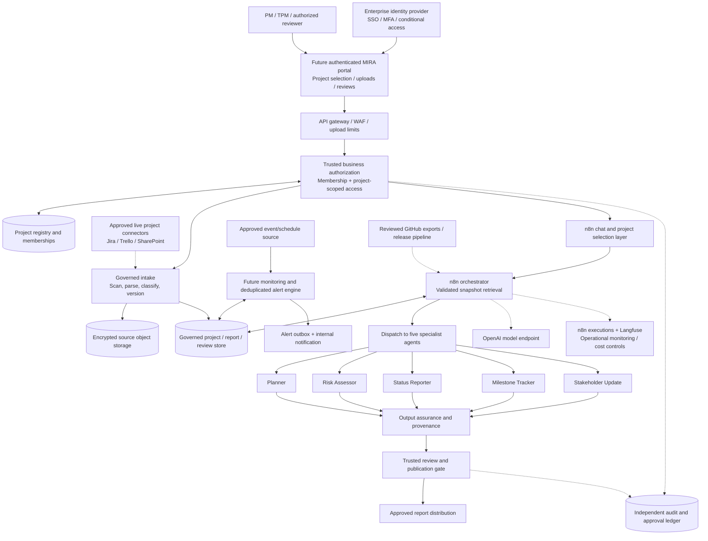
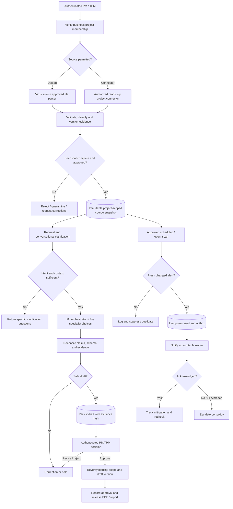
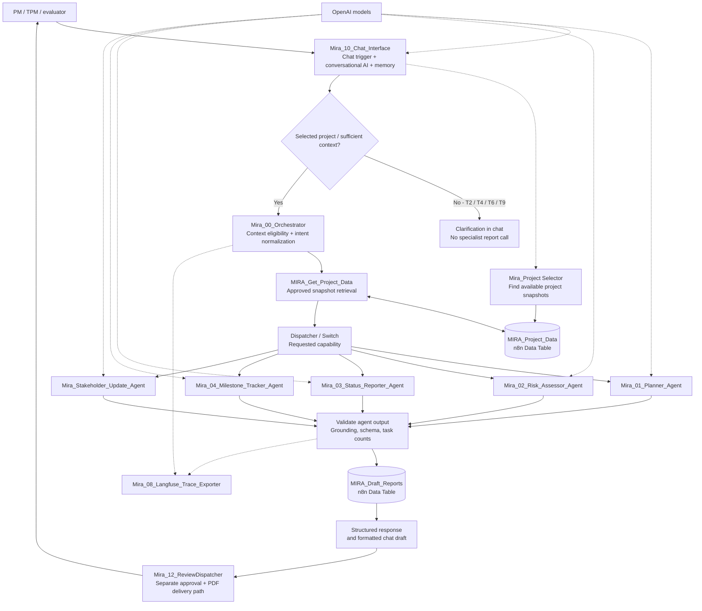
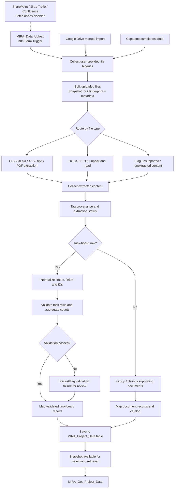
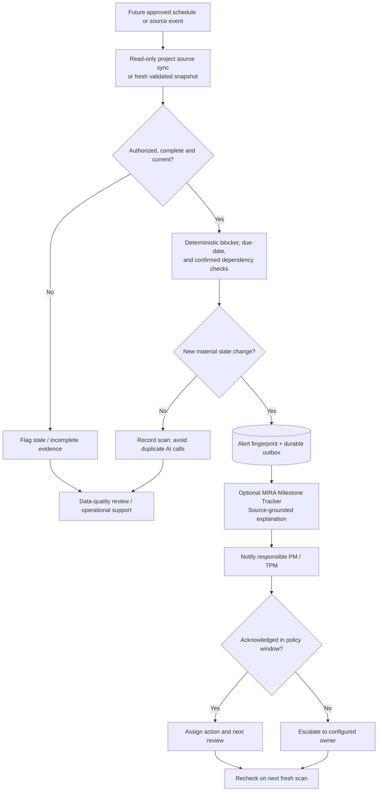
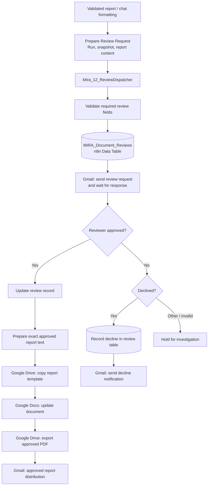
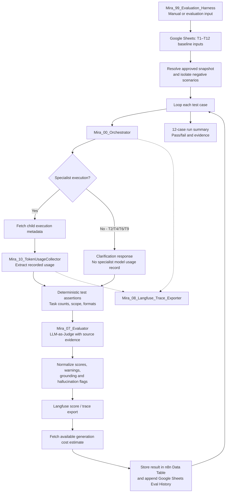

# MIRA — AI-Powered Project Intelligence Assistant

## Solution Architecture v2.3 — As-Built Capstone Baseline

| Document control | Details |
|---|---|
| **Audience** | Executive sponsors, CTO / architecture reviewers, PM/TPM leaders, and capstone evaluators |
| **Date** | November 19, 2026 |
| **Business context** | Nexora Pvt. Ltd. — ABCDE Ltd. AI Adoption Project |
| **Platform** | n8n (single orchestration platform), OpenAI, Langfuse, n8n Data Tables, Google Workspace |
| **Pattern** | Conversational Router / Dispatcher → project-snapshot retrieval → specialist subworkflow(s) |
| **Implementation** | **As-built capstone prototype** — 15 exported n8n workflows; not production certified |
| **Evidence** | Baseline T1–T12, regression run **#5814** (12/12 overall evaluation passes), recorded outputs and usage estimates |
| **Historical baseline** | Original Architecture v2.2, October 25, 2026; ADR-014 selects n8n; PRD v1.3 / TDD v2.2 |
| **Out of scope** | Production identity/tenancy, hardened audit, enterprise deployment, reliable proactive alert operations (CR-PROD-001) |

> **Decision in one sentence:** Retain **n8n-only orchestration** for the capstone. MIRA provides evidence-based project intelligence through five specialized agents, guarded by project-context checks, data validation, automated evaluation, and human review; **do not mistake capstone evidence for a production assurance claim**.

### Executive architecture summary

Nexora's PMs/TPMs need consistent plans, risk registers, status summaries and milestone insights without repeatedly assembling reports by hand. **MIRA converts approved project descriptions, timelines, risk registers, and task boards into decision-ready drafts** for an AI Adoption program at ABCDE Ltd.

The **implemented solution** uses n8n chat and project-selection workflows to qualify requests, select a stored source snapshot and dispatch one of **five specialist agents**—Planner, Risk Assessor, Status Reporter, Milestone Tracker, or Stakeholder Update. It stores source records and draft reports in n8n Data Tables, applies output checks, and supports **Gmail-mediated human review and approved PDF delivery** for report requests. Langfuse trace export, a token-usage collector, an LLM-as-Judge and a regression harness provide quality and cost-observability evidence. The paths are documented in **Diagrams 1, 2, 4 and 5** below.

The November 18, 2026 evaluation batch **#5814** recorded **12 of 12 overall passes** against the provided T1–T12 scenarios. This is evidence of *scenario-level acceptance under the implemented harness*, **not** independent proof of every source assertion, universal hallucination prevention, a production SLO, or a full platform cost statement. The chat's underspecified requests (T2, T4, T6, T9) are handled through clarification without invoking the specialist report workflows; conversational routing may still consume model tokens.

**Executive outcomes:** (1) more consistent project-delivery artifacts; (2) traceable facts and explicit unknowns for stakeholder decisions; (3) early rejection of unsupported requests; (4) an auditable capstone test record and estimated model cost visibility; and (5) human review before approved report distribution. **These are demonstrated design capabilities, not measured labor-hour or financial savings.**

### At-a-glance: implementation, evidence and release boundary

| Capability | As-built evidence | Decision / limitation |
|---|---|---|
| Project file ingestion and versioned snapshot | `MIRA_Data_Upload`; n8n Data Tables; sample, form and Drive import paths | Optional SharePoint, Jira, Trello and Confluence fetch nodes are **disabled** in the exported upload workflow |
| Conversational routing and clarification | `Mira_10_Chat_Interface`; `Mira_Project Selector`; orchestration context checks | Vague requests can stop before specialist execution; chat clarification wording is not identical to the harness's structured prompts |
| Five specialist report capabilities | Planner, Risk, Status, Milestone and Stakeholder Update exports | Outputs are **drafts** requiring source review and, when distributed, human approval |
| Report integrity | Orchestrator output checks; status/task reconciliation; source citations | Dataset completeness, independent factual verification and live-system freshness are not guaranteed |
| Evaluation and observability | T1–T12 workbook, Eval Harness, LLM Judge, Langfuse and TokenUsageCollector | 12/12 recorded harness passes; limitations and cost exclusions documented below |
| Human-in-the-loop | `Mira_12_ReviewDispatcher`: Gmail response, review table, Docs/PDF, delivery | Capstone workflow-level approvals **do not establish enterprise-grade identity/tenant authorization** |
| Proactive monitoring and production hardening | **Target-state designs** in P1/P2 and Diagram 3 | **Not asserted as deployed**; needs separate approval, controls and operational tests |

### Architecture diagram navigator

| Diagram | Primary audience | What it answers | State |
|---|---|---|---|
| **1** | Executives / evaluators | How does a user request become a grounded report? | **As built (logical)** |
| **2** | Data / QA leads | How are source files parsed, validated and stored? | **As built (logical)** |
| **4** | Governance leads | How does reviewer approval control report delivery? | **As built (workflow-level)** |
| **5** | Evaluators / TPMs | How are acceptance, tokens and costs recorded? | **As built (evaluation)** |
| **P1 / P2** | Enterprise architects | What security and operational controls must production add? | **Future target** |
| **3** | Operations / release leads | How would proactive milestone alerts work? | **Future target, not deployed** |

### Reading guide and evidence standard

The original **seven-diagram architecture** is retained: production **P1/P2** plus diagrams **1–5**. All seven diagrams are now refreshed to match the exported implementation *where relevant*; production-only diagrams remain future-state and are not presented as delivered code. “Implemented” means the exported node/connection configuration exists; it does **not** alone demonstrate execution, reliability or security. “Evaluated” is used only where run/output records are provided.

---
## Architecture decision summary — Why n8n rather than Langflow or hybrid?

| Option | Benefit | TPM-level tradeoff | Decision |
|---|---|---|---|
| Langflow only | AI-first agent graph development | Separate integration and approval engineering effort | Not selected |
| Hybrid n8n + Langflow | Specialized agent runtime plus business automation | Two runtimes, API and identity boundaries, more deployment and tracing complexity | Contingency only |
| **n8n only** | One environment for intake, agent calls, evaluation orchestration and approval workflow | Complex code nodes/credentials, external provider dependencies, and explicit production controls still needed | **Implemented for capstone** |

**ADR-014 rationale:** Consolidating orchestration reduces platform boundaries and operational handoffs. It does **not automatically reduce model token fees**; those depend on model, prompts, tool calls, retries and output length. n8n visual nodes **and JavaScript Code nodes** are used; describing the system as “no-code” would be inaccurate. The architecture favors deterministic checks for factual reconciliation and LLMs for interpretation and narrative.

## Source semantics, evidence integrity and agent contracts

| Approved source | Expected contract | Required safeguards |
|---|---|---|
| `project_description.txt` | Program intent, scope, goals | ABCDE's goals of 15% fewer delivery delays / 10% lower operating cost are **project targets, not MIRA outcomes** |
| `project_timeline.csv` | `phase, phase_name, start_week, end_week, key_activities, milestones_deliverables` | 8 phases / weeks 1–24; no approved calendar project start anchor; do not fabricate milestone dates |
| `project_risks.csv` | `risk_id, category, risk_challenge, impact, mitigation_strategy` | 10 risks; no quantitative likelihood, owner or source-defined score; top-three selections must disclose a **qualitative basis** |
| `sample_task_board.csv` | `task_id, task_name, status, assignee, priority, sprint, due_date, labels, description` | 25 rows and exact source status counts; preserve sprint scope and blocker `T024` |
| `eval_mira_inputs.txt` | T1–T12 scenario prompts and expected criteria | Keep original test wording, scope isolation and negative-test clarification behavior |

**Canonical capstone fixture:** Full board **25 tasks: 5 Done, 3 In Progress, 16 To Do, 1 Blocked**. Sprint 2: T004/T005 Done, T006 In Progress. Sprint 3: T007/T025 In Progress, T008/T009 To Do. `T024 — Security review of AI infrastructure` is Blocked, with a recorded due date of **2026-05-26**. The official narrative contains an inconsistent “3 Done” statement: actual CSV data governs reconciliation; record the discrepancy as `CR-DATA-001`. Do not silently edit the assignment.

**Critical date guardrail:** A task's recorded due date can be compared to a stated as-of date, but that does not prove the live status. Milestone weeks 1–24 cannot be converted into “next two weeks” calendar claims without an approved start-date mapping. A blocked item does not prove a dependent milestone will slip unless that dependency is evidenced.

**Snapshot principle:** An uploaded/selected source snapshot is an evidence boundary; it is not automatically the latest live state of an external project system. Supporting Word/PDF copies may provide context, while the approved CSV/TXT records are the primary baseline for the capstone assertions.

## Diagram P1 — Production deployment and trust boundaries (**future target**)

**Executive reading:** This is what must be added *before* handling independent enterprise teams or live sensitive projects at scale. **It is not the capstone deployment.** The capstone's n8n workflows map conceptually into the central execution layer, but identity, scoped authorization, durable approvals, and independent audit must be engineered separately.

**Trust boundaries:** n8n workspace/editor permissions are not end-user tenant authorization. Enterprise SSO, per-project RBAC, immutable audit, reliable queues, backup, high availability and secure deployment/promotion are **release requirements**, not benefits inherited from the current capstone. GitHub stores reviewed definitions, not live source-of-truth records or an automatic deployment.

## Diagram P2 — Production intake, human approval and alert lifecycle (**future target**)

**Executive reading:** This target sequence retains the current MIRA report-approval concept but introduces identity-bound approvals, durable decision evidence, and governed alert operations required for real teams.

**Boundary:** Approval-gated *stakeholder distribution* is different from factual *internal issue detection*. A verified internal blocker alert need not wait for report publication. Persistent identity-based decisions, alert deduplication and escalation rules shown here remain **proposed controls**.

---

## Diagram 1 — As-built capstone: chat → project evidence → five agents

**Executive reading:** The conversational interface first decides whether there is enough authorized project context. When not, it asks a question rather than generating a speculative report. When there is, n8n retrieves project evidence, executes the relevant agent and produces a checked draft.

**Implementation details:** Chat uses a conversational AI agent with a project-search tool. The Orchestrator separately contains request/context eligibility checks and a model-assisted intent fallback; this is **not purely deterministic routing**. A specialist may use its approved-data tool and structured output parser. `MIRA_Get_Project_Data` reads by snapshot ID; project selection is a *capstone context check*, **not** enterprise-grade per-user authorization. Multiple requested capabilities are supported by the Orchestrator's dispatch rules, subject to actual workflow execution behavior. The output and review paths are logically shown; approval is not a prerequisite for merely viewing a draft in chat.

## Diagram 2 — As-built source ingestion, validation and snapshot persistence

**Executive reading:** MIRA ingests supported files, recognizes task-board records, reconciles task status totals, preserves document metadata, and stores a source snapshot for agents to retrieve. The static 25-task fixture is used to test the implementation; it is **not** a global business rule.

**Operational qualification:** In the exported flow, failed validation routes to `Flag Validation Failure` and also maps a row for persistence; **do not describe the ingestion path as universally rejecting or quarantining invalid files**. Some file types are merely flagged as not extracted. The post-save optional orchestration/evaluation handoffs are not the only way to run agents; user chat and the evaluation harness have their own triggers. Exact fixture checks are for regression, not hard-coded acceptance of every customer project.

### Capstone versus production — what is and is not delivered

| Concern | Implemented capstone baseline | Additional production requirement |
|---|---|---|
| User entry | n8n chat trigger; data upload form; test/manual triggers | Branded portal, enterprise identity and authorized API surface |
| Project data | Data Table snapshot selection and retrieval | Tenant-scoped RBAC and durable project registry |
| Sources | File upload, Google Drive import, built-in synthetic fixture | Live Jira/Trello/SharePoint/Confluence only after activation, security review and connector tests |
| Business rules | n8n Code, Switch, IF, Summarize and validators | Formal rule versioning, reliable clock anchors and signed source contracts |
| Reports | Five specialists, source evidence, draft storage | SLOs, workload controls, robust retries and standardized release governance |
| Approvals | Gmail response, Data Table review status, Docs/PDF workflow | Verified reviewer authorization, immutable decisions and release authorization gate |
| Monitoring | On-demand milestone analysis and Langfuse/eval telemetry | Scheduled data-refresh and idempotent milestone alert service |
| Deployment | Manual reviewed JSON export to GitHub | Secure CI/CD, environments, rollback, backup and operational ownership |

## Diagram 3 — Proactive milestone monitoring and alert lifecycle (**proposed CR-001**) 

**Executive reading:** The capstone has an **on-demand Milestone Tracker**. A durable, scheduled, owner-directed alert service with duplicate suppression is **not in the exported baseline** and remains a separately approved extension.

**Planned status lifecycle:** `DETECTED → NOTIFIED → ACKNOWLEDGED → ACTION_ASSIGNED → MONITORING → RESOLVED` (with `ESCALATED` for SLA breach). Calendar alerts require an approved start-date/as-of anchor; dependencies must be source-evidenced. The capstone's current on-demand response must not be represented as this production alert engine.

## Diagram 4 — As-built human review and approved PDF-delivery path

**Executive reading:** After a report is generated, the n8n review workflow requests a human decision using Gmail. An approved report can be copied into a document template, exported as a PDF and sent; a declined review follows a separate notification path. This implements a **capstone workflow approval gate**, not a trusted enterprise identity boundary.

**Implementation note:** `Mira_12_ReviewDispatcher.json` contains both approval and rejection branches plus Google Docs/PDF and Gmail nodes. It validates a reviewer email and inputs; **this does not independently prove authorized corporate identity, approval immutability, delivery receipt, or PDF rendering quality**. Those controls belong in production P1/P2. Sample approved-report artifacts are evidence candidates but require privacy review before public GitHub publication.

## Diagram 5 — As-built baseline regression, evaluation and cost telemetry

**Executive reading:** A repeatable harness runs the official T1–T12 scenarios against an approved project snapshot and records both positive-path generation and negative-path clarification outcomes. A judge and deterministic checks produce verdicts; telemetry captures execution traces, token usage and model-cost estimates where observed.

**Recorded run:** Evaluation run `5814`, **November 18, 2026**, reported **12/12 `overall_eval_pass=true`**. The harness also records latency, grounding/completeness scores, scope and task reconciliation, warnings, token status and estimated model costs. The four clarification scenarios do not invoke specialist workflows; their uncollected specialist token fields **are not evidence of zero total conversational routing cost**. Judge flags are *evaluation claims*, not independent certification of factual accuracy. The separate Chat Output History represents user-facing interaction evidence and may differ in wording or execution ID from harness records.

### T1–T12 traceability to source and expected behavior

| Test | Primary path | Must demonstrate | Safeguard / caveat |
|---|---|---|---|
| **T1** | Planner | Eight approved phases, milestones, objectives and 24-week relative schedule | No invented business goals or calendar milestone dates |
| **T2** | Chat/orchestrator clarification | Ask for chatbot scope, timeline and team size | No specialist plan from one vague sentence; chat wording may need closer rubric alignment |
| **T3** | Risk Assessor | Registered logistics/AI risks, impacts and mitigations | No unsupported probability or owner |
| **T4** | Clarification | Request project purpose, scope and constraints | No invented risk register |
| **T5** | Status Reporter | Sprint 3 = 4 tasks; 2 In Progress, 2 To Do | No unrelated sprint tasks |
| **T6** | Clarification | Identify absence of reliable task-level status evidence | No fictional progress percentage |
| **T7** | Risk Assessor | Three actual risk IDs with stated qualitative rationale | Avoid claiming an official numeric risk ranking |
| **T8** | Status / Milestone path | Identify blocked security-review `T024` and examine actual due dates | No unproven cascading milestone impact |
| **T9** | Clarification | Ask for scope, goals and deliverables for 2-week request | No complete plan from duration alone |
| **T10** | Status Reporter | Full board 25 = 5 Done / 3 In Progress / 16 To Do / 1 Blocked | Reconcile task counts against source CSV |
| **T11** | Milestone Tracker | Source-derived upcoming milestone explanation | Calendar claims require an explicit approved project-start anchor |
| **T12** | Stakeholder Update / status | Sprint 2-only stakeholder draft | Avoid Sprint 3+ leakage and automatic distribution |

**Interpretation:** The harness recorded 12/12 overall passes. This does not imply every chat-only clarification includes all requested rubric fields; T2 and T9 should be reviewed against the exact phrasing of the official acceptance criteria. It does not imply that every agent-specific validation status was `PASSED` (some reports record `PARTIAL` with explicit data gaps).

## Evaluation evidence, token and cost interpretation

| Recorded example | Result | How it should be reported |
|---|---|---|
| Regression run **5814**, T1–T12 | **12/12 overall harness passes** | Single dated acceptance batch, not reliability probability or universal accuracy |
| T1 detailed project plan | **13,479 generated/collected model tokens; estimated $0.00730725** | Indicative observed per-plan *model-usage estimate* for this run; not total plan delivery cost |
| Run 5814 collected usage | **97,724 recorded generation tokens; sum of recorded cost entries about $0.03974** | Partial generation-cost visibility; exclude missing/unattributed calls from conclusions |
| Negative prompts T2, T4, T6, T9 | **Clarification path; specialist tokens not collected** | Avoided specialist calls, **not** proof of zero end-to-end LLM cost |
| Judge warnings | Original-source verification limits / missing dates / partial citation coverage in some cases | Acknowledge warnings; do not claim guaranteed zero hallucination |

**Planning estimate method:** Model cost per requested plan can be estimated as `(input tokens × relevant input token price) + (output tokens × relevant output token price)`. For a usage projection, multiply a representative *verified* per-plan value by planned user volume and frequency, then add separate allowances for routing, judging, retries, orchestration, storage, connector calls, observability and document delivery. Example only: **10 users × 5 plans/user/day × 20 working days = 1,000 plans/month**; at the recorded T1 estimate the included plan-generation component would be approximately **$7.31/month**, *before* excluded costs. This is a scenario, not a demand forecast or actual expenditure.

**Operational quality indicators proposed for ongoing tracking:** source-grounded claim coverage, exact status/task reconciliation, hallucination/unsupported-claim flag rate, p95 latency by capability, approval-to-release lead time, token/cost per successful request, incident and retry rates, and user-reported time savings. Existing evaluation evidence supports some of these measures; measured user adoption and labor savings are **not yet provided**.

## Exported workflow inventory and dependencies

The supplied exports represent **15 n8n workflows**. The inventory identifies reproducible components; after sanitization, inter-workflow IDs, Data Table IDs, credentials and document templates must be reconfigured in a new n8n environment.

| Layer | Workflow export / role |
|---|---|
| Ingestion | `MIRA_Data_Upload` — upload/import, parsing, validation and project rows |
| Project discovery | `Mira_Project Selector` — available project/snapshot list |
| Retrieval | `MIRA_Get_Project_Data` — snapshot-specific Data Table fetch |
| Chat | `Mira_10_Chat_Interface` — conversational routing, memory, project search, presentation and review handoff |
| Orchestration | `Mira_00_Orchestrator` — context gating, retrieval, dispatch, validation, draft storage |
| Specialists (5) | `Mira_01_Planner_Agent`, `Mira_02_Risk_Assessor_Agent`, `Mira_03_Status_Reporter_Agent`, `Mira_04_Milestone_Tracker_Agent`, `Mira_Stakeholder_Update_Agent` |
| Quality | `Mira_99_Evaluation_Harness`, `Mira_07_Evaluator — LLM-as-Judge` |
| Tracing and tokens | `Mira_08_Langfuse_Trace_Exporter`, `Mira_10_TokenUsageCollector` |
| Approval and delivery | `Mira_12_ReviewDispatcher` — Gmail review, document preparation, PDF and approved email |

**Environment and provenance:** Expected external services are OpenAI, Langfuse, Google Sheets, Gmail, Google Drive/Docs and n8n Data Tables. Access keys and OAuth credentials must remain external to GitHub exports. No run-time n8n URLs, credential IDs, private folder IDs, webhook IDs, customer data or pinned execution payloads should be committed. Code-based fields may contain identifiers embedded inside expressions and require manual review as well as automated sanitation.

## TPM governance, decisions and technical debt

| Topic | Decision / current posture | Future action |
|---|---|---|
| Architecture | n8n-only, modular orchestrator and specialist workflows | Retain ADR-014 and document change impacts |
| Data quality | Preserve approved source snapshot, IDs and known gaps | Formalize data contracts, source refresh SLAs and exception ownership |
| Dates and milestones | Relative week evidence is not a calendar due date | Require validated project-start anchor for future alerts |
| AI assurance | Combine deterministic validation with judge scores and explicit warnings | Add independent sampled document-level factual audits |
| Financial management | Record model usage and estimates | Complete routing/judge/retry costs and volume-based forecast |
| Human governance | Gmail-mediated review and PDF delivery path | Verify reviewer authority, immutable approval and controlled publication |
| Production security | Not approved/deployed | Tenant boundaries, secrets management, SSO, independent logging, backup |
| Operational resilience | Not certified | SLO/SLA, retries, idempotency, failure recovery, monitoring and drills |

**Evidence paths recommended in the repository:** `docs/Architecture.md` (this document), `docs/Technical_Design_Document.md`, `flows/` (sanitized JSON), `testing/` (baseline workbook, score summary and chat-output examples), `screenshots/` (canvas, chat, Langfuse trace), `reports/` (approved synthetic PDF examples after privacy review), and `presentation/` (capstone deck). These are **suggested GitHub destinations**; verify the actual files exist before adding clickable links to the README.

## Architecture change log and disposition

| Version | Date | Change / retained scope |
|---|---|---|
| v1.3–v1.5 | Historical | Source inputs, four initial specialist roles, approval concepts and T1–T12 path |
| v2.0 | Historical | Added target-state P1/P2, production governance and alert requirements |
| v2.1 | October 25, 2026 | Rebased proposed implementation to n8n-only; ADR-014 |
| v2.2 | October 25, 2026 | Corrected actual 25-task fixture and missing source date/risk semantics |
| **v2.3** | **November 19, 2026** | **Updated all seven original diagram roles**, grounded them in the 15 exports, added executive summary, five agents, ingestion, trace/eval, approval/PDF path and release boundaries |

**Final disposition:** As-built **capstone prototype**, tested against the specified baseline scenarios. **Not** an enterprise production architecture approval. Preserve the original v2.2 Markdown and the original exported workflows as historical/implementation evidence. Production FR-019–FR-026 and CR-PROD-001 require separate sign-off and verification.

### Official implementation reference links

- [n8n Summarize node](https://docs.n8n.io/integrations/builtin/core-nodes/n8n-nodes-base.summarize/)
- [n8n Schedule Trigger](https://docs.n8n.io/integrations/builtin/core-nodes/n8n-nodes-base.scheduletrigger/)
- [n8n AI evaluations](https://docs.n8n.io/advanced-ai/evaluations/overview/)
- [n8n executions](https://docs.n8n.io/workflows/executions/all-executions/)
- [n8n source-control plan and setup](https://docs.n8n.io/source-control-environments/create-environments/)
- [n8n security audit](https://docs.n8n.io/hosting/securing/security-audit/)
