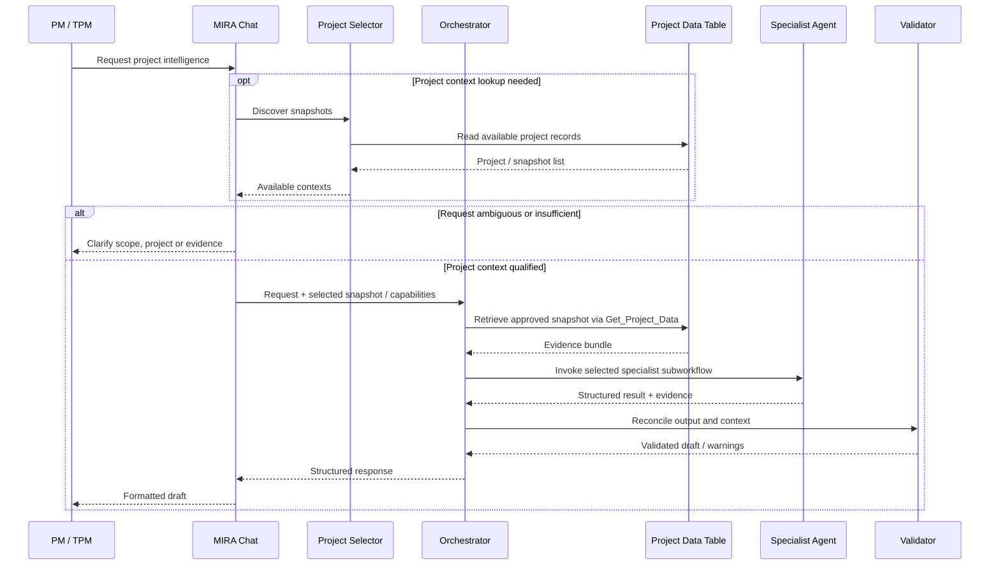

# MIRA — AI-Powered Project Intelligence Assistant

## Technical Design Document (TDD) v2.3 — As-Built Capstone Baseline

| Document control | Detail |
|---|---|
| **Audience** | TPM / PM evaluators, CTO and architecture reviewers, engineering leads, QA / AI evaluation leads |
| **Version / date** | **2.3** · November 19, 2026 |
| **Implementation status** | **Implemented and regression-tested capstone prototype; not production certified** |
| **Delivery organization / client** | Nexora Pvt. Ltd. · ABCDE Ltd. AI Adoption Project (synthetic capstone case) |
| **Platform** | n8n for orchestration, OpenAI models, n8n Data Tables, Langfuse, Google Workspace, GitHub |
| **Orchestration pattern** | Conversational intake and project selector → n8n Orchestrator / Dispatcher → specialist subworkflows |
| **Requirements baseline** | PRD v1.3 (retains FR-001–FR-018, T1–T12); production CR-PROD-001 / FR-019–FR-026 remains proposed |
| **Architecture** | [Solution Architecture v2.3 — seven updated Mermaid diagrams](Architecture.md) |
| **Decision record** | ADR-014: n8n-only orchestration (superseding Langflow / Make design) |
| **Historical baseline** | Original TDD v2.2 and Architecture v2.2 (October 25, 2026) preserved separately |
| **Document owner** | AI PM / TPM · formal sponsor / enterprise approvals not evidenced |

> **Read this first.** Sections 1–9 and 12–17 describe the **capstone implementation and its observed evidence**. Sections 10, 19–24, 27–28 retain the **separately proposed production target**, including FR-019–FR-026 and P01–P15. A workflow export, synthetic approval example, or evaluation-pass flag does **not** by itself establish enterprise production authorization, complete cost capture or a secured audit trail.

### Executive decision brief

**Business need.** PMs/TPMs currently invest substantial manual effort preparing project plans, analyzing risks and consolidating delivery status. MIRA turns a versioned project-description/timeline/risk/task-board snapshot into structured, reviewable project intelligence.

**Delivered.** Fifteen exported n8n workflows support multi-format ingestion, snapshot discovery and retrieval, conversational intake, five specialist agents, fact/schema validation, an evaluation harness, Langfuse telemetry, token collection and a human-review / approved-document delivery path.

**Observed quality.** Regression run **#5814 on November 18, 2026** recorded **12/12 overall evaluation passes** on the specified T1–T12 scenarios. This is a dated test result, not an enterprise uptime / factual-correctness certification. Negative tests T2/T4/T6/T9 prevent specialist execution; the chat routing path may still use a model.

**Financial visibility.** The run recorded **97,724 captured generation tokens** with summed recorded estimated model costs of approximately **$0.03974**; T1's plan showed **13,479 tokens / $0.00730725 estimated model cost**. These are partial model-cost estimates, not full operating spend or measured labor savings.

**Release decision.** Retain the n8n-only architecture and capstone evidence as the submission baseline. Defer multi-tenant authorization, secure immutable approval/audit, connector synchronization, proactive alert lifecycle, SLOs, recovery and production rollout until separately funded, tested and approved.

### Reader navigation

- **Technical reviewers:** Sections 5–9 (workflow contracts, ingestion, validations, agents, approvals), 12 (telemetry and economics), 14 and 17 (traceability and tests).
- **TPM / executive reviewers:** Sections 1–3 (business value and status), 13 (release gates), 16 (risks), 28 (accountability).
- **Production planning:** Sections 10, 19–24 and 27 (explicitly *target state*, not delivered scope).
- **Visual diagrams:** [Architecture.md](Architecture.md) preserves the seven P1/P2 and 1–5 diagrams updated for the implementation.

---

## 1. Executive technical summary

MIRA is an **n8n-orchestrated AI project intelligence prototype**. It is designed for Nexora PMs/TPMs working with approved project evidence for ABCDE Ltd.'s six-month AI Adoption Project. It generates source-grounded project plans, risk assessments, sprint/project status reports, milestone analysis and stakeholder drafts; human-reviewed documents can be exported to PDF through a separate approval path.

**As-built execution:** `Mira_10_Chat_Interface` receives a chat request, can discover projects through `Mira_Project Selector`, qualifies context and invokes `Mira_00_Orchestrator` when a project/snapshot is established. The Orchestrator retrieves evidence via `MIRA_Get_Project_Data`, normalizes the request and dispatches to **five independently exported specialist workflows** using `Execute Sub-workflow` nodes. Output validation precedes draft report storage and response formatting. A separate `Mira_12_ReviewDispatcher` provides Gmail-mediated review, review records and Google Docs/Drive PDF handling.

**Independent verification path:** `Mira_99_Evaluation_Harness` replays the specified baseline dataset, scores response assertions, calls `Mira_07_Evaluator — LLM-as-Judge`, writes evaluation history / chat evidence, and requests execution-usage metadata from `Mira_10_TokenUsageCollector`. `Mira_08_Langfuse_Trace_Exporter` provides trace export. External observations must distinguish **submitted** telemetry from independently confirmed ingestion.

**Non-claims:** Not every node is no-code: exported workflows contain JavaScript Code nodes for normalization, validation and formatting. This is an **n8n-only workflow platform** implementation, not a zero-code product. Project selection/snapshot gating are capstone guardrails, **not authenticated per-user project authorization**. Some optional source connectors are disabled. Trace data, approved synthetic reports, and 12 passing harness verdicts do not certify enterprise production readiness.


## 2. Business context, drivers and outcomes

ABCDE Ltd.'s AI Adoption program addresses demand forecasting, route optimization, inventory management and customer support over **six months**. The assignment cites planning at **3–4 manual hours per project**, and weekly status assembly at **1–2 hours**, as business pain points—not as savings measured in this prototype.

| Business driver | MIRA response | Evidence / measurement boundary |
|---|---|---|
| BD-01: Manual planning | Source-backed objectives, 8-phase / 24-week plan and 14 listed milestones | T1; labor time saved **not measured** |
| BD-02: Inconsistent risk register | Named risk IDs R01–R10 with impacts, mitigations and explicit missing fields | T3, T7; no invented numerical likelihood |
| BD-03: Slow reporting | Exact task/sprint filtering, structured status and stakeholder draft | T5, T10, T12; historical snapshot not live board |
| BD-04: Late milestone visibility | On-demand blocker and timing analysis | T8, T11; active scheduled alerts deferred |
| BD-05: Weak AI traceability | Evidence references, output checks, evaluation histories and trace correlation | Regression #5814; original-source independence limitations disclosed |
| BD-06: PM capacity pressure | Repeatable routing, specialist invocation, review and approved export | Capability demonstrated, not a confirmed productivity ROI |

**Current acceptance evidence:** 12/12 overall evaluations passed in one dated run. Separate completeness/grounding warnings, incomplete cost attribution and chat wording differences remain visible. **Prospective metrics** for pilot operation: source-grounded claim coverage, task reconciliation (target 100% for supplied fixtures), validation pass by capability, p50/p95 latency, cost per accepted report, approval cycle time, percentage requiring PM corrections, and user-reported time saved.


## 3. Scope and release boundaries

### 3.1 Implemented capstone baseline (PRD FR-001–FR-018)

- **Ingestion and snapshots:** `MIRA_Data_Upload` handles file uploads/manual Drive import and sample-fixture processing, maps and validates records, then stores project rows in `MIRA_Project_Data` (n8n Data Table). Alternate SharePoint/Jira/Trello/Confluence source branches are present but **disabled/not proven as live ingest routes**.
- **Conversational interface:** `Mira_10_Chat_Interface` uses a chat trigger, conversational AI agent, memory and a project-discovery tool. Unspecified or unrelated requests receive clarification before costly specialist generation.
- **Context and orchestration:** `Mira_Project Selector`, `MIRA_Get_Project_Data` and `Mira_00_Orchestrator` support project/snapshot readiness, retrieved evidence, routed capabilities, output validation and draft storage.
- **Five specialist agents:** Planner, Risk Assessor, Status Reporter, Milestone Tracker and Stakeholder Update, each implemented as a separate n8n subworkflow with an OpenAI model and approved-data retrieval tool.
- **Evaluation and observability:** Evaluation Harness, LLM-as-Judge, Langfuse Trace Exporter, TokenUsageCollector and evaluation records; November 18 run #5814 captured 12 overall passes.
- **Human review and export:** `Mira_12_ReviewDispatcher` uses a Gmail approval response, review Data Table records and Google Docs / Google Drive PDF preparation. Treat emailed approval as capstone evidence, not yet enterprise-grade identity-bound authorization.
- **Submission provenance:** Original exported JSON workflow definitions, reviewed prompts/scripts, approved synthetic sources, evaluation workbook, screenshots and architecture documentation, with GitHub redaction before publication.

### 3.2 Proposed production enhancement — CR-001 / FR-019–FR-026

Production-only: scheduled/event-triggered source refresh, deterministic milestone alerts, deduplication, persistent alert registry/outbox, accountable-owner notification, acknowledgements, escalations and rulebook governance. **On-demand tracking is implemented; a reliable proactive alert service is not established.**

### 3.3 Production-required controls and deferred work

SSO and authenticated business project membership; strict tenant/project data-scoped authorization; secure portal/API; durable versioned snapshots, immutable report and approval evidence, replay-safe publication; hardened webhooks; security/retention/privacy controls; load/recovery testing; change promotion and operational SLOs. No assertion of live customer connector support or autonomous Jira/Trello writes is made for the capstone. Fine-tuning, vector RAG and an enterprise program portal remain optional and out of scope.


## 4. Architecture principles and trust boundaries

1. **Evidence first:** Approved project files/data-table snapshots are input facts; model suggestions are proposals and reports are drafts until approved.
2. **Deterministic-before-generative where implemented:** Code/logic nodes handle schema, identifiers, task grouping, counts, routing eligibility and response validation; LLMs do not establish authoritative task totals.
3. **Single orchestration runtime:** n8n manages chat-to-workflow handoffs, specialist invocation, report/delivery paths and evaluation. OpenAI/Langfuse/Google APIs remain external dependencies.
4. **Conditional model usage:** Known/insufficient requests may be short-circuited; conversational intake and intent fallback **can** invoke OpenAI. Do not call this routing uniformly deterministic or zero-cost.
5. **Scope isolation:** Use validated project/snapshot context and fail to clarification where eligibility is missing. Production access control must be enforced independently by a trusted service.
6. **Untrusted source documents:** Uploaded documents and connector content can contain malicious instructions; no input text should grant authority to use arbitrary tools or publish.
7. **Human-governed release:** Draft report generation and approved stakeholder distribution are different operations; approval workflow presence does not prove immutable audit or recipient authorization.
8. **Traceability:** Preserve test ID, run/execution ID, source snapshot, model/agent version where recorded, assertions, costs and limitations.
9. **Degraded honesty:** Unknown owner, risk score, milestone date, project start date or live task status must be reported as missing, not invented.
10. **Protected assets:** Keep secret material and private execution IDs out of public GitHub JSON, screenshots, logs and test data.

### 4.1 Trust boundaries

**Capstone:** synthetic/approved test user input → n8n chat/form → n8n Data Tables/project snapshot → n8n Orchestrator/agents → OpenAI and optional Langfuse/Google Workspace paths. Project Selector shows available sample project contexts, not authenticated enterprise user-specific entitlements.

**Production target:** authenticated enterprise portal + verified business project access → secured n8n endpoints → versioned project store and approved read-only integrations → model/telemetry providers → trusted approval/publication and independent audit/alert stores. n8n workflow editor permissions do **not** establish row-level application authorization for end users.


## 5. Logical component and workflow design

See **[Architecture.md](Architecture.md)** for the seven retained and updated Mermaid views: **P1–P2 are production targets**; **Diagrams 1–2, 4–5 describe capstone paths**; **Diagram 3 describes the proposed alert extension**.

### 5.1 As-built workflow inventory and orchestration

The supplied exports contain **15 workflows**. Names below are export names, not guessed deployment IDs. A JSON `active=true` field is **not** independent proof that every route is configured, reachable or tested in the target environment.

| Layer | Exported n8n workflow | Verified responsibility / principal nodes |
|---|---|---|
| User entry | `Mira_10_Chat_Interface` | Chat Trigger, Conversational Agent, Simple Memory, project discovery tool, Orchestrator, review handoff, Sheet history |
| Project discovery | `Mira_Project Selector` | `Get Available Project Rows` Data Table + `Build Project List` |
| Upload / ingestion | `MIRA_Data_Upload` | Form/Drive/manual test, file extraction, validation, counts, document catalog, Data Table persistence |
| Project retrieval | `MIRA_Get_Project_Data` | Execute Sub-workflow Trigger, read data rows, select requested files/snapshot, return structured data |
| Core orchestration | `Mira_00_Orchestrator` | Context eligibility/intent checks, Switch, five Execute Sub-workflow specialist calls, output validation, draft saving |
| Plan specialist | `Mira_01_Planner_Agent` | Plan generation from approved description/timeline; source references and gap reporting |
| Risk specialist | `Mira_02_Risk_Assessor_Agent` | Actual risk register content; qualitative ranking with gap disclosure |
| Status specialist | `Mira_03_Status_Reporter_Agent` | Task/sprint filtering, source-grounded counts, status and draft messaging |
| Milestone specialist | `Mira_04_Milestone_Tracker_Agent` | On-demand blocker / milestone analysis; incomplete temporal anchors disclosed |
| Stakeholder specialist | `Mira_Stakeholder_Update_Agent` | Audience-aware stakeholder draft; Sprint 2-only isolation for T12 |
| Judge | `Mira_07_Evaluator — LLM-as-Judge` | Structured judgement of report quality/grounding for evaluation |
| Langfuse trace export | `Mira_08_Langfuse_Trace_Exporter` | Workflow telemetry export / root trace path |
| Token usage | `Mira_10_TokenUsageCollector` | n8n Execution API usage extraction, Langfuse trace association, OTEL export, token metrics |
| Baseline regression | `Mira_99_Evaluation_Harness` | T1–T12 loop, Orchestrator invocation, programmatic assertions, Judge, Langfuse scores/cost, Google Sheets evaluation history |
| Review and delivery | `Mira_12_ReviewDispatcher` | Gmail reviewer wait/response, decision Data Table, Google Docs and Drive approved PDF handling |

**Architecture classification:** **Router/Dispatcher with specialist subworkflow orchestration**, not fully autonomous agent-to-agent collaboration. There is an AI conversational front end, plus deterministic and model-assisted intent logic in the Orchestrator. Data ingestion and scheduled evaluation are separately triggerable workflows.

### 5.2 Logical request / response contracts

| Contract | Fields found / useful for integration | Guardrail |
|---|---|---|
| Chat or Orchestrator request | `request_text`, `capabilities`, `request_type`, `test_case_id`, selected `snapshot_id`, context eligibility and trace context | Do not invent or silently attach an unrelated project ID |
| Snapshot lookup | `snapshot_id`, `doc_kind`, `file_name`; response with `found` and source files | A valid ID is not equivalent to per-user authorization; missing files produce known absence |
| Specialist result | `agent`, `snapshot_id`, `status`, `generated_at`, structured `plan` / `risks` / `tasks` / `milestones`, `source_references`, `validation_status`, `data_gaps` when provided | Preserve field-level provenance; unknown values may be `null` |
| Orchestrator response | `status`, `message` or report(s), `trace_id`, normalized context/evaluation flags | `needs_clarification` is a successful safety response, not a failed specialist call |
| Review request | Selected report/run reference and review routing fields | Do not claim evidence of authenticated reviewer-role checks merely from an email response |
| Evaluation result | `eval_run_id`, `test_id`, `actual_output`, judge metrics, latency, token fields, cost estimate, warnings, `overall_eval_pass` | Keep test pass separate from agent validation `PARTIAL` or telemetry availability |

The contract table describes **observed fields and logical integration expectations**, not a newly enforced universal JSON schema. Exact field names and expressions are maintained in each exported workflow; absent fields in a given capability must not be synthesized.

### 5.3 As-built execution sequence (logical)



This diagram is a **logical functional sequence**, not a claim that project discovery or validation executes identically on every branch. ReviewDispatcher and regression evaluation are separately invoked paths.


## 6. Project data architecture and ingestion

The capstone sources are `project_description.txt`, `project_timeline.csv`, `project_risks.csv`, `sample_task_board.csv`, plus `eval_mira_inputs.txt`. The actual n8n ingestion implementation accepts multiple file types and creates versioned project/snapshot records for subsequent retrieval.

### 6.1 As-built ingestion and retrieval

**File and execution inputs:** `MIRA_Data_Upload` includes a `Project File Upload Form`, manual Google Drive import, and a manual capstone sample-test branch. It has nodes for CSV/XLS/XLSX/text/PDF extraction and DOCX/PPTX unpacking, which require format-specific testing. SharePoint, Jira, Trello and Confluence connectors appear in the exported graph but are **not verified active**.

**Transformation path:** split files → select extraction route → collect parsed content → tag source metadata → identify task-board rows → normalize fields → validate records → count tasks by status → assemble documents/catalog → persist to `MIRA_Project_Data`. The exported validation-failure branch can still map/persist a **flagged** row; do **not** state that all invalid source data is automatically quarantined or discarded.

**Retrieval:** `MIRA_Get_Project_Data` reads stored rows and filters requested `doc_kind`, `file_name` and `snapshot_id` into a structured response. `Mira_Project Selector` lists discoverable snapshots for the chat tool. Project read authorization remains a proposed production control.

### 6.2 Source precedence, quality and freshness

Canonical TXT/CSV records remain authoritative for assignment facts. Additional DOCX/PDF text is supporting material and must not silently overwrite source IDs or statuses. Source `uploaded_at`/snapshot identifiers provide provenance but do not prove the underlying task board is fresh. Validate missing or malformed columns, duplicate IDs, unknown status labels, date syntax, mismatched snapshots and unsupported extraction results. Some checks are implemented; broader security/quarantine completeness is a **release gap**.

### 6.3 Verified source schemas and capstone fixtures

| Source | Relevant exact schema / fixture |
|---|---|
| `sample_task_board.csv` | `task_id,task_name,status,assignee,priority,sprint,due_date,labels,description` |
| `project_timeline.csv` | `phase,phase_name,start_week,end_week,key_activities,milestones_deliverables` |
| `project_risks.csv` | `risk_id,category,risk_challenge,impact,mitigation_strategy` |
| Full board T10 | 25 tasks = **5 Done, 3 In Progress, 1 Blocked, 16 To Do** |
| Sprint 3 T5 | T007/T025 In Progress; T008/T009 To Do; total four |
| Sprint 2 T12 | T004/T005 Done; T006 In Progress |
| Blocker T8 | T024 `Security review of AI infrastructure`, Blocked, due 2026-05-26 |
| Timeline T1/T11 | 8 phases, project weeks 1–24; **no approved calendar start anchor** |
| Risk T3/T7 | R01–R10, without numerical probability, likelihood, risk score or authorized source ranking |

These **25-row values are capstone-specific fixture checks**. A production project may have a different task count; ingestion must not hard-code 25 as a universal business invariant.

### 6.4 Assignment-prose discrepancy — preserve rather than conceal

The assignment prose describes **3 Done, 3 In Progress, 1 Blocked**, whereas the supplied board and output evidence contain **5 Done, 3 In Progress, 1 Blocked, 16 To Do**. Source data is authoritative for T10's reconciled total. Record the discrepancy as `CR-DATA-001`; do not alter the assignment or silently substitute its prose counts.

### 6.5 Data and temporal contracts

A request-specific context should include `snapshot_id`, requested capabilities, scope/sprint when known, and explicit `as_of_date` for historical deadline checks. Milestone calendar windows require an approved `project_start_date` or project-week-to-date reference, which is not present in the provided timeline. `null` milestone dates, `Unknown` health and explicit evidence gaps are correct when sources do not support a value. Reports should be marked **STATIC SNAPSHOT / DRAFT**, not described as live statuses.


## 7. Deterministic rules and output assurance

### 7.1 Task aggregation and scope assurance

For supported status requests, group validated source records and reconcile `Done + In Progress + To Do + Blocked = total`. For the canonical full-board fixture: **5 + 3 + 16 + 1 = 25**; for Sprint 3: **0 + 2 + 2 + 0 = 4**. Validate task IDs and exact sprint filter *before* narrative generation, then check that the reported IDs and counts match the selected source scope. The exported implementation uses **Code nodes as well as built-in n8n nodes**; do not label all reconciliation logic no-code.

### 7.2 Milestone, blocked and date rules

- `BLOCKED` means the source task status equals `Blocked` (T024), not a speculative project-wide block.
- `OVERDUE` requires a supported `as_of_date`, a real due date and an incomplete task; the result represents that historical/reference date, not current operational state.
- Relative project weeks cannot become calendar dates without a documented anchor. T11 should clarify or present only valid relative-week information.
- An at-risk *milestone dependency* must have source evidence; a blocked task alone does not prove a downstream milestone delay.
- Unknown dependencies, owners or dates must stay explicitly unknown.

### 7.3 Qualitative risk selection

`project_risks.csv` contains no risk score or likelihood. T7 chooses **three real risk IDs** with an explicit qualitative rationale. Different valid qualitative rankings can result from different documented criteria; none should be presented as the source's objective numerical ranking. Keep invented owners or mitigation completion statuses out of the output.

### 7.4 Generation and output quality controls

The Orchestrator includes `Validate Agent Outputs` as a Code node; specialists expose an approved-data tool and structured parser. Baseline checks verify scope and reconciliation where applicable; an LLM-as-Judge supplies additional qualitative scores. Outputs can be tagged `PASSED` or `PARTIAL` at the specialist level and still produce an `overall_eval_pass=true` under the harness criteria. **Do not conflate JSON-schema validity, judge approval and independently verified factual truth.**

### 7.5 Clarification gating and cost-conscious routing

For T2/T4/T6/T9, chat and/or Orchestrator returns targeted clarification with **no specialist report-generation execution**. In these cases the recorded specialist generation usage is uncollected or not applicable. The chat conversational model may still incur usage; only avoided specialist invocations are evidenced. Improve chat phrasing to ask all rubric-required fields (especially T2 scope/timeline/team and T9 scope/goals/deliverables) without changing the validated test prompts.


## 8. Specialist output specifications

| Specialist | Export | Required source-bound output | Baseline evidence |
|---|---|---|---|
| Planner | `Mira_01_Planner_Agent` | Approved objectives, 8 phase schedule, activities, deliverables, milestone names, explicit unknown dates | T1, clarification T2/T9 |
| Risk Assessor | `Mira_02_Risk_Assessor_Agent` | Registered risk IDs/categories, impact, mitigation, qualitative selection rationale, missing scores/owners | T3/T7, clarification T4 |
| Status Reporter | `Mira_03_Status_Reporter_Agent` | Exact sprint/full-board task list, counts, blockers, source references, draft summary | T5/T10, clarification T6 |
| Milestone Tracker | `Mira_04_Milestone_Tracker_Agent` | Task/blocker and milestone observations with documented dates, unknown-calendar-anchor warnings | T8/T11; T8 chat may route via status |
| Stakeholder Update | `Mira_Stakeholder_Update_Agent` | Professionally formatted audience-aware update, with strict Sprint 2 isolation | T12 |

**Agent implementation pattern:** Each specialist is a separate n8n workflow with an execution trigger, model, structured output handling and approved-data access; no claim of free-running autonomous cross-agent deliberation. Evidence and recommendations must be distinguished, and stakeholders see drafts until approval.


## 9. Human-in-the-loop report approval

**As-built capstone:** `Mira_12_ReviewDispatcher` receives a review request from the chat workflow. Its exported nodes include `Validate Review Request`, Gmail `Send message and wait for response`, reviewer-approved and reviewer-declined decision branches, `MIRA_Document_Reviews` Data Table operations, `Prepare PDF Content`, Google Drive template copy, Google Docs update and Google Drive `Export Approved PDF` handling. The supplied examples include approved status and risk documents (run/report names `MIRA_status_5944_APPROVED` and `MIRA_risk_5933_APPROVED`). These are **capstone execution artifacts**, not evidence that organization-wide authority policies have been configured.

**Lifecycle:** Draft generated → review request validated → email reviewer response → approved/declined branch → record decision → on approval, prepare approved document and PDF and route the delivery step. A plain chat response can show a draft without the reviewer path being invoked.

**Current security limitation:** Gmail-mediated approval is not by itself a verified PM/TPM identity and permission service; report content hashes, reviewer authorization, immutable signed decisions, replay protections, publication idempotency and enterprise audit retention still need independent design and tests.

**Future production target:** Bind decision to authenticated identity, project membership, immutable draft/snapshot hash and expiry; persist rejection/revision versions and enforce an authorized *server-side* publish gate. Internal fact-based alerts can follow a separately approved notification policy instead of waiting for stakeholder-report approval.


## 10. Production proactive monitoring and escalation (CR-001 pending)

### 10.1 Business objective and change control

PRD v1.1 requires **on-demand** milestone detection. FR-019–FR-026 introduce scheduled/event-driven detection, notification, acknowledgement and escalation; they are a production extension subject to PRD v2.0 / CR-PROD-001 approval. Do not claim all missed milestones will be prevented.

### 10.2 n8n execution pipeline

Use n8n **Schedule Trigger** with explicitly configured workflow timezone, or authorized Jira/Trello event triggers. Triggered run → fetch fresh authorized read-only data → schema/freshness/tenant-project validation → persist snapshot → deterministic blocked/overdue/upcoming/dependency checks → compare alert fingerprint and prior state in durable register → optionally call `Mira_04_Milestone_Tracker` for concise grounded wording → persist/outbox → notify owner → track acknowledgement and escalation. Do **not** incur AI calls on unchanged/no-alert checks. Static uploaded CSV repeated on a schedule does not detect new status changes.

### 10.3 Proposed rulebook (approval pending)

| **ID** | **Trigger condition**                                           | **Proposed output**            |
| ------ | --------------------------------------------------------------- | ------------------------------ |
| MR-01  | Task status BLOCKED                                             | High internal alert            |
| MR-02  | Incomplete task past actual due date                            | High overdue alert             |
| MR-03  | Milestone ≤7 days away with documented blocked prerequisite     | High milestone risk            |
| MR-04  | Milestone ≤14 days away with documented incomplete prerequisite | Medium watch                   |
| MR-05  | Incomplete task due within ≤3 days                              | Low watch, not asserted missed |
| MR-06  | Stale/failed source sync or missing valid dates                 | Source-quality alert           |
| MR-07  | Critical alert unacknowledged past threshold                    | Escalation                     |

### 10.4 Registry and deduplication

Minimum: `alert_id`, `tenant_id`, `project_id`, `source_ref`, `rule_id`, `rule_version`, `severity`, `source_snapshot_id`, `detected_at`, `last_seen_at`, `owner`, `notification_status`, `acknowledged_at`, `mitigation_owner`, `mitigation_due`, `state`, `escalation_level`. Fingerprint `tenant_id + project_id + source_ref + rule_id`; include relevant state/version for meaningful changes, not every polling run. State: `DETECTED → NOTIFIED → ACKNOWLEDGED → ACTION_ASSIGNED → MONITORING → RESOLVED`, with `ESCALATED` when policy threshold elapses.

### 10.5 Notifications and approvals

Use approved provider nodes/email/Teams/Slack with least-privilege credentials. Persist an outbound intent **before** sending and record acceptance/receipt where the provider supports it; a successful n8n HTTP request is not proof the recipient read the notice. Bounded retry/backoff; idempotent sending prevents duplication. Public/stakeholder communications remain approval-gated.

### 10.6 Proposed operational targets

Subject to sponsor approval: ≥99% scheduled-run success, 100% detection of synthetic seeded blockers, ≤15 minutes from successful scan to internal alert dispatch, and ≤4 business hours for critical acknowledgement. Actual performance must be measured, with coverage for missed schedules, stale sources, false alerts, undelivered messages, repeats and resolved conditions.


## 11. Security, privacy, reliability and governance

- n8n credentials for OpenAI, Jira/Trello and notifier are encrypted/managed per approved deployment. **Never export credentials or secrets to GitHub**; scrub all workflow JSON, sample files and execution screenshots.
- Treat uploaded files and connector fields as untrusted; prohibit AI from invoking arbitrary HTTP/write tools based on source text. Explicit tool allowlists and read-only scopes.
- n8n workflow-editor/project permissions are **not** a replacement for business end-user `project_id` authorization; validate membership at trusted portal/data service.
- Disable or protect public forms/webhooks and apply file-size/type controls and malware screening before production ingestion; synthetic demos only on open testing endpoints.
- Verify permitted external processing, retention and cross-border transfer before sending client data to OpenAI or telemetry.
- Persist approval/alert audit in a controlled store; constrain retries, budgets, task timeouts, notification channels, data retention and logging.
- Outage or stale feed returns `DEGRADED`/`INSUFFICIENT_DATA`, never fabricated green status.
- Actual n8n license/edition and hosting options (Cloud vs self-hosted) determine availability of enterprise SSO, source control, queue mode and other controls; verify entitlements before finalizing deployment.


## 12. Observability, evaluation and economics

### 12.1 Recorded evaluation and observability implementation

`Mira_99_Evaluation_Harness` loops through T1–T12, calls the Orchestrator, runs deterministic scoring and the `Mira_07_Evaluator — LLM-as-Judge`, stores evaluation records to n8n Data Table and Google Sheets, and posts available evaluation observations to Langfuse. `Mira_10_TokenUsageCollector` fetches execution details through the n8n API and extracts reported model usage, associates the result with a trace and submits a generation observation. `Mira_08_Langfuse_Trace_Exporter` emits trace data from the orchestration path.

**Important distinction:** Export submission / HTTP acceptance does not necessarily mean the generation was queryably ingested in Langfuse. The collector may return incomplete usage if execution records do not contain a supported payload; keep `langfuse_ingestion_confirmed` and collection-status flags accurate. n8n execution history is a debug source, not a tamper-proof security audit log.

### 12.2 Dated regression evidence — run #5814, November 18, 2026

| Acceptance measure | Recorded evidence | Qualification |
|---|---|---|
| Coverage | 12 supplied T1–T12 scenarios | One dated regression batch |
| Overall verdict | **12/12 `overall_eval_pass=true`** | Does not mean all subsidiary validator fields `TRUE` |
| Hallucination flags | No hallucinations detected by harness in tested cases | Judge flags are not independent source-document certification |
| Captured generation tokens | **97,724** | Excludes uncollected/undiscovered calls |
| Sum of recorded estimates | **~$0.03974** | Partial generation-model estimate, not all API/infrastructure spend |
| Example T1 plan | **13,479 tokens / ~$0.00730725** | Indicative included model usage for one plan |
| Clarification cases | T2/T4/T6/T9 avoid specialist calls | Chat/router may still make model calls |
| Quality exceptions | Ground-truth independence warnings, missing dates, T12 partial citation coverage | Retain warnings in submission; do not conceal gaps |

**Cost-data exception:** The reported evaluation history includes a T10 token record with **zero estimated cost**. Treat that as a collection/pricing attribution gap, not evidence that the tokens were free. Preserve full raw history and explain excluded values instead of silently replacing them.

### 12.3 Cost per plan and TPM capacity scenario

At the captured T1 generation estimate, **$0.00730725 per detailed plan** is a *model-only observed estimate*. An illustrative demand case of **10 PM/TPMs × 5 plans/user/day × 20 workdays = 1,000 plans/month** gives approximately **$7.31** in the *same included model-generation component*. Add any chat routing, evaluation/judge, retries, storage, Google provider, Langfuse and n8n operating costs separately before presenting total cost of service. This is not a promise of monthly bills or headcount savings.

General provider formula: `estimated LLM cost = input_tokens × effective_input_price_per_1M / 1,000,000 + output_tokens × effective_output_price_per_1M / 1,000,000`. Document model/version, effective pricing period, caching/reasoning token treatment, and which calls each measurement includes.

### 12.4 Production quality and reliability metrics

Track plan groundedness (source-backed phase/milestone claims), status reconciliation, risk relevance, hallucination/unsupported-claim flag rate, p50/p95 by capability, report corrections after review, actual routing+specialist+judge cost per accepted report, user time saved, trace ingestion success, retry/failure rates and data freshness. The earlier **p95 < 30 seconds** is a *proposed* target, not a measured acceptance result; individual recorded tests may exceed it. Cost and latency service objectives require real traffic and load tests before approval.


## 13. Implementation plan, dependencies and release gates

| Gate | Capstone evidence / acceptance | Status / decision |
|---|---|---|
| **G1 — Platform** | n8n, model and provider integrations; runnable exports | **Implemented in test environment**; recreate credentials on import |
| **G2 — Source profile** | Canonical files/schema, approved sample snapshot, source precedence | **Documented**; source-data discrepancy CR-DATA-001 retained |
| **G3 — Ingestion + deterministic checks** | File parse/validation, task IDs/statuses/sprint scope | **Implemented; regression evidence**; full malformed-file and connector security coverage not certified |
| **G4 — Specialists** | Five distinct subworkflows, source context, structured reports | **Implemented; tested in defined baseline** |
| **G5 — Routing and review** | Chat/project selection, clarification, drafts, ReviewDispatcher | **Implemented**; enterprise reviewer authorization not certified |
| **G6 — Regression / eval** | T1–T12 outputs, judge, Langfuse and usage histories | **12/12 overall passes, run #5814**; caveats remain |
| **G7 — Submission package** | Sanitized 15 exports, architecture, TDD, all testing artifacts, screenshots, Q1–Q4 docs | **Completeness depends on actual GitHub upload and evidence review** |
| **G8 — CR-001 approval** | Policy for alert rulebook, scheduling and ownership | **Not approved — production target** |
| **G9 — Proactive alert proof** | Fresh connector data, durable dedup, notification and escalation | **Not established** |
| **G10 — Enterprise release** | Security P01–P15, RACI, SLO, recovery and go/no-go | **Not established** |

### 13.1 Code and reproducibility boundary

The implementation is **n8n-only orchestration**, but JavaScript Code nodes are actively used. Record that honestly. To reproduce, import **all 15** exported JSON definitions, resolve their subworkflow IDs and `MIRA_Project_Data` / draft/review/evaluation Data Table IDs, configure OpenAI and Google OAuth credentials, set Langfuse keys, and restore the evaluation dataset. Re-run T1–T12 on a *controlled test snapshot*; copied exports with redacted IDs are not plug-and-play.

### 13.2 Release and rollback rules

Treat GitHub as a versioned artifact and review store, **not** a live deployment. Keep a manifest of workflow file, sanitized hash, source workflow version, dependency, prompt/model settings and fixture snapshot. Test clean import, routing, negative inputs, export and controlled rollback in staging; document any retained manual reconfiguration. Preserve historical v2.2 documents as architectural baselines.


## 14. Requirements traceability (no requirement loss)

| Requirement | Implemented workflow / evidence | Delivery boundary |
|---|---|---|
| FR-001 | `MIRA_Data_Upload` and `MIRA_Get_Project_Data` | Supports files and stored snapshots; optional connectors not validated |
| FR-002 | Chat Interface + Project Selector + Orchestrator | Conversational and conditional model-assisted router |
| FR-003/004 | Planner | T1; T2/T9 early clarification |
| FR-005/006 | Risk Assessor | T3/T7; T4 clarification; unscored risks |
| FR-007/008 | Status Reporter | T5/T10 and T6 clarification; exact task counts |
| FR-009/010 | Milestone Tracker / Status path | T8/T11; calendar-anchor limit and blocker detection |
| FR-011 | Stakeholder Update specialist / Status draft | T12 Sprint 2-only; approval before actual publication |
| FR-012/013 | Orchestrator `Validate Agent Outputs`, source checks | Individual reports can be `PARTIAL`; independence warnings remain |
| FR-014/015 | Evaluation Harness, Judge, Langfuse and token collector | Run #5814 evidence; complete trace confirmation may vary |
| FR-016 | Structured reports, chat Markdown/JSON, Docs/PDF review path | Draft and approved artifacts separate |
| FR-017 | ReviewDispatcher | Email-based approval path; enterprise authority/audit deferred |
| FR-018 | Source connector nodes in Data Upload | Optional / disabled, not proven active |
| FR-019–FR-026 | Proposed schedule + alert registry/outbox | **Production CR-001**; not implemented as reliable service |

**Evidence priorities for scoring:** architecture and TDD, workflows as sanitized JSON, T1–T12 input/output and regression-history table, Langfuse/n8n/screenshots, plan token/cost estimate, project charter and one-page reflection. The 1–2-page Q2 summary may refer to this detailed TDD as a supporting artifact rather than replacing it.


## 15. Architecture decision records and rationale

| ADR | Decision status in v2.3 | Justification / limitation |
|---|---|---|
| ADR-001/002 | Langflow-only specialist/router design superseded | Replaced by n8n subworkflows and chat integration |
| ADR-003 | Approved OpenAI model selection used in exported workflows | Preserve configured model/price evidence; do not claim historic model pinned universally |
| ADR-004/005 | Retained | Source grounding; deterministic status/count assertions and Code nodes |
| ADR-006 | LangWatch default superseded; Langfuse implemented | Trace export and score/cost telemetry; independent ingest verification still needed |
| ADR-007 | Retained | Versioned reviewed n8n JSON in GitHub; no auto deployment |
| ADR-008/009 | Implemented at capstone workflow level | Email-based human review and versioned source contexts, not secure enterprise audit/RBAC |
| ADR-010 | Implemented | On-demand milestone tracking |
| ADR-011–013 | Proposed production alert architecture retained | No validated scheduled alert/dedup/escalation service |
| **ADR-014** | **n8n-only selected and implemented for capstone** | Simplifies orchestration dependencies; does not by itself lower model token cost |

### 15.1 ADR-014 — n8n orchestration trade-off

The evaluated alternatives were **Langflow-only**, **hybrid n8n + Langflow**, and **n8n-only**. n8n-only was selected to keep business integration, report review, specialist execution and evaluation in a single workflow runtime. A hybrid would introduce cross-runtime credentials, retries, monitoring and deployment surfaces. The trade-off is that the team must maintain disciplined workflow/source validation, JavaScript Code nodes and external model/provider integration checks in n8n. **Model bills depend on actual tokens and invocation patterns, not the platform name.** Formal enterprise ADR approval is still separate from successful capstone implementation.


## 16. Risks, open decisions and sign-off

| ID | Observed risk / uncertainty | Evidence-driven disposition |
|---|---|---|
| OT-01 | Source schemas, project/milestone dates and risk severity | Source schema documented; **calendar anchor, risk scores and owners remain missing** |
| OT-02 | Code paths / strict data validation | Exported Code and built-in nodes exist; negative malformed-file and re-import tests needed |
| OT-03 | Unsupported facts / judge overconfidence | Validator and Judge exist; source-level independent audit not fully evidenced |
| OT-04 | Partial token / cost attribution, trace delivery state | Token collector implemented; clarification gaps and zero-cost T10 record flagged |
| OT-05 | Public form/webhook and customer-data exposure | Synthetic capstone scope; authenticated production gateway required |
| OT-06 | Static sample task-board freshness | Snapshot-based warnings; real connector refresh deferred |
| OT-07 | Alert rulebook / owner / SLA not approved | Retain CR-001 as target state |
| OT-08 | Retry duplicate notifications / approval events | Durable production outbox, idempotency and negative tests pending |
| OT-09 | Email review does not establish identity-bound approval | Reviewer authorization, immutable evidence and replay tests pending |
| OT-10 | n8n edition/deployment limits | Verify enterprise security, concurrency, source control and hosting capability before rollout |
| OT-11 | Multi-project/tenant data isolation | Business RBAC and scoped trusted persistence not established by selector |
| OT-12 | Chat questions differ from exact rubric wording | Tighten T2/T9 requested-field clarification without adding hallucinated data |
| OT-13 | Source assignment prose conflicts with actual CSV task counts | Record `CR-DATA-001` and source-backed T10 counts |

**Architecture review / sign-off:** Sponsor/Product Owner, TPM, AI/enterprise architect, QA/evaluation owner and Security/SRE are required **for production**. Their sign-off is **not evidenced** by capstone workflow exports or sample approval emails. Capstone technical evidence supports the course demonstration only.


## 17. Explicit T1–T12 baseline test coverage and acceptance assertions

| Test | Primary observed execution path | Evidence / acceptance assertion | Important qualifier |
|---|---|---|---|
| T1 | Planner | Eight relative-week phases, project plan and source milestone names | Calendar due dates appropriately null |
| T2 | Chat / Orchestrator clarification | No detailed chatbot plan; asks for additional information | Chat output should request scope, timeline, team size explicitly |
| T3 | Risk Assessor | R01–R10 categorized project-relevant risks | No invented likelihood or owner; report may be `PARTIAL` |
| T4 | Clarification path | No unsupported new-project risk register | Clarification scope should be sufficient |
| T5 | Status Reporter | Sprint 3 four tasks, 2 In Progress, 2 To Do | No Sprint 2/4+ leakage |
| T6 | Clarification path | No invented progress from “Things are going fine” | Chat asks which project; full rubric also expects lack of task data |
| T7 | Risk Assessor | Three registered risk IDs, qualitative rationale | No authoritative numeric ranking supplied |
| T8 | Status / Milestone path | T024 blocked security review identified with recorded due date | Do not infer undocumented dependent delays |
| T9 | Clarification path | No complete plan from “2-week project” alone | Chat should explicitly ask scope, goals, deliverables |
| T10 | Status Reporter | Full board: 25 = 5 Done + 3 In Progress + 16 To Do + 1 Blocked | Source CSV beats contradictory prose |
| T11 | Milestone Tracker | Relative schedule facts and missing calendar anchor | Do not invent next-14-day calendar milestones |
| T12 | Stakeholder Update | Professional Sprint 2-only draft | No Sprint 3+, no automatic sending |

### 17.1 Dated test evidence and control interpretation

**Baseline:** Regression **#5814** on November 18, 2026 recorded **12 overall evaluation passes**. The separate **Chat Output History** shows user-facing outputs and may have different execution IDs and wording; do not treat it as the identical execution ledger. Clarification cases T2/T4/T6/T9 have no specialist run by design. The evaluation ledger has metrics including judge verdict, grounding/completeness, unsupported-claim/hallucination flags, latency, scope/reconciliation, token status, estimated model cost and warnings. Model judge results are not independently certified factual truth.

### 17.2 Capstone exit criteria versus production release criteria

| Measure | Capstone evidence | Production requirement |
|---|---|---|
| Baseline coverage | 12/12 case IDs, dated overall pass ledger | Independent replay plus failure/negative cases |
| Core functions | Planner, Risk, Status exports + outputs | Integration tests on authorized live data |
| Extended functions | Milestone and Stakeholder specialists | Freshness and schedule/notification governance |
| Observability | Langfuse nodes, traces/usage records | Queryable, verified, protected telemetry, alerting, retention |
| Cost | Captured generation tokens and partial USD estimates | All-inclusive per-request/service unit economics |
| Approval | ReviewDispatcher and approved report artifacts | Authenticated reviewer, immutable approval, audit and publication gate |
| Reproducibility | JSON and source/snapshot histories | Clean-room import + SLO/recovery/security signoff |

**Submission readiness does not imply production readiness.** Preserve a reviewed T1–T12 table with each input, expected behavior, actual output or artifact, verdict, source snapshot ID, run ID, warnings and trace reference; use approved synthetic data only for public GitHub.


## 18. Historical version change log

| Version | Historical / current role | Key change |
|---|---|---|
| v1.2–v1.4 | Historical logical-agent and PRD foundation | Source grounding, four original agent roles, manual review, T1–T12 |
| v2.0 | Historical target state | P1/P2, production authorization, alert lifecycle, P01–P15 |
| v2.1 | Design revision | ADR-014 n8n-only choice replacing Langflow / Make |
| v2.2 (Oct 25, 2026) | Source-validated **pre-implementation** baseline | Verified canonical CSV counts/fields and missing calendar/risk semantics |
| **v2.3 (Nov 19, 2026)** | **As-built prototype baseline** | Fifteen workflow inventory, five agents, chat/selector/data tables, regression #5814, Langfuse/token economics, ReviewDispatcher and remaining production gaps |

This is a revision of the original technical design, **not** a deletion of the target-state requirements. The source v2.2 document and all original architecture diagrams should remain archived; the current Architecture v2.3 retains and updates seven diagrams.


## 19. Production reference deployment architecture (future target, not implemented)

**Proposed deployment:** authenticated user portal → enterprise IdP/SSO → WAF/API gateway → verified project-authorization service → governed upload/connector ingestion and snapshot store → **private/secured n8n workflow execution** with durable job orchestration where licensed/configured → approved OpenAI model → validated report draft/alert → persistent approval or alert lifecycle → authorized publication/notifications. n8n's main workflow invokes specialist n8n sub-workflows; no Langflow, Make.com, or cross-orchestrator HTTP hop. See Architecture P1/P2.

- **Identity:** enforce project membership and role-based access in trusted portal/data service. n8n users/projects control workflow authoring; they **do not alone provide business row-level tenant isolation**. HTTPS, secure trigger endpoints, token/SSO integration and least-privilege service identities are mandatory for production.
- **Application/data services:** project registry, versioned file ingestion, malware scan, object-store snapshots, managed relational or equivalent durable store for tasks, risks, reports, approvals, alerts and delivery events. Business state must not depend solely on workflow execution-history retention.
- **Execution:** n8n workflows for ingestion, routing, specialists, scheduler, approval dispatch, notifier and evaluation. Select a supported managed Cloud or governed self-hosted edition based on licensing, queue/concurrency, external storage, security and support requirements. Do **not** assume self-hosted queue mode, enterprise source control or external secrets are available on every plan.
- **Integration:** approved read-only Jira/Trello credentials/API scopes; validated normalized schema; explicit project mapping; webhook signature verification when available; incremental sync and reconciliation.
- **Network/security:** encrypted ingress/egress, allowlisted provider endpoints, rate and file-size limits, secrets rotation, prompt/tool restrictions, logging redaction and retention policies.

### 19.1 Environment separation

Use distinct development, staging and production environments, credentials, data stores, notifier recipients and execution retention. Synthetic/sanitized inputs in development; production customer data only after security/privacy authorization. Versions and environment changes require controlled promotion and rollback; n8n native Git-backed environments/source control is **Business/Enterprise-plan gated**, while manual JSON import/export is feasible for the capstone.

### 19.2 Project-scoped data path

`Authenticate → authorize project membership → upload/import → scan + schema checks → version snapshot → retrieve scoped evidence → n8n router → specialist sub-workflow → deterministic response assurance → immutable draft → authorized reviewer → publish`; monitor path uses fresh snapshot and alert registry. Every record/blob includes `tenant_id`, `project_id`, `source_snapshot_id`, and provenance. Verify scope on each trusted retrieval, not by changing a dropdown label.

### 19.3 No-code-first boundary

n8n is the single **visual business and AI workflow designer**. Exact task counts, date windows, alert deduplication, and business approvals must be enforceable **outside the LLM**. If a required security or deterministic function cannot be guaranteed through n8n no-code primitives, procure an approved managed component or escalate a documented code exception; no-Code-node preference is subordinate to correctness and security.


## 20. Proposed production data model and event contracts

| **Entity**          | **Required fields**                                                                           | **Data controls**                                            |
| ------------------- | --------------------------------------------------------------------------------------------- | ------------------------------------------------------------ |
| `Project`           | tenant_id, project_id, name, owner, status                                                    | Unique ID; membership-scoped access                          |
| `ProjectMembership` | tenant_id, project_id, user_id, role                                                          | RBAC policy, least privilege                                 |
| `SourceSnapshot`    | snapshot_id, project_id, source_type, version/hash, ingested_at, freshness_status             | Immutable approved version for each run                      |
| `Task`              | project_id, task_id, sprint, status, due_at, assignee, snapshot_id                            | Unique per project/snapshot; deterministic normalized states |
| `Milestone`         | project_id, milestone_id, due_at, linked_dependencies, snapshot_id                            | Dependency optional and explicitly known/unknown             |
| `Report`            | report_id, project_id, source_snapshot_id, workflow_version, draft_hash, state                | Revision tracking; approved report immutable                 |
| `Approval`          | approval_id, report_id, reviewer_id, decision, reason, timestamp                              | Durable audit; separation of duties                          |
| `Alert`             | alert_id, project_id, source_ref, rule_version, severity, state, owner, first_seen, last_seen | Unique fingerprint + state transitions                       |
| `DeliveryEvent`     | event_id, alert_id/report_id, channel, recipient, delivery_status, retry_count                | Idempotent dispatch and delivery evidence                    |

**Example event semantics:** `DataSnapshotValidated`, `ReportDrafted`, `ReportApproved`, `ReportRejected`, `RiskDetected`, `AlertAcknowledged`, `AlertEscalated`, `AlertResolved`, `NotificationDelivered`, `DataSyncFailed`. Every event includes unique ID, tenant/project, event time, actor/service and correlation ID. Payloads minimize PII and confidential report content.

**Source conflict policy:** connectors/snapshot files have documented precedence; a conflict blocks automatic status publication until reconciled or explicitly disclosed. User uploads are not trusted instructions. Reject cross-project joins and unapproved file types. Define clock timezone as UTC storage plus project-local display, and use calendar days for defined business rules unless the policy explicitly states business days.


## 21. Proposed production-grade approval and reporting workflow

States: `DRAFT → VALIDATING → PENDING_APPROVAL → APPROVED → PUBLISHED`, or `VALIDATION_FAILED`, `REJECTED → REVISED_DRAFT`, `EXPIRED`.

- Creator cannot self-approve high-impact reports where separation of duties is required; approval policy is configurable by audience/classification.
- Each approval captures immutable report content hash, source snapshot, reviewer identity, decision, comment and timestamp; edits invalidate previous approval.
- Reports exceeding a freshness threshold require refresh and re-review before publishing.
- Publishing/export endpoint enforces `APPROVED` and verified project membership on the **server**; hiding a UI button is insufficient.
- Alerts about internal blockers can notify responsible PMs automatically without preapproval; schedule changes and external publication still require authorized approval.


## 22. Proposed proactive monitoring service design

**Triggers:** scheduler (proposed every business day, adjustable per project) and verified connector change events. Detect stale connectors, missed schedules and invalid snapshots as first-class alerts. Evaluate all projects with scoped credentials, not a single combined corpus.

**Pipeline:** retrieve/checkpoint source → validate schema/freshness → stage snapshot atomically → compute exact rule matches → deduplicate `(tenant, project, source_ref, rule, relevant_state)` → persist alert before dispatch → enqueue outbox notification → record provider receipt → monitor acknowledgement → escalate based on configured business-hours SLA → close only with evidence or authorized override.

**Controls:** idempotent processing; at-least-once event delivery with deduplication; backoff and dead-letter queues; schedule-miss alarms; notification opt-outs only where policy permits; owner fallback for unassigned issues; alarm-fatigue suppression; no false claim of guaranteed prevention. Proposed operational targets from CR-001 (99% scheduled checks, 15-minute post-run notification, 4-hour critical acknowledgement) must be approved and separately measured. Protect contacts and notification destinations.


## 23. Production security, privacy and abuse-resilience

- Threat model: prompt injection in uploads or connector rows, compromised API credentials, public form/webhook exposure, malicious file types, cross-tenant/project reference tampering, SSRF-capable HTTP tools, unauthorized email/Jira actions, approval-bypass attempts, poisoned snapshots, replay/duplicate events and leaking sensitive text in n8n execution history.
- Controls: file allowlist/size limits, malware quarantine, schema validation, least-privilege credentials, read-only Jira/Trello, outbound host allowlisting, disabled risky/unreviewed/community nodes where required, restricted AI tool access, bounded input/output sizes, data-minimized AI prompts and redacted execution logging.
- Authenticate at application gateway with enterprise IdP/OIDC/MFA as approved, verify business roles against project registry, separate user and service credentials, apply TLS, rotate keys and secure webhooks/forms. n8n editor/project RBAC does not alone provide application-user project isolation.
- Enforce provider data-classification approval, region/retention requirements, deletion policies and security incident response; do not claim blanket regulatory compliance from architecture alone.
- Formal red-team tests include malicious CSV instructions, cross-project ID manipulation, unintended tool invocation, approval link replay, secrets in workflow exports and compromised-notifier simulation.

Reference: [https://docs.n8n.io/hosting/securing/security-audit/](https://docs.n8n.io/hosting/securing/security-audit/) and [https://docs.n8n.io/workflows/sharing/](https://docs.n8n.io/workflows/sharing/).


## 24. Proposed reliability, scalability and recovery

**Proposed release SLOs, not achieved:** request availability 99.9% monthly; report p95 ≤30 seconds under measured load; successful monitored runs ≥99%; alert persisted before dispatch 100%; RPO ≤1 hour and RTO ≤4 hours where business and hosting choices permit. Approval delay excluded from report-generation latency; provider outages reported separately.

- Validate n8n Cloud/hosted service sizing, concurrency, execution timeouts and retry behavior with expected load; production queue mode and worker replication only if the selected edition/deployment supports and is configured for them.
- Prevent accidental cost spikes using per-project quotas, capped LLM iterations, output budgets, timeouts, bounded retry/backoff and circuit-breaking on provider failure.
- Durable data store/outbox must survive workflow errors and execution-history pruning. Alert replay and report-publication retries use persisted idempotency keys to avoid duplicates.
- Backups/restore drills must cover n8n workflow definitions/credentials encryption configuration, data store, object snapshots, approvals, alerts and notifier outbox; validate actual achievable RPO/RTO.
- Degraded path: if model is down, exact deterministic counts and failure reason remain available; generated narrative is marked pending, not fabricated.


## 25. Observability, audits and operations

**As-built capstone observability:** n8n execution records, `Mira_08_Langfuse_Trace_Exporter`, `Mira_10_TokenUsageCollector`, `Mira_99_Evaluation_Harness`, `Mira_07_Evaluator — LLM-as-Judge`, evaluation Data Table/Google Sheets history and separate chat-output history. Correlate `eval_run_id`, `test_id`, source `snapshot_id`, parent/child execution IDs and `trace_id` when present. These are **diagnostic/evaluation** records, not immutable regulatory logs.

**Collection limitations:** The token collector reads the n8n Execution API and publishes a Langfuse generation observation; Langfuse export submission is not always confirmed ingestion. Missing generation token fields in clarification paths are expected because no specialist is called, but do not prove conversational routing costs zero. An observed T10 zero-priced token record must be flagged, not hidden. Use measured end-to-end latency rather than extrapolating p95 from one success batch.

**Operations backlog:** errors on file extraction; invalid snapshots; no project selected; missing/expired provider credentials; hallucination or incorrect status reconciliation; stuck reviewer Gmail waits; PDF export/provider errors; incorrect upload schema; unqueryable Langfuse traces; missing token attribution; duplicate delivery; stale project data; source-content prompt injection. Define ownership, severity, retention and escalation before production. For implementation detail, see [Architecture Diagram 5](Architecture.md) and Section 12 above.


## 26. CI/CD, release engineering and governance

### 26.1 Capstone GitHub artifacts

```text
README.md
flows/                         # 15 SANITIZED exported n8n JSON workflows
  [actual export names retained; dependency manifest required]
docs/
  Architecture.md              # v2.3, 7 Mermaid diagrams
  Technical_Design_Document.md # this v2.3 TDD
  MIRA_Executive_Architecture_Overview.md
  [Q1, Q2, Q3 charter, Q4 reflection — only link if files actually exist]
testing/
  [T1–T12 baseline test results, evaluation history, chat outputs, scoring notes]
screenshots/
  [n8n canvas, chat, Langfuse trace, human review]
reports/
  [approved synthetic PDF examples, after content/privacy review]
presentation/
  [capstone deck, if uploaded]
```

The filenames in brackets are **placement guidance**; the actual repository must not claim unuploaded files exist. Do not commit raw credential bindings, webhook identifiers, private n8n hostname, pinned sensitive execution payloads, private file IDs or email addresses. Use environment-specific placeholders with a `dependency-map` and explicit import instructions.

### 26.2 Release engineering and reproducibility

Capstone path: export workflow JSON → review/sanitize → commit to private GitHub → map credential/Data Table/subworkflow references → clean test import → run T1–T12 and compare evidence → tag the validated submission snapshot → publish an authorized repository link when the course requires it. A GitHub commit does not itself deploy or activate a workflow.

Production path: separate dev/staging/prod, reviewed releases, required approvals, independent secrets and datasets, current n8n edition/license verification, deployment smoke checks, rollback drills, isolation/privacy checks, observability confirmation and P01–P15. Do not promise native Git-backed environments or enterprise SSO unless licensed/configured.


## 27. Proposed production verification matrix (adds to T1–T12)

| **ID** | **Production acceptance test**                                      | **Required evidence**                                       |
| ------ | ------------------------------------------------------------------- | ----------------------------------------------------------- |
| P01    | OIDC/SSO login, MFA and sign-out/session expiry                     | Identity/gateway test and screenshots                       |
| P02    | Unauthorized user cannot access another project via ID/blob changes | Negative authorization tests and audit entries              |
| P03    | Oversize/malicious/malformed file rejected or quarantined           | Upload security and error logs                              |
| P04    | Stale/missing Jira/Trello data blocks unsupported real-time claim   | Freshness test and warning                                  |
| P05    | Scheduled and event-driven checks detect injected blocker           | Rules and trace evidence                                    |
| P06    | Duplicate trigger never duplicates alert or external notification   | Replay/idempotency test                                     |
| P07    | Notification provider outage retries without losing alert           | Outbox/DLQ evidence                                         |
| P08    | Unauthorized/changed report cannot bypass approval                  | API negative tests and immutable approval log               |
| P09    | Prompt-injection attempt cannot extract secrets or trigger tools    | Adversarial evaluation evidence                             |
| P10    | Secrets absent from JSON, logs and telemetry exports                | Secret scan and redaction sample                            |
| P11    | Restore backup meets approved RPO/RTO                               | Timed recovery drill report                                 |
| P12    | Production rollback restores approved working version               | Staging rollback drill                                      |
| P13    | Per-project quota prevents resource exhaustion                      | Load and rate-limit test                                    |
| P14    | Incident alarm reaches on-call with documented runbook              | Incident exercise                                           |
| P15    | Full T1–T12 baseline still passes against pinned source snapshots   | Regressions, n8n executions and approved evaluation results |

No production acceptance may be inferred from design documentation alone. All P-series gates must be exercised in a production-like staging environment and signed off.


## 28. Production responsibility and sign-off (RACI summary)

| **Domain**                         | **Accountable owner**             | **Required approval/evidence**             |
| ---------------------------------- | --------------------------------- | ------------------------------------------ |
| Product/ROI and CR-001             | Nexora sponsor / Product Owner    | PRD v2.0 approval and monitoring policy    |
| n8n platform orchestration         | AI technical lead / platform team | ADR-014, G1–G7, supported edition          |
| Identity + project RBAC            | Application security owner        | Threat model, P01/P02/P09/P10              |
| Data snapshots, privacy, retention | Source owner + privacy lead       | Classification, authorized source sync     |
| T1–T12, deterministic checks       | QA/evaluation lead                | Actual no-code counts, ground-truth ledger |
| Monitoring and escalation          | Delivery operations owner         | Rulebook, P05–P07, delivery proof          |
| Reliability, incident response     | SRE / hosting owner               | Load, recovery, P11–P14                    |
| Release authorization              | CTO delegate + Product Owner      | Signed P01–P15 evidence and go/no-go       |

**Disposition:** n8n-only capstone implementation has recorded T1–T12 evaluation evidence; **production** remains unapproved pending enterprise security, project authorization, operational gates P01–P15, and named owner sign-off.


## 29. Version change log and retained design

**v2.3 (November 19, 2026):** Revised the October 25 v2.2 TDD using the **15 available exported n8n workflows**, the as-built Architecture v2.3, dated evaluation history, chat-output history, token/cost records and approved capstone report examples. Updated five-agent descriptions, conversational routing and project discovery, Data Table persistence/retrieval, validation, Langfuse observability, human review and evidence limitations. Preserved CR-001 / FR-019–FR-026, P01–P15, ADR-014 trade-offs, canonical data discrepancy and release-governance boundary.

**Disposition:** Implemented capstone prototype / **not production certified**. Architecture/design owners should review version consistency with PRD, TDD, ADR and actual GitHub artifacts before publishing. The v2.2 original remains a historical design baseline; no production scope has been approved by this update.

### References

- [Solution Architecture v2.3 (seven updated diagrams)](Architecture.md)
- [n8n Evaluations](https://docs.n8n.io/advanced-ai/evaluations/overview/)
- [n8n Executions](https://docs.n8n.io/workflows/executions/all-executions/)
- [n8n security audit](https://docs.n8n.io/hosting/securing/security-audit/)
- [n8n Schedule Trigger](https://docs.n8n.io/integrations/builtin/core-nodes/n8n-nodes-base.scheduletrigger/)
- [n8n source control](https://docs.n8n.io/source-control-environments/create-environments/)

