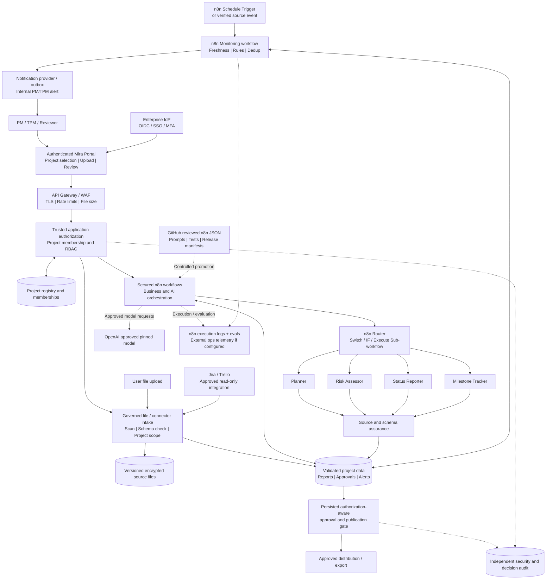
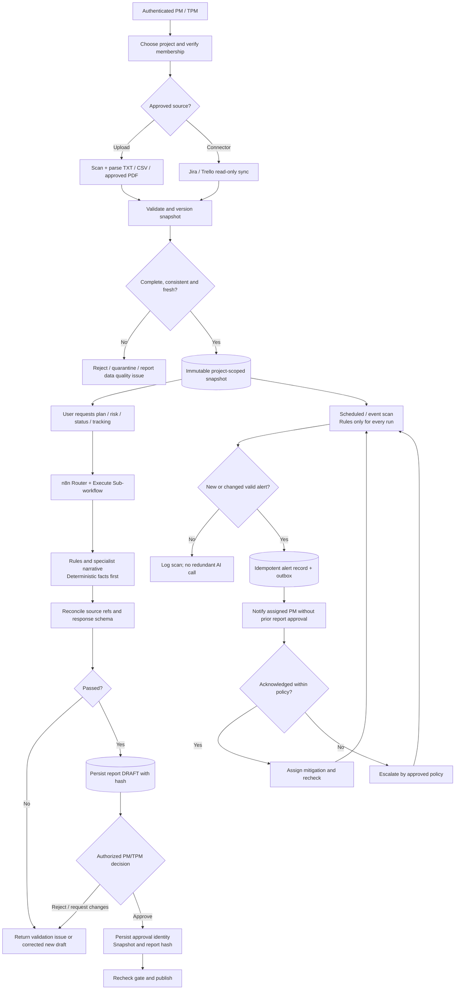
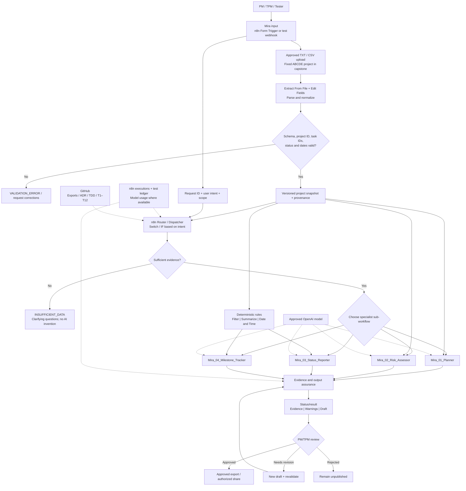
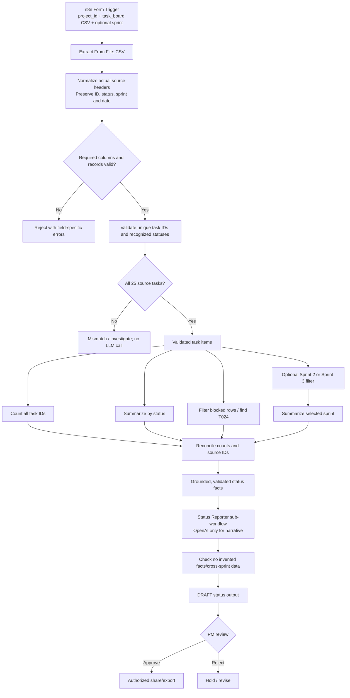
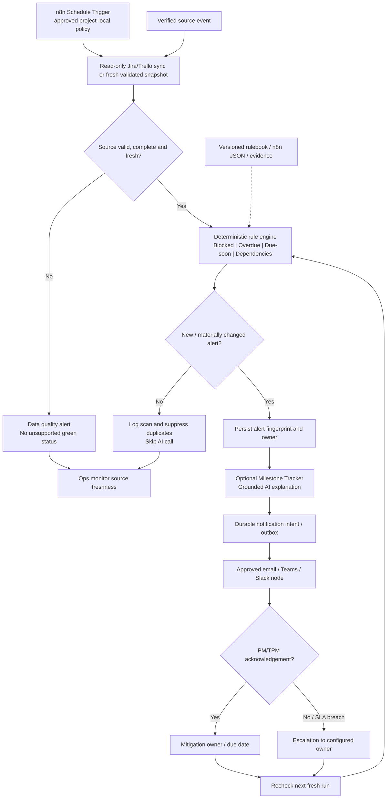
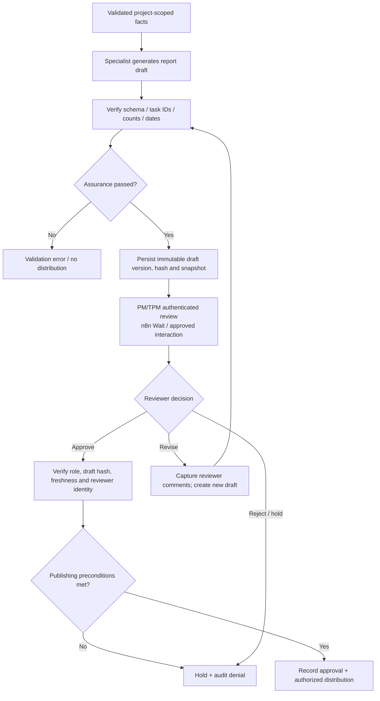
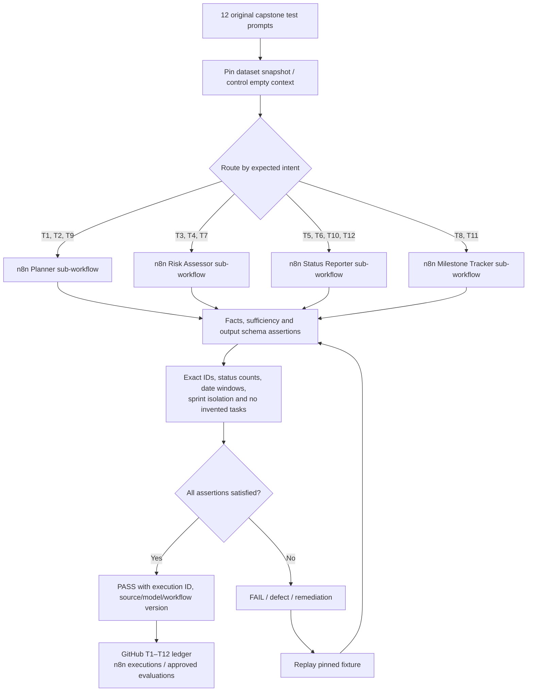

# Mira – Solution Architecture (n8n Single-Platform Baseline)

**Version:** 2.1 – Production Target / n8n-only recommendation  
**Date:** October 25, 2026  
**Status:** Proposed implementation baseline; **not yet implemented or production certified**  
**Rebased from:** Original `Architecture.md` v2.0 and `Technical_Design_Document.md` v2.0  
**Requirements:** PRD v1.1 capstone functions; separately proposed PRD v2.0 / CR-PROD-001 production extensions  
**Technical design:** [Technical_Design_Document.md](Technical_Design_Document.md) v2.1  
**Platform ADR:** ADR-014 – n8n-only selection (Langflow and hybrid retained as evaluated alternatives)  
**Primary implementation:** n8n workflows + approved OpenAI model + governed project data source + GitHub  

> **Reading guide:** Diagrams **P1–P2** are the **target-state production design** and include components not yet built. Diagrams **1–5** show the capstone logical workflow, data/approval handoffs, proactive extension, and T1–T12 evidence path. The v2.0 seven-diagram coverage is preserved while replacing Langflow/Make orchestration with n8n. This change does not approve production FR-019–FR-026 or claim a working system.

## Architecture decision summary — Why n8n instead of Langflow or hybrid?

| Candidate | Advantage | Mira-specific trade-off | Result |
|---|---|---|---|
| Langflow-only | AI-first graph development and agent tooling | Additional design effort for business integrations, scheduled workflows, approvals and state management | Not selected |
| Hybrid n8n + Langflow | Dedicated AI specialist platform plus business automation | Two runtimes; n8n-to-Langflow authentication, retries, failure paths, cross-platform logs and hosting; no automatic LLM token advantage | Contingency only |
| **n8n-only** | Single orchestration runtime for data, AI agents, integrations, schedules and notification gates | Must prove exact no-code processing, agent results and commercial/hosting controls | **Selected for capstone proof and production-target design** |

**Expected benefit, not a measured claim:** simpler dependency graph and API surface; fewer operating platforms; deterministic source processing before AI; capacity to avoid redundant router calls. **Token cost depends on prompt size, calls, model, output and retries—not on platform branding.** Measured cost/accuracy/latency and platform edition features must be validated under G1–G7. Approval of ADR-014 remains pending.

## Diagram P1 — Production deployment and trust boundaries (target state)

**Boundary note:** n8n workspace/project permissions govern **workflow editors**, not end-user tenant data. The production portal/data service must authorize each business project lookup. Queue/worker mode, high availability, enterprise Git source control and OIDC/SSO depend on the licensed n8n edition and deployment. Native workflow execution history is not an immutable audit register. P1 is **not a claim of deployed controls**.

## Diagram P2 — Production intake, report approval and milestone alert lifecycle

**Publication vs. detection:** report sending and baseline-changing actions require verified authorization; evidence-backed internal notices do not wait for report approval. Unchanged or stale snapshots do not prove new project developments. Approval must be persisted and enforced at trusted application/data boundary—not only in a UI button or an unsecured n8n form.

---

## Diagram 1 — Capstone logical n8n architecture and four specialist agents

**Routing strategy:** deterministic routing for known intents avoids an extra model token charge. An optional AI classifier handles genuinely ambiguous requests only; it must not retrieve ABCDE files automatically during negative tests T2/T4/T6/T9. Agent separation is by reusable workflow and contract, not necessarily multiple interacting autonomous LLMs.

## Diagram 2 — MIRA-001 source ingestion, aggregation and human review

**MIRA-001 pass criterion:** From **actual uploaded source CSV**, independently verify `25 = 3 Done + 3 In Progress + 1 Blocked + 18 To Do` and T024 `Security review` BLOCKED. These are **assignment expectations, not tested outputs**. Sprint filtering precedes generation, and invalid/missing/duplicate records must not be silently dropped or coerced. The first milestone is deterministic data verification, before any AI narrative.

### Capstone MVP vs. production boundary

| Component | Capstone | Production target |
|---|---|---|
| Input surface | n8n Form Trigger; approved synthetic/sample data | Authenticated portal and governed API |
| Business project selection | Fixed `ABCDE-AI-001` | Authorized multi-project registry + data-scoped RBAC |
| Source data | Original task/timeline/risk files | Approved read-only Jira/Trello with scheduled refresh |
| Rule execution | n8n visual nodes, G3 proof | Governed durable data/rule services if needed |
| Approval | Documented PM/TPM manual review | Secure persistent workflow with authorization |
| Monitoring | On-demand Tracker | Approved scheduled/event detection, registry, dedup and escalation |
| Source control | Manual n8n JSON export, PR | Approved promotion CI/CD according to licensed edition |

## Diagram 3 — Proactive milestone monitoring and alert lifecycle (proposed CR-001)

**State:** `DETECTED → NOTIFIED → ACKNOWLEDGED → ACTION_ASSIGNED → MONITORING → RESOLVED`, with `ESCALATED` when policy dictates. Dedup fingerprint keyed by tenant/project/source-item/rule and relevant status transition; source freshness/owner mapping must be approved. Rule checks need not incur tokens; use OpenAI only for new or changed alerts when a narrative adds value. **FR-019–FR-026 are not capstone P0 features until authorized.**

## Diagram 4 — Human-in-the-loop draft review and publish gate

**Capstone implementation caution:** manual documented review is acceptable; no automatic publish gate should be claimed until built. For production, n8n Wait does not independently authenticate business users, authorize project membership or create immutable approvals; a trusted portal/data service and store enforce those controls. Internal issue alerts remain outside the stakeholder-report approval gate.

## Diagram 5 — T1–T12 regression and evaluation evidence

### Traceability for all twelve baseline cases

| Test | Flow / capability | Required input and isolation | Pass criteria | Failure guard |
|---|---|---|---|---|
| **T1** – Detailed ABCDE project plan | Planner | project_description.txt + project_timeline.csv | Use actual objectives, six-month duration, phases, activities, deliverables and approved milestones; label unsupported proposals | No invented goals, phase names or dates |
| **T2** – “We want to build a chatbot” | Planner | Only one-sentence user request; do not silently inject ABCDE context | INSUFFICIENT_DATA; request scope, timeline and team size | No full implementation plan |
| **T3** – ABCDE risk assessment | Risk | Project description + project_risks.csv | Categorized logistics/AI-relevant risks with documented impacts and mitigations; source IDs | No unrelated generic risks presented as source facts |
| **T4** – “New project starting soon” | Risk | Only vague request; no project risk file specified | INSUFFICIENT_DATA; ask for project details | No invented project-specific risk register |
| **T5** – Sprint 3 weekly status | Status | sample_task_board.csv filtered exactly to Sprint 3 | Real task names and status groups; accurate Sprint 3 counts | No cross-sprint leakage or invented tasks |
| **T6** – “Things are going fine” | Status | No task board provided for that request | Explicitly state no task data; request board/sprint | No fabricated progress, tasks or percentages |
| **T7** – Top 3 ABCDE risks | Risk | project_risks.csv | Return three actual risk records with IDs and transparent source ranking or declared derived priority | No newly fabricated risks; do not claim unsupported ranking certainty |
| **T8** – Blocked/at-risk tasks | Tracker | sample_task_board.csv + as-of date | Identify T024 Security review as BLOCKED; check other deadlines against actual statuses | Do not invent due dates, dependencies or blocker cause |
| **T9** – Two-week project, no further detail | Planner | Only two-week duration | INSUFFICIENT_DATA; ask for scope, goals and deliverables | No detailed plan based on duration alone |
| **T10** – Count current tasks | Status | Full sample_task_board.csv, no sprint filtering | 25 total: 3 Done, 3 In Progress, 18 To Do, 1 Blocked; verify against CSV | Counts reconcile; no unknown statuses silently coerced |
| **T11** – Upcoming milestones in 2 weeks | Tracker | project_timeline.csv + explicit as-of date | Actual milestone names and dates within inclusive [as-of, as-of + 14 days] | No invented milestones; empty truthful result if none |
| **T12** – Sprint 2 stakeholder email | Status / email mode | Only Sprint 2 tasks from sample_task_board.csv | Professional draft with Sprint 2-only facts, issues and next actions when documented | No Sprint 3+ tasks; no automatic sending |

**Status:** All twelve cases are **addressed in the design**, but none should be claimed as executed or passed until original project files and recorded output evidence are available. Negative tests T2/T4/T6/T9 require isolated no-data context. T10 expects 25 tasks (3 Done, 3 In Progress, 1 Blocked, 18 To Do), to be verified from the original CSV. T11 uses a fixed explicit as-of date; T12 is a draft requiring approval before distribution. Proactive-monitoring CR-001 tests are **additional**, not replacements for these tests.

## Architecture change log and baseline retention

| Version | Change | Preserved |
|---|---|---|
| 1.3–1.5 | Source input, four logical agent roles, human approval, monitoring and explicit T1–T12 path | Capstone baseline |
| **2.0** | Added P1/P2 production data/control plane, persistent approvals/alerts, high availability/security gates | Seven diagram views + T1–T12 + P01–P15 |
| **2.1 (2026-10-25)** | **Replaced Langflow/Make target with n8n-only orchestration and n8n specialists; added ADR-014 rationale, MIRA-001 exact-data implementation map, platform cost/integration risks and no-code feasibility gates** | **All seven diagram views, four agent responsibilities, FR-001–018, proposed FR-019–026, T1–T12, P01–P15** |

## Platform, cost and API integration assumptions

- **Single orchestrator:** n8n `Switch` + `Execute Sub-workflow` means no n8n→Langflow API hop and no Make.com scheduler; however OpenAI, Jira/Trello, storage and notification APIs still require authentication, retries and availability controls.
- **Token economics:** deterministic counts and calendar filters consume no LLM tokens; route known intents without LLM classification; call only necessary specialist(s); avoid AI on unchanged monitoring scans. The same OpenAI model with the same input/output token counts has **the same LLM bill** whether invoked from Langflow, n8n or hybrid. Record real token usage, retries, n8n workflow-execution charges, infrastructure, storage and provider message fees separately.
- **No-code feasibility:** n8n visual `Extract From File`, `Summarize`, `Filter`, `IF`, `Date & Time`, `Merge` and schema mappings are candidates, not automatic proof of uniqueness, date or type correctness. Do not conceal a Code node or spreadsheet calculation while claiming zero code. G3 must pass against the actual 25-row fixture.
- **Edition caveat:** n8n internal source control/environments and certain enterprise security/storage capabilities require eligible editions/configurations. GitHub manual exports are the capstone approach; do not represent a file commit as a deployed workflow.
- **Data governance:** n8n Form Trigger is a POC input surface, **not** a complete authenticated project portal. Use synthetic/approved data in development and verified per-project authorization for production.
- **Observability:** n8n executions + evaluation ledgers are the selected baseline. Additional model tracers (including LangWatch) require a separate compatibility/privacy decision and are not deployed by this design.
- **Release policy:** CR-001/proactive monitoring and P01–P15 production gates stay pending. System availability, isolation, approvals and notification delivery must be tested; none is inherited automatically from n8n.

### Official implementation reference links

- [n8n Summarize node](https://docs.n8n.io/integrations/builtin/core-nodes/n8n-nodes-base.summarize/)
- [n8n Schedule Trigger](https://docs.n8n.io/integrations/builtin/core-nodes/n8n-nodes-base.scheduletrigger/)
- [n8n AI evaluations](https://docs.n8n.io/advanced-ai/evaluations/overview/)
- [n8n executions](https://docs.n8n.io/workflows/executions/all-executions/)
- [n8n source-control plan and setup](https://docs.n8n.io/source-control-environments/create-environments/)
- [n8n security audit](https://docs.n8n.io/hosting/securing/security-audit/)

**Design disposition:** Selected proposed n8n-only implementation baseline; historical v2.0 Langflow/hybrid design remains archived. Actual workflow configuration, dataset inspection, 12 capstone tests, production security and business approval are not yet evidenced.
