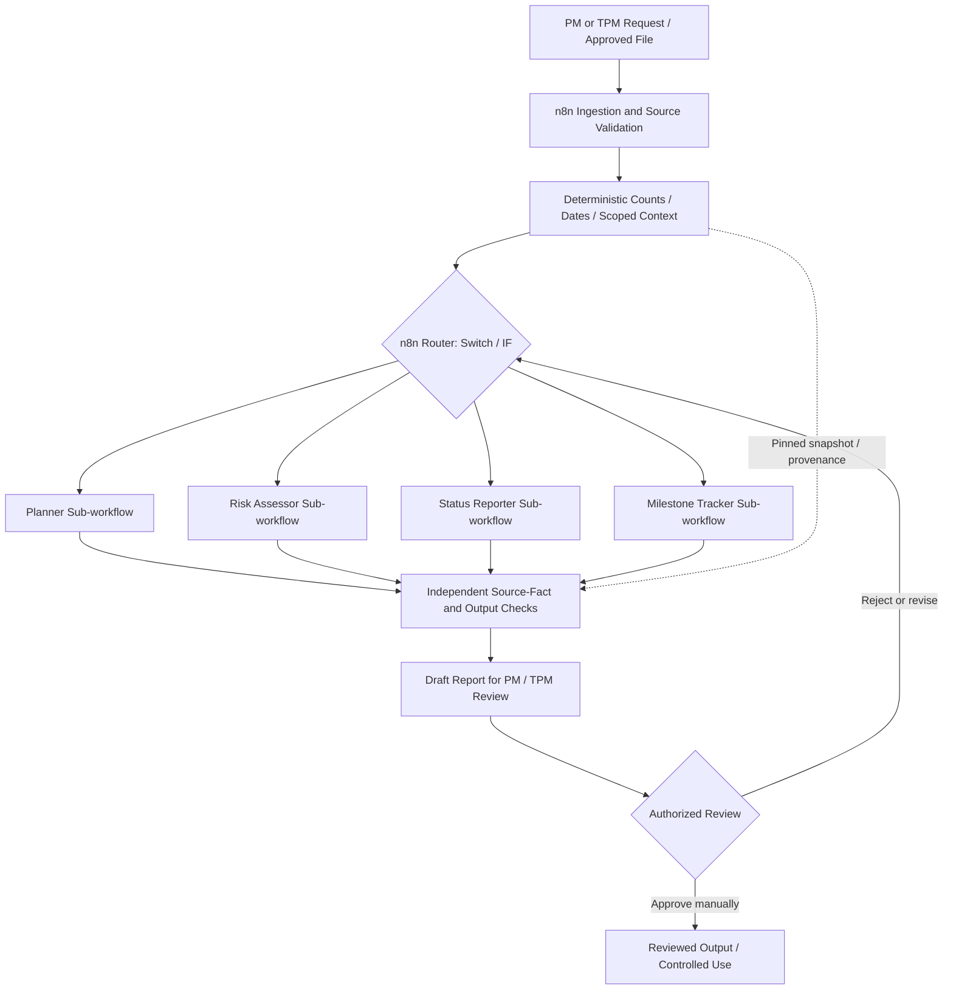

# Product Requirements Document (PRD)

# Mira – AI-Powered Project Intelligence Assistant

| Document control | Value |
|---|---|
| **Version** | **1.2 – n8n Implementation Alignment** |
| **Status** | **Proposed – Pending Product Owner / Architecture Review and Approval** |
| **Date** | October 25, 2026 |
| **Project** | Applied Agentic AI for PMs/TPMs – Capstone |
| **Client** | ABCDE Ltd. |
| **Implementation partner** | Nexora Pvt. Ltd. |
| **Product owner** | AI PM/TPM (name pending) |
| **Implementation approach** | No-code-first, source-grounded, modular multi-agent workflows |
| **Selected platform** | **n8n only**, subject to ADR-014 approval and feasibility gates |
| **Model** | Approved OpenAI model, version pinned at implementation (GPT-4o-mini is a historical candidate, not an unconditional commitment) |
| **Version control** | GitHub; manual review of n8n JSON exports |
| **Requirements baseline** | PRD v1.1 business problems, FR-001–FR-018, T1–T12, and capstone scope retained |
| **Related controlled documents** | [Technical Design v2.1](Technical_Design_Document.md) · [Architecture v2.1](Architecture.md) · [Project Charter v1.1](Project_Charter.md) |
| **Architecture decision** | ADR-014 – n8n-only over Langflow-only and n8n/Langflow hybrid (proposed) |
| **Production expansion** | **NOT approved in this PRD:** separately proposed PRD v2.0 / CR-PROD-001 / CR-001, FR-019–FR-026, production controls, P01–P15 |

> **Baseline rule:** This is a revision of the original PRD v1.1, **not a new product**. The business problem, four specialist capabilities, FR-001–FR-018, T1–T12, human review and grounding requirements are preserved. All changes to technical implementation reflect the selected **n8n-only proposal**. Neither a diagram nor a document constitutes evidence that a workflow, test, security control, or production deployment is operational. Sponsor/architecture approval and release-gate evidence remain pending.

---

## 1. Executive Summary

**Mira** is a no-code-first AI Project Intelligence Assistant designed to help Nexora's Project Managers (PMs) and Technical Program Managers (TPMs) manage ABCDE Ltd.'s **six-month AI Adoption Project** spanning **demand forecasting, route optimization, inventory management, and customer support**. Nexora must coordinate delivery while also overseeing multiple projects with constrained PM/TPM capacity.

Mira converts **approved project descriptions, schedules, registered risks and task-board records** into source-grounded plans, risk assessments, sprint/project status reports and milestone intelligence. A Router/Dispatcher invokes **four logical specialist AI workflows**—Planner, Risk Assessor, Status Reporter and Milestone Tracker—based on the user's request. Workflow components calculate counts, filters and date comparisons **before** asking an LLM to write explanations or recommendations.

**Selected platform and rationale:** The revised baseline uses **n8n as the sole business and AI orchestrator** for file handling, validation, workflow routing, specialist execution, evaluation evidence and optional future scheduling. This avoids an extra n8n-to-Langflow API boundary and reduces platform/incident ownership complexity. **It does not, by itself, guarantee lower LLM token costs or enterprise readiness.** See §8.8 / ADR-014.

**Phase A – capstone MVP:** One fixed ABCDE project, approved assignment files, on-demand specialist outputs and milestone identification, manual PM/TPM review of drafts, n8n execution/evaluation evidence, all twelve acceptance scenarios and GitHub-reviewed workflow exports. **No external stakeholder message is auto-sent.**

**Phase B – separately approved production target:** Authenticated multi-project portal, read-only integrations, versioned data, durable audited approvals, scheduled/event-driven alerting with acknowledgement/deduplication/escalation, production security/resilience and a limited PM/TPM pilot. These items are **not automatically included** in capstone acceptance.

### 1.1 Explicit product problem statement

> **Nexora's PMs and TPMs currently spend 3–4 hours preparing project plans and 1–2 hours each reporting cycle producing status updates, while project risk identification is inconsistent and blocked tasks or threatened milestones may be discovered late. With limited delivery-management capacity across concurrent projects, these manual and fragmented processes reduce time available for proactive intervention. Nexora needs a trustworthy, repeatable assistant that transforms approved project records into actionable plans, risks, reports and milestone signals—without inventing facts, compromising source integrity, or bypassing human accountability.**

**Who is affected:** PMs, TPMs, delivery managers and the stakeholder recipients of their reports.  
**Why the problem matters:** Administrative effort, uneven governance, delayed awareness and decision-making from incomplete or inaccurate information.  
**What success means:** Less manual preparation time, correct source-derived facts, standardized outputs, earlier issue visibility, accountable review and evidence demonstrating reliability.  
**What this PRD does not claim:** Achieved savings, deployed workflows, verified alerts, real-time project tracking or production authorization.

## 2. Business Problem and Opportunity

### 2.1 Current state and pain points

| ID | Business problem | Current impact / baseline | Expected product response |
|---|---|---|---|
| **BP-01** | Manual project plan creation | **3–4 hours per plan**, as supplied in the assignment | Grounded plan with phases, deliverables and milestones |
| **BP-02** | Inconsistent risk assessments | Varying categorization, priorities and mitigations | Source-backed, standardized risk matrix and documented proposals |
| **BP-03** | Manual weekly reporting | **1–2 hours per reporting cycle**, as supplied in the assignment | Validated task summaries plus a draft status narrative |
| **BP-04** | Late blocker/milestone visibility | Reactive tracking and late awareness of delays | **On-demand** blocked/due-date detection in MVP; proactive monitoring only after change approval |
| **BP-05** | Inconsistent governance artifacts | Nonstandard plans, registers and stakeholder updates | Standard structured outputs, evidence and review status |
| **BP-06** | Limited PM/TPM capacity | Less time for cross-team risk resolution and stakeholders | Reusable workflows; time savings to be measured in a pilot |

The time estimates above are **assignment-reported baselines**; a pre/post PM time study is still required to verify realized impact.

### 2.2 Business opportunity

Provide a governed decision-support assistant that handles repetitive preparation while preserving the PM/TPM's judgment over commitments, communications and escalations. The product's value is **evidence-based project intelligence**, not merely fast generative text.

### 2.3 Business-value hypotheses and verification

| Hypothesis | Proposed measure | Source / evidence |
|---|---|---|
| Planning can be faster | Human preparation + review minutes per accepted plan | Before/after time study; T1 quality gate |
| Status preparation can be faster | Human preparation + review minutes per accepted weekly report | Before/after time study; T5/T10/T12 |
| Reports can be factually reliable | Record reconciliation and unsupported-fact count | Deterministic assertions against pinned snapshots |
| Issues can be surfaced earlier | Blocker/due-date identification, later alert detection-to-notification | T8/T11, then CR-001 pilot logs |
| Governance can be more consistent | Template field completeness and PM approval outcomes | Structured checks and reviewer feedback |

These are hypotheses/targets. No measured improvement is claimed at PRD approval.

## 3. Product Vision, Objectives and Success Measures

### 3.1 Product vision

Build an accessible, **no-code-first, modular AI project intelligence assistant** that turns authorized project records into accurate and explainable management artifacts and actionable issue visibility, while retaining human oversight and source traceability.

### 3.2 Objectives

| ID | Product objective | Acceptance direction |
|---|---|---|
| **OBJ-01** | Generate plans from approved description and timeline | Grounded milestones/phases; clarify missing scope |
| **OBJ-02** | Standardize risk assessment and mitigation | Registered risk IDs and transparent ranking logic |
| **OBJ-03** | Reduce reporting preparation effort | Accurate sprint and full-board counts; measured review time |
| **OBJ-04** | Identify blocked tasks and potentially threatened milestones | Deterministic status/date rules; no unsupported dependencies |
| **OBJ-05** | Prevent unsupported project facts | Source-linked assertions and negative-data behavior |
| **OBJ-06** | Make outputs explainable and testable | Reproducible requests, source snapshots and execution evidence |
| **OBJ-07** | Provide usable PM/TPM interaction | Capstone form/test interface; production portal only if approved |

### 3.3 Proposed MVP quality targets (not achieved metrics)

- **12/12** baseline T1–T12 tests executed, with a *target* of all passing after remediation; no critical defects at acceptance.
- **100%** task-count reconciliation for all valid records in tested snapshots; verified status taxonomy and duplicate-ID handling.
- **Zero unsupported source-fact claims** in accepted baseline outputs, as verified by test assertions and human review.
- Routine-request latency **p95 < 30 seconds** is an initial hypothesis to benchmark; not an SLA or release guarantee.
- Record model request counts, available actual token usage, end-to-end latency, cost estimates/actuals and errors by workflow/test.
- Manual review required for stakeholder-facing artifacts; no uncontrolled external publication.

## 4. Users, Stakeholders and Decision Rights

### 4.1 Primary personas

| Persona | Primary work | Mira need |
|---|---|---|
| Project Manager | Plan and report on delivery | Fast accurate plan, sprint report, stakeholder draft |
| Technical Program Manager | Manage dependencies and delivery risks | Cross-workstream blockers, evidence-based milestone watch |
| Delivery Manager | Standardize delivery governance | Consistent status and risk artifacts, evidence and review |
| Executive stakeholder | Review delivery outcomes | Concise, approved updates with defensible claims |

### 4.2 Stakeholder and governance assignments

| Role | Decision responsibility |
|---|---|
| Nexora CTO / architecture delegate | Approve ADR-014, design exceptions and technical release gates |
| AI PM/TPM / Product Owner | Own scope, backlog, prioritization, acceptance and report governance |
| n8n workflow implementer | Configure/maintain flows, schemas, mappings and credential integrations |
| QA / evaluation owner | Verify T1–T12, negative cases, telemetry and release evidence |
| ABCDE business/data owner | Approve dataset meaning, risk priority rules and source revisions |
| PM/TPM reviewer | Approve/revise stakeholder-facing drafts before use |
| Security/privacy/operations owners | Authorize production data, identity, audit, notification and resilience controls (Phase B) |
| Executive sponsor | Approve production change request, pilot funding and rollout |

Roles may be combined for a capstone demonstration; a future production approval process must enforce any required separation of duties.

## 5. Scope, Phasing and Boundaries

### 5.1 Phase A – Capstone MVP (in scope)

1. Fixed project context for the supplied ABCDE AI Adoption Project; explicit project ID in requests.
2. Read/validate approved `TXT` project description and `CSV` schedules, risks and tasks; no invented schema.
3. Route supported intents using n8n `Switch`/`IF` with a defined ambiguity path.
4. Four separately testable n8n specialist workflows with grounded outputs and missing-data handling.
5. Plans, registered risk matrices/top-risk selections, weekly/sprint and project-wide status reports.
6. **On-demand** blocked/overdue/upcoming milestone identification using a fixed `as_of_date`.
7. Stakeholder **draft** messages scoped to a requested reporting period/sprint; manual review before any external sending.
8. Deterministic task/status counts, valid sprint filtering, record-level source references and output checks.
9. n8n execution history/evaluation evidence, documented token/cost/latency where obtainable, T1–T12 ledger and defects.
10. GitHub Markdown documentation, screenshots, prompt/version information and reviewed **n8n JSON** exports.

### 5.2 Phase A – explicitly out of scope

- Autonomous Jira/Trello **writes**, schedule edits, risk-register commits or stakeholder email dispatch.
- Dynamic multi-project production portal, enterprise SSO/tenant isolation or real client data without authorization.
- Guaranteed scheduled alert delivery/acknowledgement/escalation or durable production audit store.
- High availability, disaster recovery, enterprise-scale load engineering or production service-level guarantees.
- Model fine-tuning, unnecessary vector DB/RAG, custom app development and complex ERP actions.
- Claiming n8n form/workspace permissions are equivalent to business-user authorization.

### 5.3 Phase B – proposed, subject to PRD v2.0 / CR-PROD-001 approval

Authorized multi-project portal and registry; verified identity and project-specific RBAC; approved read-only Jira/Trello import; encrypted/versioned source store; scheduled/event-driven milestone monitoring; persistent alert registry, deduplication, owner acknowledgement and escalation; audited durable human approval; secured notifications; reliability, recovery, retention, monitoring and a controlled pilot of up to ten PMs/TPMs. The detailed **proposed** FR-019–FR-026 remain outside this capstone requirements baseline (see §7.4).

### 5.4 Scope and change-control rule

A production-target component shown in [Architecture.md](Architecture.md) does **not** become an MVP commitment. Any Phase B scope, timing, budget, data policy or external integration requires sponsor/security/architecture review according to the [Charter](Project_Charter.md), **G8** authorization and **P01–P15** evidence before an operational go-live.

## 6. User Journeys and Use Cases

### UC-01 – Generate grounded project plan

**Actor:** PM. **Data:** `project_description.txt`, approved `project_timeline.csv`. **Route:** Router → Planner. **Draft:** objectives, scope, phases, activities, deliverables, milestones, stated dependencies, assumptions, source references and clarification questions. **Guardrail:** With incomplete goals, scope, team or schedule, request details instead of filling in fictitious content (**T1/T2/T9**).

### UC-02 – Assess and prioritize project risks

**Actor:** PM/TPM. **Data:** project description + approved `project_risks.csv`. **Route:** Router → Risk Assessor. **Draft:** real risk IDs, category, description, documented impact/mitigation, priority basis, proposed improvement (clearly marked), evidence. Existing/top risk requests cannot invent registered entries or scores (**T3/T4/T7**).

### UC-03 – Create weekly or sprint-specific report

**Actor:** PM. **Data:** `sample_task_board.csv`, requested sprint/reporting window; timeline for milestone statements. **Route:** Router → deterministic filter/aggregation → Status Reporter. **Draft:** counts, actual task IDs/names/statuses, blockers, next activities and justified health (otherwise `UNKNOWN`). No input board → no fabricated progress. Filter **before** model invocation (**T5/T6/T10**).

### UC-04 – Identify blocked, overdue and upcoming milestones

**Actor:** TPM. **Data:** task board + approved timeline + fixed `as_of_date`. **Route:** Router → date/status rules → Milestone Tracker. **Draft:** observed blockers (including source-backed **T024 Security review**), due-date conditions and relevant actual milestones; missing dependencies are *unknown*, not silently assumed. Blocked status does not automatically prove milestone delay (**T8/T11**).

### UC-05 – Draft an audience-appropriate stakeholder update

**Actor:** PM. **Data:** explicit sprint/period and that period's actual records. **Route:** Router → Status Reporter in stakeholder-email mode. **Draft only:** achievements, blockers, next steps, missing-information note. **T12** requires Sprint 2-only activity; Sprint 3+ content must be excluded. External sending requires human authorization.

### UC-06 – Inspect output provenance and evaluate quality

**Actor:** QA/PM/Architect. **Data:** original source snapshot, request and recorded workflow/model versions. **Flow:** inspect counts/IDs/source references, outcome reason, execution trace and review status; accept, revise or reject. Source-data availability is a precondition for any claim of accuracy.

## 7. Functional Requirements and Acceptance Criteria

### 7.1 Preserved requirements register (FR-001–FR-018)

| ID | Functional requirement (preserved) | Priority | Primary n8n responsibility | Evidence |
|---|---|---|---|---|
| **FR-001** | Ingest and validate approved TXT/CSV project data | P0 | Form/file input → `Extract From File`, schema checks | G2/G3 |
| **FR-002** | Classify request intent and dispatch to specialist | P0 | `Switch`/`IF` → `Execute Sub-workflow`; bounded fallback | Router test |
| **FR-003** | Grounded project plans with phases, deliverables and milestones | P0 | `Mira_01_Planner` | T1 |
| **FR-004** | Clarify missing critical planning information | P0 | Planner input-sufficiency gate | T2/T9 |
| **FR-005** | Project-specific, categorized risk assessments | P0 | `Mira_02_Risk_Assessor` | T3 |
| **FR-006** | Source-backed registered-risk selection and ranking | P0 | Risk workflow + deterministic selection policy | T7 |
| **FR-007** | Sprint-specific and project-wide status reports | P0 | Filter → `Mira_03_Status_Reporter` | T5/T6 |
| **FR-008** | Deterministically calculate task counts and percentages | P0 | Filter/Summarize/validated mappings | T10, G3 |
| **FR-009** | Detect blocked, overdue and potentially at-risk tasks | P0 | `Mira_04_Milestone_Tracker` + rules | T8 |
| **FR-010** | Find upcoming milestones for requested date windows | P0 | Timeline filter + fixed-date comparison | T11 |
| **FR-011** | Generate period-scoped stakeholder updates | P0 | Status Reporter email draft mode | T12 |
| **FR-012** | Validate generated project facts against approved sources | P0 | Grounding assertions outside LLM | Cross-cutting |
| **FR-013** | Handle missing, malformed, unknown or conflicting data | P0 | Validation errors, insufficient-data path | Negative tests |
| **FR-014** | Capture AI execution/evaluation and usage evidence | P0 | n8n executions/evaluation where supported; metadata | G6 |
| **FR-015** | Execute and document twelve baseline evaluation tests | P0 | `Mira_07_Evaluation_Runner` or controlled manual test ledger | T1–T12 |
| **FR-016** | Produce structured Markdown and JSON outputs | P0 | Standard output mapping + validation | Schema tests |
| **FR-017** | Support review before stakeholder-facing distribution | P1 | **Manual MVP review**; durable approval Phase B | Approval evidence |
| **FR-018** | Integrate with live Jira/Trello task boards | P2 | Authorized read-only connectors into canonical schema | Separate integration acceptance |

**Priority interpretation:** P0 is required for capstone functionality. FR-017's *automated approval workflow* remains P1, but **manual approval/non-publication is a mandatory governance safeguard** even during the capstone. FR-018 remains optional/deferred. Priority does not waive source privacy or safety controls.

### 7.2 Detailed functional acceptance criteria

**FR-001 — Ingestion and validation**
- Read approved assignment files with correct encoding and delimiter handling; confirm actual headers/types before configuring mappings.
- Reject blank IDs, required-field omissions, duplicate task IDs, malformed dates and unrecognized statuses; preserve source filename, row ID, timestamp/snapshot reference.
- Failure produces `VALIDATION_ERROR` with actionable missing/invalid fields—not a partial report represented as complete.

**FR-002 — Routing**
- Planning → Planner; risk → Risk Assessor; status/email → Status Reporter; blockers/milestones → Tracker.
- Rule-based dispatch for explicit intents; optional constrained LLM classification only if ambiguity requires it and cost/accuracy are measured.
- Unsupported or ambiguous requests return clarification or a documented bounded multi-specialist route; avoid firing all agents by default.

**FR-003/004 — Planning**
- A detailed request produces a structured plan with actual source phases/milestones and no invented objectives or dates.
- Vague “build a chatbot” and “two-week project” requests without sufficient details ask for scope/goals/deliverables/timeline/team; no ABCDE context silently inserted (**T2/T9**).

**FR-005/006 — Risks**
- Risk outputs use actual ABCDE risk register entries where requested; retain IDs/categories and documented impact/mitigation.
- Top-three ranking uses documented priority; if no authoritative ranking is supplied, apply an approved transparent derived policy or ask for ranking criteria. Never fabricate a numeric risk score.
- Generic new-project risk requests without context request necessary details (**T4**). Suggested new risks are labeled **PROPOSED**, not registered.

**FR-007/008 — Reporting and arithmetic**
- Preserve actual task names, statuses, IDs and sprint memberships; filter requested period **before** aggregation and generation.
- Count all valid records, reject unmatched status categories, verify no duplicated/missing IDs and `sum(status_counts) = valid_task_total`.
- T10 expected snapshot: **25** tasks, **3 Done / 3 In Progress / 1 Blocked / 18 To Do** (to be confirmed against original file).
- Percentages, if displayed, use explicitly defined numerator/denominator; absent board → no counts or claims of progress (**T6**).

**FR-009/010 — Milestone and due-date intelligence**
- Identify `BLOCKED` from documented status; `OVERDUE` only when incomplete and due before a fixed, valid `as_of_date` in a declared project timezone.
- `UPCOMING` for T11 means actual approved milestones within inclusive **[as_of_date, as_of_date + 14 calendar days]** unless the request specifies otherwise.
- `AT_RISK` requires documented dependency/schedule evidence; due-soon without impact evidence is a **watch item**, not a proven delay.
- T024 must be identified by reading the source, not by hardcoding its ID; unknown dependency/ownership/date must remain unknown.

**FR-011 — Stakeholder update**
- Professional draft scoped to the explicit sprint/report period; T12 Sprint 2 draft excludes Sprint 3 and later work.
- Distinguish known progress from recommendations/risks; external distribution remains blocked until authorized review.

**FR-012/013 — Grounding, missing data and conflicts**
- Source-ground every project goal, actual task/risk ID, milestone and status; invalid IDs/counts must fail review.
- Empty or conflicting datasets produce an explicit warning/status; do not silently merge contradictory snapshots or infer missing owners/dependencies.
- Data-free scenarios T2, T4, T6 and T9 **must not** retrieve or inject the unrelated ABCDE fixtures (`allow_project_context=false`).

**FR-014/015 — Evidence and evaluation**
- Each test has input, pinned snapshot/date, workflow/model/prompt version, expected/actual, evidence link, reviewer, disposition and any defect.
- Record available n8n execution IDs, timings, error class and actual model tokens/usage where returned; clearly label estimates/unavailable metadata.
- Preserve rejected cases as failures; a plausible response is not a passing test without source assertions.

**FR-016 — Output schema**
- Human-readable Markdown and structured JSON where requested; required response fields validated separately from prose quality.
- Response includes result status, provenance, unresolved information, warnings and review state; `SUCCESS` cannot bypass fact checks.

**FR-017/018 — Review and optional integration**
- Approved business recipients cannot receive automated stakeholder reports from the capstone workflow.
- Jira/Trello access, if implemented later, is **read-only by default**, least-privileged and mapped through the same input validation; no connector bypass of project authorization.

### 7.3 Cross-cutting requirements and business rules

- User-selected or imported project identifiers are *claims* until a trusted access layer authorizes them (Phase B); capstone has a **fixed ABCDE project**.
- Source text, issue comments and imported data are **untrusted content**, not executable system instructions or permission grants.
- Generated plans, risks and reports are **DRAFT** recommendations; source documents remain the systems of record.
- n8n workflow-builder roles are not equivalent to business-user per-project data authorization.

### 7.4 Proposed production extensions — **not part of approved FR-001–FR-018 baseline**

The following are **proposed feature IDs only**, consistent with TDD v2.1, Architecture v2.1 and Charter v1.1; detailed acceptance policies require PRD v2.0/CR-001 approval.

| Proposed ID | Phase B capability | Prerequisite / release control |
|---|---|---|
| FR-019 | Scheduled/event-driven project health checks | Approved freshness cadence and source permissions |
| FR-020 | Controlled refresh of authorized Jira/Trello/source snapshots | RBAC and project-scoped immutable/versioned source record |
| FR-021 | Deterministic alert classification, owner/action context | Approved threshold/rulebook and no fabricated dependencies |
| FR-022 | Persistent deduplicated alert registry | Durable idempotency and safe replay |
| FR-023 | Internal owner notifications with verified delivery | Channel policy, consent/recipient restrictions, audit |
| FR-024 | Alert acknowledgement and action/mitigation tracking | Persistent state, owner identity |
| FR-025 | Timed escalation and resolution checks | Approved escalation matrix, clocks and exception handling |
| FR-026 | Monitoring SLOs, auditability and operating controls | Approved SLAs, operational readiness, P01–P15 |

*This table summarizes the proposed lifecycle; exact FR-019–FR-026 wording and thresholds must be reconciled and formally approved in the separate PRD v2.0 change baseline before development or contractual commitment.*

## 8. No-Code-First Solution Architecture — Revised for n8n

### 8.1 End-to-end logical flow



See [Architecture.md](Architecture.md) for the **seven diagrams**: production deployment/trust boundaries, production intake and alert lifecycle, capstone logical design, MIRA-001 ingestion, proactive monitoring, human approval and T1–T12 evaluation. Production diagrams describe **target controls**, not the current capstone implementation.

### 8.2 Router/Dispatcher design

- A single n8n parent workflow owns request lifecycle, decisions, errors and downstream report review.
- Use visual `Switch`/`IF` conditions for recognizable intent and `Execute Sub-workflow` to invoke **one needed specialist** where possible.
- Additional agent delegation is optional and must be explicitly justified. Multiple *logical specialist workflows* fulfill the capstone agent design; autonomous inter-agent tool-use must not be claimed unless built and tested.
- Avoid model-based routing when a deterministic rule is sufficient to reduce avoidable token usage and ambiguity.

### 8.3 Named logical workflows (consistent with TDD v2.1)

| ID | Workflow | Contract and role | MVP status |
|---|---|---|---|
| `MIRA-WF-00` | `Mira_00_Orchestrator` | Request validation, rules-based dispatch, results and handoffs | Proposed |
| `MIRA-WF-01` | `Mira_01_Planner` | Grounded plan or insufficiency question | To implement |
| `MIRA-WF-02` | `Mira_02_Risk_Assessor` | Registered risks, ranking basis, recommendations | To implement |
| `MIRA-WF-03` | `Mira_03_Status_Reporter` | Exact sourced status facts and narrative/email draft | **First AI specialist** |
| `MIRA-WF-04` | `Mira_04_Milestone_Tracker` | Blocked/overdue/upcoming deterministic outcomes and context | To implement |
| `MIRA-WF-05` | `Mira_05_Data_Validation` | Ingest, validate, normalize, preserve provenance | **MIRA-001 foundation** |
| `MIRA-WF-06` | `Mira_06_Proactive_Alert_Monitor` | Scheduled checks, durable dedup and escalation | **Phase B – proposed only** |
| `MIRA-WF-07` | `Mira_07_Evaluation_Runner` | Execute/record T1–T12 assertions | Proposed; manual ledger acceptable initially |

### 8.4 Selected technology stack and ownership

| Category | Baseline selection | Notes / caveats |
|---|---|---|
| Business + AI orchestration | **n8n** | Single platform; visual, modular sub-workflows |
| AI model | Approved OpenAI model | Verify currently supported model, pricing, performance and version |
| Capstone intake | n8n Form Trigger/manual test input | **Synthetic or approved assignment data only**; not a production portal |
| File parsing | `Extract From File`, field mapping | Real file schemas must be inspected |
| Deterministic processing | `IF`, `Filter`, `Summarize`, date operations, validated mapping | Candidate no-code capability; G3 is a blocking proof |
| Routing | `Switch`/`IF`, `Execute Sub-workflow` | Bound/cost-measure optional LLM classification |
| Generation | Four specialist n8n sub-workflows + approved LLM | Scoped validated context; schema and fact checks |
| Evaluation/observability | n8n executions + evaluations where available, test ledger | Verify edition/node/runtime; optional external telemetry |
| Version control | GitHub, reviewed workflow JSON and docs | Manual export/import unless separately licensed/integrated |
| Input data | Approved TXT/CSV assignment files | Fixed ABCDE project in capstone |
| Optional live sources | Jira, Trello (read-only) | **P2 / Phase B**, permission and privacy review |
| Proposed production services | Authorized portal/IdP, project registry, encrypted store, audit/notification systems | **Not included in MVP by platform choice** |

**Removed from selected baseline:** Langflow as the orchestrator, Langflow exported flow JSON, Make.com as milestone scheduler, mandatory LangWatch and an n8n↔Langflow HTTP integration. Langflow/other eval tools remain alternatives if requirements and evidence warrant reconsideration.

### 8.5 No-code feasibility and engineering boundary

“No-code-first” means using n8n visual nodes, mapping expressions and approved external services instead of hand-coded applications. It **does not** mean no engineering verification. Before claiming no-code completion, demonstrate real-file schema validation, date parsing, exact duplicate-ID checks, filters and correct branch associations using actual fixtures.

If visual components cannot enforce a critical invariant (for example reliable duplicate rejection, unique counting, exact joins or timezone-safe comparisons), **raise a documented design exception** and propose an approved deterministic query/data service. Do **not** delegate arithmetic or authorization to the LLM and do **not** quietly introduce custom JavaScript/Python while describing the solution as purely no-code.

### 8.6 Source-of-truth precedence

| Project facts | Authoritative input |
|---|---|
| Project objectives and workstreams | `project_description.txt` |
| Approved timeline/phases/milestones | `project_timeline.csv` |
| Registered risks and supplied risk priorities | `project_risks.csv` |
| Task IDs, statuses, sprints, assignees, due dates | `sample_task_board.csv` |
| Baseline scenario inputs | `eval_mira_inputs.txt` (a test fixture, **not** project facts) |

Conflicting records/snapshots must be flagged rather than silently reconciled. Do not substitute invented missing CSV columns, milestones or risk scores.

### 8.7 Logical request and response contracts

**Request (illustrative field names; implement with validated mappings):** `request_id`, `project_id`, `user_message`, `intent`, `sprint`, `as_of_date`, `reporting_start`, `reporting_end`, `output_mode`, `source_snapshot_id`, `workflow_version`, `allow_project_context`. Production adds **trusted**, server-verified `tenant_id`, `user_id`, permission claims and access decisions—not user-controlled form values.

**Response:** `request_id`, `project_id`, `agent_name`, `result_status`, `response_data`, `source_references`, `source_snapshot_id`, `missing_information`, `warnings`, `execution_metadata`, `review_status`.

`result_status` must be one of `SUCCESS`, `INSUFFICIENT_DATA`, `VALIDATION_ERROR`, `UNSUPPORTED_REQUEST`, `SERVICE_ERROR`. For external-ready artifacts, require `review_status = APPROVED`; MVP review can be a recorded manual decision rather than a deployed approval service.

### 8.8 ADR-014 — Rationale for n8n-only baseline (platform-selection addendum)

**Decision context:** PRD v1.1 initially specified Langflow. Subsequent production-target exploration added scheduling, live task connectors, approval lifecycles and operating controls. The earlier hybrid proposal improved capability separation but added a second deployable platform and a new authenticated API failure boundary. The team selected the **smallest defensible implementation architecture** for the capstone and a credible enterprise extension path.

| Evaluated option | Advantages | Material trade-offs for Mira | Disposition |
|---|---|---|---|
| Langflow-only | AI-centric visual agent composition | Additional design for native business triggers, deterministic processing, operational scheduling/approvals | Not selected |
| n8n + Langflow hybrid | Separate AI composition and business automation | Extra service hosting/authentication, API retries/timeouts, cross-platform traces and cost; no intrinsic token-cost advantage | Contingency option |
| **n8n-only** | One routing/integration/evaluation surface, native business workflow primitives, modular agents | Must **prove** data invariants, AI-quality coverage and edition-dependent features | **Proposed baseline** |

**Token and platform cost decision:** One model call with the same tokens/model has essentially the same model charge regardless of orchestration platform. Savings come from *fewer LLM calls*, filtered project context, avoiding LLM arithmetic and reducing retry/repeated routing—not from a platform label. Track n8n execution/hosting, API and optional evaluation costs separately.

**Decision controls:** CTO/architecture approval pending; G3 must demonstrate correct n8n data rules; G4/G6 must prove specialists/evaluation; monitor actual total cost, latency and errors. **Reopen ADR-014** if n8n fails a required invariant or independent AI quality is materially weaker, and compare hybrid on identical test fixtures. All FR-001–FR-018 and T1–T12 remain intact.

## 9. Data and Grounding Requirements

### 9.1 Provided/expected input artifacts

| File | Assignment-described content | Validation status |
|---|---|---|
| `project_description.txt` | ABCDE AI Adoption Project overview | Original contents to inspect |
| `project_timeline.csv` | Six-month timeline, **8 phases** | Headers, milestone dates and dependencies to verify |
| `project_risks.csv` | **10** project risk records | Headers, ranking fields and values to verify |
| `sample_task_board.csv` | **25** tasks with assignment-described statuses | Required fields and status counts to verify |
| `eval_mira_inputs.txt` | **12** evaluation prompts | Exact source prompt text to inspect/pin |

These filenames and expected totals are supplied by the capstone description; the original file contents have **not** been independently validated for this PRD. Inspect original fixtures at G2 before implementing column-specific logic.

### 9.2 Data validation and grounding controls

- Check file availability, extension/MIME/size as applicable, encoding, required column names, type and date parseability.
- Reject duplicate/empty record IDs, unknown status categories, missing critical fields and source counts that cannot reconcile.
- Preserve project ID, source row references, snapshot version/import timestamp and fixed test `as_of_date`.
- Use **least context necessary** for the request. ABCDE's files must not contaminate unrelated data-free negative tests.
- Label source facts, user-supplied assumptions, derived metrics and **PROPOSED** AI recommendations separately.
- No model-generated task counts, registered risk IDs, milestone dates or stakeholder delivery claims.

### 9.3 Status terminology and calculations

Canonical task status mapping for the T10 baseline: **Done**, **In Progress**, **Blocked**, **To Do**. Normalization of capitalization/spaces may be configured only after inspecting actual records and approving source mappings. Unknown categories fail validation.

Completion percentage, when requested: `(validated Done count / validated total task count) × 100`. Disclose the denominator and rounding policy. For a sprint-specific report, both numerator and denominator apply **only** to that sprint.

### 9.4 Source freshness and project isolation

- Show that static uploads are snapshots **as of ingestion**, not live board state.
- Later sources require approved refresh cadence, connector permissions and source precedence.
- Distinguish n8n internal workflow projects from Mira business `project_id`. A dropdown alone never enforces data isolation.
- Production access must be authorized **before** source lookup or model processing; prompt instructions are not security controls.

## 10. Non-Functional Requirements

| ID | Requirement | Proposed target or control | Evidence / scope |
|---|---|---|---|
| **NFR-01** | Factual grounding | Zero unsupported factual project claims in accepted test results | T1–T12 review |
| **NFR-02** | Exact arithmetic | 100% reconciliation of valid task records; no LLM-derived counts | G3/T10 |
| **NFR-03** | Response performance | Proposed p95 <30 seconds on routine capstone tests | Actual latency distribution |
| **NFR-04** | Credential security | No API keys in repo, screenshots, workflow exports or prompts | Credential audit |
| **NFR-05** | Traceability | Test requests/outputs source snapshot and execution ID where available | G6/G7 |
| **NFR-06** | Failure management | Controlled validation/provider errors; retry boundaries, no silent partial success | Negative tests |
| **NFR-07** | Structured consistency | Required Markdown/JSON fields consistently validated | Output checks |
| **NFR-08** | Maintainability | Named n8n sub-workflows and reviewed changes | Import/export smoke test |
| **NFR-09** | Human accountability | Manual MVP approval for external-facing artifacts; no auto-send | Review ledger |
| **NFR-10** | Privacy and retention | Assignment/approved data only; minimum necessary telemetry | Data review |
| **NFR-11** | Cost awareness | Measured model calls/tokens where available; separate n8n execution/hosting costs | Cost log |
| **NFR-12** | End-user project isolation | **Production-only** verified RBAC and negative cross-project tests | P01/P02/P09/P10 |
| **NFR-13** | Reliable alerts and recovery | **Production-only** durable alert registry, retries, audit/recovery, approved operational targets | G9/G10/P01–P15 |

All values are design targets unless backed by executed tests. Production SLO/SLAs must be separately negotiated and approved.

## 11. Exceptions, Failure Handling and Responsible Output

| Condition | Expected behavior | Result status / guardrail |
|---|---|---|
| Missing project description | Ask for objectives, scope and related inputs | `INSUFFICIENT_DATA` |
| Missing task board | State counts and progress cannot be assessed | `INSUFFICIENT_DATA` |
| Malformed CSV / duplicate task ID | Reject/identify specific bad records | `VALIDATION_ERROR` |
| Unrecognized sprint or status | Report no matching sprint or invalid status; do not infer | Insufficient or validation error |
| Invalid/unknown due date | Omit unsupported overdue/upcoming prediction | `VALIDATION_ERROR` or qualified result |
| No dependency mapping | State milestone impact cannot be established | Source gap / watch only |
| Conflicting snapshots | Hold reporting; request data owner decision | Validation warning; no auto-merge |
| OpenAI error, rate limit or timeout | Controlled service error, bounded safe retry | `SERVICE_ERROR`; no fabricated report |
| Evaluation telemetry unavailable | Mark evidence incomplete, collect available execution logs | Do not claim a trace exists |
| Source prompt injection | Treat imported text as data only, never authority | Block unauthorized actions |
| Unauthorized project/recipient | Deny retrieval/publication at trusted enforcement boundary | Production security prerequisite |
| Unknown user intent | Ask for clarification or return supported capability menu | `UNSUPPORTED_REQUEST` / insufficient |

## 12. Evaluation and Acceptance Strategy

### 12.1 Test approach

Use pinned source snapshots and fixed `as_of_date` settings. Evaluate (a) deterministic data integrity, (b) logical routing, (c) missing-data behavior, (d) source-grounded natural-language quality, (e) structured output contracts, (f) observability/cost and (g) review controls. Capture actual outputs and discrepancies, not only prompt screenshots.

### 12.2 T1–T12 baseline test matrix — all retained

| Test | Assignment scenario | Acceptance assertion | Owner flow |
|---|---|---|---|
| **T1** | Detailed ABCDE plan | Real project objectives, 8 source phases if present, milestones/timeline; no inventions | Planner |
| **T2** | “We want to build a chatbot” | Ask for scope, timeline and team; **no ABCDE fixture injected** | Planner |
| **T3** | ABCDE project risk matrix | Relevant, source-supported categories, impacts and mitigations | Risk Assessor |
| **T4** | “New project starting soon” risk request | Ask for needed details; **no ABCDE context injection** | Risk Assessor |
| **T5** | Sprint 3 status | Actual Sprint 3 task names/statuses only | Status Reporter |
| **T6** | “Things are going fine” with no board | No invented statuses or completion percentages; no implicit board | Status Reporter |
| **T7** | Top three ABCDE risks | Three actual risk records and defensible ranking basis | Risk Assessor |
| **T8** | Blocked or at-risk tasks | Identify source **T024 Security review as BLOCKED**, apply actual due dates | Milestone Tracker |
| **T9** | Two-week project with no other details | Ask goals, scope and deliverables; **no ABCDE fixture injected** | Planner |
| **T10** | Overall ABCDE board counts | **25 total: Done 3, In Progress 3, Blocked 1, To Do 18** | Status Reporter / data logic |
| **T11** | Milestones due in next two weeks | Actual approved milestone rows in fixed window; no fabricated dates | Milestone Tracker |
| **T12** | Sprint 2 stakeholder email | Professional **draft**, actual Sprint 2-only records, excludes Sprint 3+ | Status Reporter |

T10 counts and T024 are **assignment expected values**, not workflow execution results. T1 timeline details and T7 ranks must be validated from source data; no dates/risk names are invented in this PRD.

### 12.3 Evidence and defect ledger

For each test record: test ID, exact prompt, fixture/hash/snapshot, `allow_project_context` flag, selected project/sprint, frozen `as_of_date`, n8n workflow/execution ID, model/prompt version, expected vs actual, record-level assertions, token/cost/latency where available, pass/fail, screenshot/log, reviewer and defect link. If automated evaluation is unsupported in the selected n8n edition, maintain a **controlled manual ledger** rather than claiming a nonexistent integration.

### 12.4 Quality and economic metrics

| Metric | Formula / definition |
|---|---|
| Test pass rate | Passing scenarios / 12 |
| Routing accuracy | Correct specialist routes / evaluated requests |
| Grounding accuracy | Supported factual assertions / reviewed assertions |
| Task-count accuracy | Reconciled aggregates / tested aggregates |
| Unsupported-fact count | Number of invented, misattributed or wrong-sprint facts |
| Latency | Request start → validated draft, p50 and p95 where sample size permits |
| LLM efficiency | Calls, input/output tokens, retry calls per accepted output |
| Cost per accepted plan/report | Actual attributable LLM cost + separately stated platform/execution allocation |
| Workflow failure rate | Failed requests / attempted requests |
| Human review time | Minutes required to validate/edit/approve a usable draft |

**Cost calculation:** Sum actual `(input_tokens × input_rate + output_tokens × output_rate) / 1,000,000` for rates quoted per million tokens, plus applicable provider fees. Record **pricing date and model**; do not insert unverified current rates into the requirements baseline. Track n8n subscriptions, workflow execution charges, hosting, storage and evaluation separately. Model cost is driven by tokens/model/call count, not intrinsically by n8n vs Langflow.

## 13. Security, Privacy and Governance

### 13.1 Capstone controls

- Use only provided, synthetic or explicitly approved project files; no personal/client-sensitive information in a public test form.
- Store model and connector secrets through supported n8n credentials. Never include credentials in exported workflows, Markdown, GitHub or screenshots.
- Keep repository private unless sharing has been approved; review all JSON exports and logs for embedded URLs, tokens and sensitive content.
- Treat imported CSV/issue text as **untrusted evidence**. The model cannot authorize data access, call high-risk tools, approve its own output, or change project commitments.
- Draft stakeholder communications must undergo documented PM/TPM review before use; no autonomous send.

### 13.2 Phase B requirements (not capstone authorization)

An enterprise portal and access gateway require SSO/MFA, trusted identity and `project_id` authorization, encrypted data and secure connector scopes, malware/format protection on ingestion, retained approval/audit records, privacy review, retention/redaction, rollback, backup/recovery and separation of duties. The proposed production verification matrix **P01–P15** in TDD v2.1 must pass before production claims.

### 13.3 Governance decisions

| Decision | Accountable authority |
|---|---|
| PRD v1.2 business scope and priorities | Product Owner / AI PM/TPM |
| ADR-014 platform and no-code exceptions | Architect / CTO delegate |
| Data classification and fixtures | Project data owner |
| T1–T12 acceptance | QA/evaluation owner + Product Owner |
| Distribution of stakeholder artifact | Authorized PM/TPM reviewer |
| CR-001/production funding and policies | Executive sponsor + security/operations |

## 14. Implementation Roadmap, Dependencies and Release Gates

### 14.1 Proposed Phase A sequence (not a committed schedule)

| Step | Major work | Deliverable / evidence |
|---|---|---|
| Discovery and requirements | Baseline PRD, input data owners, acceptance ledger | Proposed PRD v1.2 and approved backlog |
| Architecture | ADR-014 and single-platform logical design | TDD v2.1, Architecture v2.1, Charter v1.1 |
| Environment | n8n approved instance, secured model credentials | G1 platform smoke test |
| **MIRA-001 data proof** | Real CSV input, exact status counts, uniqueness, sprint filter, date controls | **G2/G3 blocker**, before model reliance |
| Specialist implementation | Status first; Planner, Risk, Tracker; Router | G4/G5 sub-workflow evidence |
| Verification | T1–T12, negative-data and malformed-input tests, measurements | G6 result ledger and defects |
| Release packaging | Reviewed JSON, versioned docs, redacted screens, import/replay | G7 GitHub capstone submission |

### 14.2 Unified gate register (aligned with Charter/TDD v2.1)

| Gate | Acceptance meaning | Authorization boundary |
|---|---|---|
| **C0** | Charter/ADR sponsor and technical scope acknowledgment | Pre-phase authorization |
| **G1** | n8n environment, credentials and export/import smoke test | Capstone |
| **G2** | All five actual source files inspected, data classifications and schemas approved | Capstone |
| **G3 – MIRA-001** | 25 unique valid task records; **3/3/1/18**; source T024; sprint filter, negative tests; zero LLM arithmetic | **Blocking Capstone** |
| **G4** | Four specialist sub-workflow input/output and insufficiency contracts pass | Capstone |
| **G5** | Router and manual review/no-autosend boundaries shown | Capstone |
| **G6** | T1–T12 execution ledger, costs/latency/errors, remediation | Capstone |
| **G7** | Reviewed GitHub assets, credential-clean JSON, reproduction/rollback demonstration | Capstone exit |
| **G8** | Approve PRD v2.0 / FR-019–FR-026, funding and alert policy | **Phase B entry only** |
| **G9** | Scheduled data freshness → rule checks → dedup → notify → acknowledge evidence | Phase B |
| **G10** | Production identity, RBAC, resilience, audit, P01–P15 and operational approval | Phase B / pilot |

### 14.3 Core dependencies and gating uncertainties

- Actual original five assignment files, schemas, task taxonomy and a named data owner.
- A permitted n8n instance/plan and necessary operations; edition-dependent evaluation/source-control features must be verified.
- Approved model/API access, usage budget, secure credentials and supported-model selection.
- Reviewer for capstone test evidence and output approval.
- No-code proof for unique IDs, exact grouping/filtering, timezone-safe date rules and branch output pairing.
- GitHub repository access, versioning, PR review and export/import testing.

### 14.4 Workflow export and repository layout

```text
mira-ai-project-intelligence/
├── README.md
├── docs/
│   ├── PRD.md
│   ├── Technical_Design_Document.md
│   ├── Architecture.md
│   ├── Project_Charter.md
│   └── adr/
├── n8n/
│   ├── Mira_00_Orchestrator.json
│   ├── Mira_01_Planner.json
│   ├── Mira_02_Risk_Assessor.json
│   ├── Mira_03_Status_Reporter.json
│   ├── Mira_04_Milestone_Tracker.json
│   ├── Mira_05_Data_Validation.json
│   └── Mira_07_Evaluation_Runner.json
├── data/                # approved/synthetic fixtures only
├── prompts/
├── testing/             # T1–T12 evidence and defect ledger
└── screenshots/         # redacted
```

`Mira_06_Proactive_Alert_Monitor.json` belongs in the tree **only after Phase B authorization and implementation**. Workflow JSON filenames above are **planned artifacts**, not claims that exports currently exist. GitHub commits do not automatically deploy workflows into n8n; inspect exports for embedded secrets and demonstrate manual import/replay unless separately configured and supported.

## 15. Rollout and Adoption

### 15.1 Controlled capstone demonstration

Use the ABCDE assignment data with a fixed project context and a test-focused input experience (for example n8n Form Trigger or test webhook with approved/synthetic data). Demonstrate project-plan, risk, status and milestone outputs; expose warnings and `DRAFT` review state. Do **not** call this an enterprise portal.

### 15.2 Proposed pilot after Phase B authorization

Invite up to ten authorized PMs/TPMs to evaluate quality, usability, time saved and operational controls. Record training, support, incidents, user feedback, failed/no-data cases and reviewer effort. Require signed-off identity, isolation, retention, audited approval, alerts and operations before real client use.

### 15.3 Expansion criteria

Scale only after observed factual quality, no critical privacy/authorization defects, acceptable unit economics/latency, explicit owner accountability, production test evidence P01–P15 and documented business go/no-go approval.

## 16. Risks, Assumptions, Issues and Constraints

### 16.1 Delivery and platform risks

| ID | Risk | Consequence | Mitigation / owner |
|---|---|---|---|
| R-01 | AI fabricates source project facts | Incorrect planning/decisions | Facts outside model; source assertions; QA |
| R-02 | Missing/ambiguous assignment schemas | Bad counts, invalid timelines | G2 file inspection; data owner |
| R-03 | n8n no-code rules cannot reliably deduplicate/join/compare dates | Inaccurate evidence | G3 feasibility spike; governed deterministic service exception |
| R-04 | Langflow-to-n8n transition introduces drift | Requirements mismatch | ADR-014 + FR/test traceability; Architect |
| R-05 | API model/connector outages or retry duplication | Failed/duplicated outputs | Timeouts, bounded retries, idempotency where needed |
| R-06 | Insufficient n8n evaluation/usage data | Weak test/cost evidence | Verify plan features at G1; manual ledger fallback |
| R-07 | Unsafe public form/credentials/logs | Data exposure | Approved fixture-only tests, secrets/redaction review |
| R-08 | Cost inflation through unnecessary agent calls | Uncontrolled model expense | Rule routing, scoped context, call limits, measured usage |
| R-09 | Confusing capstone outputs with production guarantees | Premature external reliance | Draft state, explicit Phase B gates and sponsor authorization |
| R-10 | Unverified project access isolation | Cross-project data disclosure | Fixed synthetic capstone; trusted RBAC and P-tests in Phase B |
| R-11 | Alert policy without owner/threshold approval | Notification noise / false escalation | CR-001 policy and G8/G9 prerequisite |
| R-12 | Scope inflation | Schedule/cost risk | FR baseline, separate production change requests, GitHub issues |

### 16.2 Assumptions

- Approved original assignment files exist and may be used for the capstone, subject to data handling approval.
- The ABCDE project is the **single** baseline project for Phase A.
- PMs/TPMs remain accountable for stakeholder communications and official commitments.
- A supported OpenAI model and an n8n environment can be provisioned; actual service availability is not guaranteed.
- Baseline status totals, record counts and T024 are expectations pending actual source/execution verification.

### 16.3 Constraints

- No-code-first; must transparently disclose any exception requiring expressions, custom code or an external deterministic service.
- Multi-agent/Router-Dispatcher, prompt engineering, grounding and evaluation evidence required by the assignment.
- No unapproved external publication, no fake real-time data claims and no production-readiness claim based solely on a working demonstration.
- Clear review distinction between *designed*, *implemented*, *tested* and *approved*.

## 17. Requirements Traceability Matrix

| Business problem / objective | Requirements | n8n capability | Acceptance scenarios |
|---|---|---|---|
| **BP-01 / OBJ-01** – Planning effort | FR-003, FR-004 | Planner + sufficiency gate | T1, T2, T9 |
| **BP-02 / OBJ-02** – Risks | FR-005, FR-006 | Risk Assessor + actual risk rows | T3, T4, T7 |
| **BP-03 / OBJ-03** – Weekly status | FR-007, FR-008, FR-011 | Data Validation + Status Reporter | T5, T6, T10, T12 |
| **BP-04 / OBJ-04** – Late milestone awareness | FR-009, FR-010 | Milestone Tracker + date rules | T8, T11 |
| **BP-05 / OBJ-05/06** – Governance/evidence | FR-012, FR-016, FR-017 | Source assertions, drafts, review | Cross-cutting / T12 |
| **BP-06 / OBJ-07** – PM capacity/usability | FR-002, FR-014, FR-015 | Router, executions/evaluation, test UI | Routing and T1–T12 |
| **Data readiness** | FR-001, FR-013 | `Mira_05_Data_Validation` | G2/G3/negative cases |
| **Deferred system integration** | FR-018 | Read-only Jira/Trello normalization | P2; future acceptance |
| **Proposed proactive lifecycle** | FR-019–FR-026 | `Mira_06_Proactive_Alert_Monitor` | **G8–G10 / P01–P15; not capstone** |

GitHub issues should link PRD requirement ID, exact acceptance assertion, owner, source snapshot and test evidence. Do not close an issue solely because a node visually exists on a canvas.

## 18. Definition of Done

A **capstone capability** is complete only after all applicable criteria hold:

1. Its n8n workflow/sub-workflow is configured, named, reviewed and runnable with approved input.
2. Required data fields, authorization scope (if applicable), missing-data cases and exceptions are validated.
3. Deterministic assertions reconcile with the actual fixtures; no LLM arithmetic substitutes for checks.
4. The correct specialist is routed and the output contract is checked.
5. Generated claims are supported by the source snapshot; recommendations are clearly distinguished.
6. Relevant T1–T12 tests (plus negative cases) have explicit recorded pass/fail evidence.
7. n8n execution information, errors, latency, available tokens/cost and evidence gaps are captured.
8. Applicable security/credential controls are inspected; no unapproved stakeholder delivery is enabled.
9. Critical defects are remediated and retested; reviewer disposition is recorded.
10. Actual n8n workflow JSON is safely exported, reviewed and committed to GitHub with documentation/screenshots.
11. A clean-workspace import and representative replay/rollback is demonstrated for release packaging.
12. The implementation and documentation are synchronized; **unbuilt components remain marked proposed**.

Production DoD is **separate** and includes approved Phase B change scope, P01–P15 proof, operations sign-off and contractual authorization.

## 19. MVP Capstone Acceptance Criteria

The Product Owner may consider Mira ready for the **final capstone demo** only when:

- G1–G7 evidence is completed and any remaining deviations are signed off.
- Four n8n specialists and the Router demonstrate their defined logical contracts; invalid or missing source cases are handled.
- G3 proves complete ABCDE task processing: source-verified **25 / 3 / 3 / 1 / 18** status aggregation, duplicate/unknown checks, **T024** blocked, sprint filter and date rules.
- T1–T12 have logged execution outputs and pass/fail assertions, targeting twelve passes after fixes.
- T2/T4/T6/T9 don't consume unrelated ABCDE fixtures; T12 is a scoped **draft** reviewed before external use.
- No known critical arithmetic, unsupported-fact, project isolation, credential-exposure or unsafe publication defect is unresolved.
- Trace/usage/latency evidence (or explicitly disclosed gaps) and cost per plan/report are recorded.
- GitHub contains reviewed n8n JSON exports, PRD, TDD, Architecture, Charter, README, evaluation results and redacted screenshots.
- Known limitations and unimplemented proposed production controls are clearly presented.

**Passing the capstone does not authorize an enterprise pilot, real-client data use or production deployment.**

## 20. Open Decisions and Required Evidence

| ID | Open decision / verification | Owner and closure point |
|---|---|---|
| **OD-01** | Can chosen n8n visual nodes enforce unique task IDs, four statuses, accurate aggregation, branch joins and date rules without custom code? | Architect + QA, **G3** |
| **OD-02** | What are the actual CSV headers, due dates, dependencies and authorized priority fields? | Data owner, **G2** |
| **OD-03** | Which approved supported OpenAI model/temperature/structured-output settings meet quality, cost and policy? | Architect/Product Owner, **G1/G4** |
| **OD-04** | Which n8n plan/edition offers required evaluation, usage metadata, execution history and export/import capabilities? | Platform owner, **G1/G6** |
| **OD-05** | How are source snapshot/version, review decisions and evidence IDs tracked with approved capstone tools? | Technical lead/QA, **G2/G5** |
| **OD-06** | Can GitHub JSON exports be credential-clean and faithfully imported/replayed with the correct mappings? | Technical lead, **G7** |
| **OD-07** | Who are named PM/TPM reviewers and signatories for the capstone? | Product Owner, **C0/G5** |
| **OD-08** | Does G3/G6 evidence support ADR-014, or is a controlled Langflow/hybrid benchmark required? | CTO/Architect, **G3/G6** |
| **OD-09** | Will CR-001 / FR-019–FR-026 and portal/production control obligations be approved/funded? | Sponsor/Product Owner, **G8** |
| **OD-10** | What production freshness thresholds, alert severities, acknowledgement/escalation SLAs and notification owners are acceptable? | Operations/Sponsor, **G8/G9** |

## 21. Approval and Document Control

| Role | Name | Decision | Status |
|---|---|---|---|
| Product Owner / AI PM/TPM | TBD | Functional scope, criteria, priority and PRD v1.2 | Pending |
| Enterprise Architect / CTO delegate | TBD | ADR-014 and n8n feasibility exceptions | Pending |
| QA / Evaluation Owner | TBD | Test coverage, expected assertions and evidence | Pending |
| ABCDE / Nexora Data Owner | TBD | Dataset content and permissible usage | Pending |
| Executive Sponsor | TBD | Charter/Phase A authorization, distinct Phase B release scope | Pending |

**Status remains Proposed** until named approvals are recorded. Revising this PRD does not retroactively change the approval state of the Charter or TDD, and does not automatically grant PRD v2.0 production scope.

## 22. Version History and Baselining Impact

| Version | Date | Summary | Relationship to other baselines |
|---|---|---|---|
| **v1.0** | Prior | Initial Mira business vision, user cases and AI-agent scope | Historical |
| **v1.1** | Prior | Detailed FR-001–FR-018, data grounding, T1–T12, Langflow-centered implementation | **Preserved functional baseline** |
| **v1.2 (this document)** | **2026-10-25** | Clarified explicit problem statement; selected **n8n-only** per proposed ADR-014; mapped all FRs to n8n flows; updated evaluation, security, cost, API, workflow export and release controls; protected Phase A/Phase B boundary | **Proposed requirements/implementation-alignment baseline** |
| **v2.0 / CR-PROD-001** | Future / pending | Proposed production portal, scheduled alert lifecycle FR-019–FR-026, P01–P15 and operating/security guarantees | **Not approved by this document** |

### 22.1 What changed from v1.1—and what did not

| Area | v1.1 | v1.2 disposition |
|---|---|---|
| Business problem, six-month ABCDE context | Original | **Unchanged, clarified** |
| FR-001–FR-018 / T1–T12 | Original | **All retained, explicit source assertions** |
| Four logical agents | Langflow flows | **Four named n8n sub-workflows** |
| Primary orchestrator | Langflow Router / Run Flow | **n8n Switch/IF + Execute Sub-workflow** |
| File ingestion/count/date | Langflow components or supplemental service | **n8n visual processing; G3 feasibility mandatory** |
| LLM | GPT-4o-mini | **Approved supported model; pin/benchmark, record price** |
| Observability | LangWatch specified | **n8n executions/evals plus manual evidence; optional external tool** |
| Version-controlled workflow exports | Langflow JSON | **n8n JSON**, reviewed for sensitive values |
| Milestone alerts | On-demand baseline, discussion of automation | **On-demand stays MVP; proactive lifecycle Phase B only** |
| Human approval | Required before sending | **Manual MVP safeguard retained; durable audited approval Phase B** |
| Production expansion | Future | **Explicit G8–G10, FR-019–FR-026, P01–P15 approval boundary** |

### 22.2 Companion document alignment after PRD approval

- Update only the **active requirements baseline references** in `Technical_Design_Document.md` v2.1, `Architecture.md` v2.1 and `Project_Charter.md` v1.1 from **PRD v1.1 → PRD v1.2** by reviewed pull request; retain historical v1.1 citations/change-log entries as historical.
- Keep **ADR-014 = Proposed** until explicitly approved by architecture authority. Keep **C0 and G1–G10**, **T1–T12** and **P01–P15** identifier schemes stable.
- Keep FR-019–FR-026 and production security/portal/alert policy **outside** approved MVP until a future PRD v2.0 / CR-001 approval.
- GitHub branch suggestion: `docs/prd-v1.2-n8n-baseline`; PR review should show FR-001–FR-018 preservation and test-mapping continuity.

---

**Next delivery checkpoint:** **G2 → G3 / MIRA-001**, using the *actual* `sample_task_board.csv` to verify 25 records, exact status counts, T024, sprint filtering, invalid-data handling and deterministic date evaluation **before relying on any LLM-generated report**.
