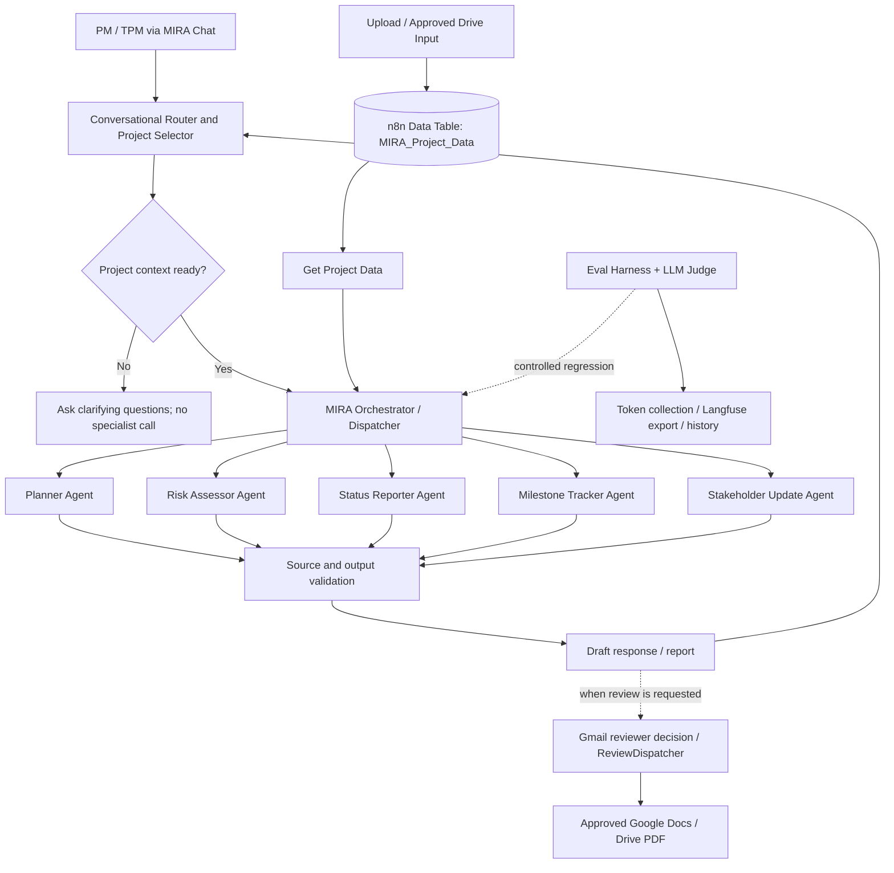

# Product Requirements Document (PRD)

# MIRA — AI-Powered Project Intelligence Assistant

**Version 1.4 — As-Built Capstone Baseline | November 20, 2026**

| Document control | Value |
|---|---|
| **Audience** | Executive sponsors, Product Owner, PM/TPM evaluators, engineering, QA and architecture reviewers |
| **Status** | **Implemented and regression-tested capstone prototype; product-owner acceptance / production authorization not evidenced** |
| **Business context** | Nexora Pvt. Ltd. · ABCDE Ltd. six-month AI Adoption Project (instructional / approved sample data) |
| **Implementation** | **Low-code n8n-only workflow orchestration**, OpenAI, n8n Data Tables, Langfuse, Google Workspace |
| **Agent pattern** | Conversational Router / Project Selector → Orchestrator → **five** specialist agents |
| **Requirements preserved** | PRD v1.1 / v1.3 **FR-001–FR-018** and original **T1–T12** baseline scenarios |
| **Architecture** | [Architecture.md](Architecture.md) **v2.3**; seven Mermaid diagrams |
| **Technical design** | [Technical_Design_Document.md](Technical_Design_Document.md) **v2.3** |
| **Program Charter** | [Project_Charter.md](Project_Charter.md) **v1.3** |
| **Architecture decision** | ADR-014: n8n-only orchestration selected for capstone, formal architecture approval pending |
| **Evaluation evidence** | Evaluation Harness run **#5814, November 18, 2026**; **12/12 `overall_eval_pass=true`** |
| **Production expansion** | **NOT approved:** PRD v2.0 / CR-PROD-001 / FR-019–FR-026; production controls P01–P15 |
| **Historical baseline** | Original PRD v1.3 dated October 25, 2026; preserve in repository history/archive |

> **Document decision boundary:** This revision changes the **implementation and evidence status**, not the business problem or the original capstone acceptance prompts. A 12/12 automated regression result does **not** demonstrate independent verification of all original-source facts, robust population-level quality, commercial cost completeness, enterprise data isolation or production readiness. The user-facing chat history and the automated evaluation harness are separate evidence paths.

---

## 1. Executive Summary

MIRA is a **project intelligence decision-support prototype** for Nexora PMs and TPMs working on the ABCDE Ltd. AI Adoption Project. It transforms approved project descriptions, relative timelines, risk registers and task-board records into **source-referenced plans, risk assessments, status reports, milestone intelligence and stakeholder drafts**. It is intended to reduce manual preparation effort without delegating delivery commitments or stakeholder accountability to an AI system.

### 1.1 Executive problem statement and value proposition

The supplied capstone describes **3–4 hours to prepare project plans** and **1–2 hours for weekly reporting**, alongside inconsistent risk identification and late awareness of blockers. MIRA addresses these workflow problems with reusable agents, structured evidence, early clarification for ambiguous questions and a human review process. **Labor savings are prospective** until actual PM/TPM time studies establish benefit.

**ABCDE program objectives are separate:** a **15% reduction in delivery delays** and **10% lower operating costs** are goals of ABCDE's underlying AI-adoption program, **not measured impacts of MIRA**. ABCDE's four focus areas are demand forecasting, route optimization, inventory management and customer support.

### 1.2 Delivered solution and current evidence

| Capability / measure | As-built status | Evidence / interpretation |
|---|---|---|
| Workflow implementation | **15 exported n8n workflow definitions** | File inventory and execution traces; exports alone do not prove every branch is exercised |
| AI specialists | **5**: Planner, Risk Assessor, Status Reporter, Milestone Tracker, Stakeholder Update | Separately exported n8n workflows invoked by Orchestrator |
| Request experience | Chat interface, conversational routing, Project Selector and snapshot gating | T2/T4/T6/T9 avoid specialist calls on insufficient context; chat-routing model usage may still exist |
| Data foundation | Upload/import, validation, document catalog, n8n Data Table persistence and retrieval | Versioned ABCDE test snapshot, not a verified live business connector |
| Quality evaluation | **12/12 overall passes**, regression run **#5814** dated November 18, 2026 | LLM-as-Judge plus programmatic evaluation; does not replace independent source audit |
| Generation-token visibility | **97,724** total recorded for 8 generation scenarios | Four clarification scenarios have no specialist-generation usage collected |
| Model-cost estimate | **~$0.03974** summed recorded estimated cost for run #5814 | Partial model estimate; T10 has 15,859 tokens but $0.00 cost recorded; excludes other operating costs |
| Plan reference cost | T1: **13,479 recorded tokens; ~$0.00731 estimated** | One sample, not a general billing guarantee |
| Human-governed output | Reviewer response, review records, Google Docs / Drive and PDF export path | Approved risk/status PDF examples exist; enterprise identity-bound approval not certified |

**Measured versus proposed:** Detailed agent outputs exist and the automated regression passed. Long-term business benefits, system availability, actual user-adoption rates, enterprise access control, full tracing ingest verification and production SLOs remain **unmeasured, incomplete or separately gated**.

### 1.3 Product differentiation and architecture decision

MIRA uses **n8n as its sole workflow orchestration platform** instead of the earlier Langflow / Make alternative. Its runtime uses **JavaScript Code nodes as well as native n8n nodes**; therefore this is **low-code**, not strictly zero-code. Its conversational entry point obtains context, the Orchestrator retrieves the authorized-in-context snapshot, and only relevant specialist subworkflows are invoked. A separate evaluation harness supplies repeatable QA evidence.

### 1.4 Authorization and release request

**Capstone decision requested:** review MIRA's original FR-001–FR-018 and T1–T12 evidence, accept documented deviations/limitations, and authorize submission of sanitized code/workflow artifacts. **Not requested:** using real confidential client data, customer-facing autonomous publication, enterprise rollout, production service commitments or FR-019–FR-026. Those require a separately approved production PRD, security/privacy assessments, funding and release gates.

**Review path:** executive readers can start here and at §§3, 5, 12, 14 and 19; implementation reviewers should examine §§7–9 and 17; production planning and security are bounded in §§10, 13, 15–16 and 20–22.

## 2. Business Problem and Opportunity

### 2.1 Current state and pain points

| ID | Business problem | Current impact / baseline | Expected product response |
|---|---|---|---|
| **BP-01** | Manual project plan creation | **3–4 hours per plan**, as supplied in the assignment | Grounded plan with phases, deliverables and milestones |
| **BP-02** | Inconsistent risk assessments | Varying categorization, priorities and mitigations | Source-backed, standardized risk matrix and documented proposals |
| **BP-03** | Manual weekly reporting | **1–2 hours per reporting cycle**, as supplied in the assignment | Validated task summaries plus a draft status narrative |
| **BP-04** | Late blocker/milestone visibility | Reactive tracking and late awareness of delays | **On-demand** blocked/due-date detection in MVP; proactive monitoring only after change approval |
| **BP-05** | Inconsistent governance artifacts | Nonstandard plans, registers and stakeholder updates | Standard structured outputs, evidence and review status |
| **BP-06** | Limited PM/TPM capacity | Less time for cross-team risk resolution and stakeholders | Reusable workflows; time savings to be measured in a pilot |

The time estimates above are **assignment-reported baselines**; a pre/post PM time study is still required to verify realized impact.

### 2.2 Business opportunity

Provide a governed decision-support assistant that handles repetitive preparation while preserving the PM/TPM's judgment over commitments, communications and escalations. The product's value is **evidence-based project intelligence**, not merely fast generative text.

### 2.3 Business-value hypotheses and verification

| Hypothesis | Proposed measure | Source / evidence |
|---|---|---|
| Planning can be faster | Human preparation + review minutes per accepted plan | Before/after time study; T1 quality gate |
| Status preparation can be faster | Human preparation + review minutes per accepted weekly report | Before/after time study; T5/T10/T12 |
| Reports can be factually reliable | Record reconciliation and unsupported-fact count | Deterministic assertions against pinned snapshots |
| Issues can be surfaced earlier | Blocker/due-date identification, later alert detection-to-notification | T8/T11, then CR-001 pilot logs |
| Governance can be more consistent | Template field completeness and PM approval outcomes | Structured checks and reviewer feedback |

These are hypotheses/targets. No measured improvement is claimed at PRD approval.

## 3. Product Vision, Objectives and Success Measures

### 3.1 Product vision

Build an accessible, **low-code-first, modular AI project intelligence assistant** that turns authorized project records into accurate and explainable management artifacts and actionable issue visibility, while retaining human oversight and source traceability.

### 3.2 Objectives

| ID | Product objective | Acceptance direction |
|---|---|---|
| **OBJ-01** | Generate plans from approved description and timeline | Grounded milestones/phases; clarify missing scope |
| **OBJ-02** | Standardize risk assessment and mitigation | Registered risk IDs and transparent ranking logic |
| **OBJ-03** | Reduce reporting preparation effort | Accurate sprint and full-board counts; measured review time |
| **OBJ-04** | Identify blocked tasks and potentially threatened milestones | Deterministic status/date rules; no unsupported dependencies |
| **OBJ-05** | Prevent unsupported project facts | Source-linked assertions and negative-data behavior |
| **OBJ-06** | Make outputs explainable and testable | Reproducible requests, source snapshots and execution evidence |
| **OBJ-07** | Provide usable PM/TPM interaction | Capstone form/test interface; production portal only if approved |

### 3.3 Quality outcomes, measured evidence and future targets

| Metric | Recorded capstone evidence | Acceptance interpretation / next action |
|---|---|---|
| Baseline test coverage | **T1–T12**, 12/12 `overall_eval_pass=true` in #5814 | Test-harness scenario acceptance achieved for this dated run; retain test-by-test assertions |
| Unsupported factual claims | Latest harness reports **0 detected** in its scenarios | Original source documents were **not independently revalidated** by the judge; human/source assertion checks still needed |
| Task reconciliation | T5/T10 recorded reconciliation/scope checks in evaluation outputs | Compare against the pinned CSV; do not generalize the 25-row fixture to every project |
| Routing and safe clarification | T2/T4/T6/T9 asked for clarification without specialist execution | Chat wording in some cases does not yet ask all rubric-specified scope/timeline/team fields |
| Source references | Many generated cases reported high citation coverage; T12 had **50%** in #5814 | Strengthen row-level evidence and review citation metric definition |
| Latency | Per-test latency is logged; T1 ~31.3s and T11 ~31.1s | Original p95 <30s is **not established**; use more repetitions, workload definitions and measured p50/p95 |
| Tokens / unit cost | 97,724 recorded generation tokens; ~$0.03974 summed recorded estimates | Fix T10 $0.00 pricing anomaly; capture chat-router, judge, retries, hosting and platform costs |
| Human review | Gmail-mediated approval path and approved report artifacts | Formal reviewer identity and authorization policy remains future production control |
| Real PM time saved | **Not measured** | Proposed pilot: measure preparation + review time per accepted plan and report |

**Proposed pilot targets, not achieved results:** 100% task reconciliation on verified snapshots, zero unsupported factual claims under independent inspection, satisfactory user ratings and a measured reduction in PM effort. Set operational thresholds only after baseline workload and business-owner review.

## 4. Users, Stakeholders and Decision Rights

### 4.1 Primary personas

| Persona | Primary work | Mira need |
|---|---|---|
| Project Manager | Plan and report on delivery | Fast accurate plan, sprint report, stakeholder draft |
| Technical Program Manager | Manage dependencies and delivery risks | Cross-workstream blockers, evidence-based milestone watch |
| Delivery Manager | Standardize delivery governance | Consistent status and risk artifacts, evidence and review |
| Executive stakeholder | Review delivery outcomes | Concise, approved updates with defensible claims |

### 4.2 Stakeholder and governance assignments

| Role | Decision responsibility |
|---|---|
| Nexora CTO / architecture delegate | Approve ADR-014, design exceptions and technical release gates |
| AI PM/TPM / Product Owner | Own scope, backlog, prioritization, acceptance and report governance |
| n8n workflow implementer | Configure/maintain flows, schemas, mappings and credential integrations |
| QA / evaluation owner | Verify T1–T12, negative cases, telemetry and release evidence |
| ABCDE business/data owner | Approve dataset meaning, risk priority rules and source revisions |
| PM/TPM reviewer | Approve/revise stakeholder-facing drafts before use |
| Security/privacy/operations owners | Authorize production data, identity, audit, notification and resilience controls (Phase B) |
| Executive sponsor | Approve production change request, pilot funding and rollout |

Roles may be combined for a capstone demonstration; a future production approval process must enforce any required separation of duties.

## 5. Scope, Phasing and Boundaries

### 5.1 Phase A — implemented capstone prototype (FR-001–FR-018)

**Included and available as exported implementation:**

1. **Conversational chat intake** (`Mira_10_Chat_Interface`), including conversational model, memory, project lookup and clarification.
2. **Project Selector and snapshot context:** `Mira_Project Selector` discovers ready snapshots; `MIRA_Get_Project_Data` retrieves selected n8n Data Table records; project selection is not enterprise business authorization.
3. **Data Upload:** `MIRA_Data_Upload` supports approved sample/manual/Google Drive file ingestion, extraction, source mapping, quality checks and storing document/task records in `MIRA_Project_Data`.
4. **Orchestration:** `Mira_00_Orchestrator` dispatches to five specialist subworkflows, supports clarification, data context and output validation, and stores draft results.
5. **Five specialist agents:** Planner, Risk Assessor, Status Reporter, Milestone Tracker and Stakeholder Update for grounded reports based on the ABCDE sample project.
6. **Historical data and exact records:** T001–T025, R01–R10, project timeline Weeks 1–24, source references and applicable sprint filters. Dynamic project count and file presence depend on uploaded snapshots.
7. **Extended capability:** on-demand milestone/blocker analysis; no implied always-on alerting.
8. **Automated quality and observability:** Evaluation Harness, LLM-as-Judge, evaluation/Chat Output history, TokenUsageCollector and Langfuse trace exporter.
9. **Human-review route:** Gmail-mediated approval or rejection, review Data Table records and approved-document preparation/export using Google Docs/Drive.
10. **Submission deliverables:** sanitized actual n8n JSON exports, GitHub documentation, T1–T12 evidence, snapshots, screenshot/trace evidence, Q1–Q4 materials and installation notes.

**Implementation qualification:** Exported n8n nodes include JavaScript `Code` nodes, some conditionally used branches and disabled connector paths. No blanket claim of "no code", complete test coverage of every workflow branch, immutable source quarantine or production authorization is made.

### 5.2 Phase A — explicitly excluded or unproven

- Enterprise SSO/MFA, authenticated tenant/project RBAC and an authorized external-user portal.
- Guaranteed live Jira/Trello/SharePoint/Confluence ingest: connector nodes exist in the upload export but are **disabled**, not verified as working source integrations.
- Production-grade malware handling, guaranteed rejection/quarantine of every invalid upload, secure immutable approval or a verified anti-replay publication gate.
- Unattended external stakeholder publication; capstone messages and approved exports remain reviewer-governed.
- Continuous monitoring with durable alert deduplication, owner acknowledgement, SLA-based escalation or event-sourced production audits.
- Real customer-data processing without privacy authorization, tested availability/recovery SLOs, measured labor productivity improvement or cost-complete billing.

### 5.3 Phase B — proposed production capabilities only

Separate PRD v2.0 / CR-PROD-001 / FR-019–FR-026 covers an authenticated multi-project portal, verified user/project roles, read-only source synchronization, encrypted/versioned evidence stores, authorized durable approvals, schedule/event alert processing, alert outbox, deduplication, owner notification/acknowledgement, escalation, SRE/incident controls, retention and a limited **10-PM/TPM pilot**. Product, sponsor, architecture, legal/privacy, security and operations approvals remain prerequisites.

### 5.4 Scope-protection rule

The capstone demonstrates **selected paths** from chat to approved-data analysis, automated evaluation and reviewable output. A target-state architecture box or exported disabled node does not automatically become an approved or tested MVP requirement. Keep **G8–G10** and production tests **P01–P15** separate from Phase A acceptance, as required by the [TDD](Technical_Design_Document.md) and [Charter](Project_Charter.md).

## 6. User Journeys and Use Cases

### UC-01 — Grounded project plan (T1, T2, T9)

A PM asks for a plan. The chat interface evaluates intent, obtains or confirms a ready project snapshot, and passes an eligible request to the Orchestrator and **Planner Agent**. The plan includes actual project objectives, phases, relative schedule and available milestone names, with missing dates and dependencies disclosed. For insufficient unrelated prompts, the chat path asks for clarification **without specialist invocation**. **Do not turn the 24 relative project weeks into fabricated calendar dates.**

### UC-02 — Registered risk assessment (T3, T4, T7)

A TPM asks for risks or the top three risks. The **Risk Assessor Agent** consumes approved R01–R10, returns documented impact/mitigation and explicitly distinguishes a **proposed qualitative top-three selection** from authoritative ranking. The original CSV contains no numeric likelihood/severity/rank/owner fields. Vague project risk requests trigger clarification rather than an invented risk register.

### UC-03 — Sprint and project status (T5, T6, T10)

A PM requests Sprint 3 or full-board status. The **Status Reporter Agent** uses the appropriate task scope, exact source rows and validated task-count reconciliation to produce a status report and proposed actions. Sprint 3 has **4 records (2 In Progress, 2 To Do)**; the full 25-row board has **5 Done, 3 In Progress, 1 Blocked, 16 To Do**. An unactionable statement such as "Things are going fine" with no authorized board produces clarification instead of fictional metrics.

### UC-04 — Milestone and blocker analysis (T8, T11)

The **Milestone Tracker Agent** identifies source-recorded blockers such as **T024 — Security review of AI infrastructure, Blocked, due 2026-05-26**, and uses an explicit reference date for due-date reasoning. `project_timeline.csv` contains **relative Weeks 1–24**; when no approved project-start calendar anchor is supplied, calendar-based upcoming-milestone predictions must be withheld or clarified. A blocked task does not by itself prove the downstream delivery date will slip.

### UC-05 — Stakeholder communications and human review (T12)

A PM requests a Sprint 2 stakeholder update. The **Stakeholder Update Agent** prepares a scoped draft using only Sprint 2 tasks **T004/T005 Done and T006 In Progress**. The independent `Mira_12_ReviewDispatcher` can solicit reviewer input through Gmail, record a decision and prepare an approved PDF via Google Docs/Drive. Sending a review invitation is **not** the same as sending an unapproved stakeholder report; formal external publication remains gated by reviewed decision. Approval identity/security controls require production hardening.

### UC-06 — Quality and economics review (cross-cutting)

An evaluator runs T1–T12 through `Mira_99_Evaluation_Harness`. The harness records outputs, grading, trace IDs, latency, token collection and estimated cost, and uses `Mira_07_Evaluator — LLM-as-Judge`. Langfuse telemetry supports additional analysis; submitted trace data must not be described as independently confirmed ingested until verified.

### UC-07 — Upload, project discovery and context eligibility

A user uploads or imports permitted project files. MIRA extracts recognized formats, records document metadata and task-board rows in `MIRA_Project_Data`, and exposes ready snapshots to the chat. File presence and project eligibility are readiness checks. **They are not substitutes for end-user RBAC, privacy classification or source authenticity verification.**

## 7. Functional Requirements and Acceptance Criteria

### 7.1 Preserved requirements register (FR-001–FR-018)

The original requirement IDs and business intent are retained. "Implemented" below means a corresponding exported workflow/path exists; it does **not** prove every branch was independently acceptance-tested or signed off.

| ID | Original requirement retained | Priority | As-built workflow/path | Acceptance evidence and limitation |
|---|---|---|---|---|
| **FR-001** | Ingest and validate approved project data | P0 | `MIRA_Data_Upload`, `MIRA_Get_Project_Data` | Sample snapshot records; disabled optional connectors excluded |
| **FR-002** | Classify intent and route requests | P0 | Chat Interface, Project Selector, Orchestrator | Clarification T2/T4/T6/T9; model-assisted chat route, not purely deterministic |
| **FR-003** | Create grounded project plans | P0 | Planner Agent | T1 and Chat Output History |
| **FR-004** | Clarify insufficient planning input | P0 | Chat / Orchestrator sufficiency gate | T2/T9; align direct chat prompts more closely to rubric |
| **FR-005** | Source-backed risk assessment | P0 | Risk Assessor Agent | T3; source-document independent verification remains limited |
| **FR-006** | Transparent top-risk selection | P0 | Risk Assessor + qualification/selection logic | T7; qualitative prioritization only, no numeric source rank |
| **FR-007** | Sprint and project status reporting | P0 | Status Reporter Agent | T5/T6; exact sprint membership |
| **FR-008** | Correct task counts and reconciliation | P0 | Validation / source aggregation / Status Reporter | T10; full board 25 = 5/3/1/16; no LLM authority over totals |
| **FR-009** | Identify blocked/at-risk tasks | P0 | Milestone Tracker / Status route | T8; T024 identified; due-date context requires as-of date |
| **FR-010** | Identify upcoming milestones | P0 | Milestone Tracker Agent | T11; relative weeks need approved calendar anchor |
| **FR-011** | Period-scoped stakeholder draft | P0 | Stakeholder Update Agent; Status draft paths | T12; review before distribution |
| **FR-012** | Verify project facts against supplied sources | P0 | Orchestrator validation, Evaluation Harness, Judge | Harness checks; full independent grounding audit pending |
| **FR-013** | Safe errors / missing-data handling | P0 | Chat clarification, orchestrator and validators | No-data branch demonstrated; invalid-file test depth varies |
| **FR-014** | Evaluation and model observability | P0 | n8n history, Langfuse Trace Exporter, TokenUsageCollector | Tracing/export exists; confirm external ingestion and model-cost coverage |
| **FR-015** | Run/document twelve baseline tests | P0 | Evaluation Harness + LLM-as-Judge | #5814, 12/12 overall pass |
| **FR-016** | Structured human/JSON outputs | P0 | Model parsers, Code nodes, Chat output formatter | Structured output examples; source proof separate from schema validity |
| **FR-017** | Review before stakeholder distribution | P1 | `Mira_12_ReviewDispatcher` | Reviewer path and approved PDF examples; not enterprise-certified |
| **FR-018** | Optional live task integrations | P2 | Jira/Trello/other connector stubs in Data Upload | **Disabled / not validated**; production-only acceptance |

**Change classification:** A separate Stakeholder Update specialist, conversational routing, snapshot discovery, low-code normalization, Langfuse and approval workflow are **implementation refinements** of FR-001–FR-018, not an automatic change to the original capstone test prompts or authorization to deploy production features.

### 7.2 Detailed functional acceptance criteria

**FR-001 — Ingestion and validation**
- Read approved assignment files with correct encoding and delimiter handling; confirm actual headers/types before configuring mappings.
- Reject blank IDs, required-field omissions, duplicate task IDs, malformed dates and unrecognized statuses; preserve source filename, row ID, timestamp/snapshot reference.
- Failure produces `VALIDATION_ERROR` with actionable missing/invalid fields—not a partial report represented as complete.

**FR-002 — Routing**
- Planning → Planner; risk → Risk Assessor; status → Status Reporter; blockers/milestones → Tracker; stakeholder drafting → Stakeholder Update. Chat first handles project discovery and clarification.
- The implemented chat entry point includes a conversational LLM and project discovery; the Orchestrator also supports provided capabilities and intent normalization. Deterministic paths can avoid specialist invocations, but not necessarily all chat-router model usage.
- Unsupported or ambiguous requests return clarification or a documented bounded multi-specialist route; avoid firing all agents by default.

**FR-003/004 — Planning**
- A detailed request produces a structured plan with actual source phases/milestones and no invented objectives or dates.
- Vague “build a chatbot” and “two-week project” requests without sufficient details ask for scope/goals/deliverables/timeline/team; no ABCDE context silently inserted (**T2/T9**).

**FR-005/006 — Risks**
- Risk outputs use actual ABCDE risk register entries where requested; retain IDs/categories and documented impact/mitigation.
- Top-three ranking uses documented priority; if no authoritative ranking is supplied, apply an approved transparent derived policy or ask for ranking criteria. Never fabricate a numeric risk score.
- Generic new-project risk requests without context request necessary details (**T4**). Suggested new risks are labeled **PROPOSED**, not registered.

**FR-007/008 — Reporting and arithmetic**
- Preserve actual task names, statuses, IDs and sprint memberships; filter requested period **before** aggregation and generation.
- Count all valid records, reject unmatched status categories, verify no duplicated/missing IDs and `sum(status_counts) = valid_task_total`.
- T10 expected snapshot: **25** tasks, **5 Done / 3 In Progress / 1 Blocked / 16 To Do** (source-backed fixture; evaluation history records reconciliation, with independent source review still required for final signoff).
- Percentages, if displayed, use explicitly defined numerator/denominator; absent board → no counts or claims of progress (**T6**).

**FR-009/010 — Milestone and due-date intelligence**
- Identify `BLOCKED` from documented status; `OVERDUE` only when incomplete and due before a fixed, valid `as_of_date` in a declared project timezone.
- `UPCOMING` for T11 means actual approved milestones within inclusive **[as_of_date, as_of_date + 14 calendar days]** unless the request specifies otherwise.
- `AT_RISK` requires documented dependency/schedule evidence; due-soon without impact evidence is a **watch item**, not a proven delay.
- T024 must be identified by reading the source, not by hardcoding its ID; unknown dependency/ownership/date must remain unknown.

**FR-011 — Stakeholder update**
- Professional draft scoped to the explicit sprint/report period; T12 Sprint 2 draft excludes Sprint 3 and later work and is routed through the Stakeholder Update specialist when requested.
- Distinguish known progress from recommendations/risks; external distribution remains blocked until authorized review.

**FR-012/013 — Grounding, missing data and conflicts**
- Source-ground every project goal, actual task/risk ID, milestone and status; invalid IDs/counts must fail review.
- Empty or conflicting datasets produce an explicit warning/status; do not silently merge contradictory snapshots or infer missing owners/dependencies.
- Data-free scenarios T2, T4, T6 and T9 **must not** retrieve or inject the unrelated ABCDE fixtures (`allow_project_context=false`).

**FR-014/015 — Evidence and evaluation**
- Each test has input, pinned snapshot/date, workflow/model/prompt version, expected/actual, evidence link, reviewer, disposition and any defect.
- Record available n8n execution IDs, timings, error class and actual model tokens/usage where returned; clearly label estimates/unavailable metadata.
- Preserve rejected cases as failures; a plausible response is not a passing test without source assertions.

**FR-016 — Output schema**
- Human-readable Markdown and structured JSON where requested; required response fields validated separately from prose quality.
- Response includes result status, provenance, unresolved information, warnings and review state; `SUCCESS` cannot bypass fact checks.

**FR-017/018 — Review and optional integration**
- No report may be distributed to stakeholder recipients **before** reviewer approval; the implemented ReviewDispatcher includes reviewer-mediated approved-document handling, but enterprise reviewer authorization is not certified.
- Jira/Trello access, if implemented later, is **read-only by default**, least-privileged and mapped through the same input validation; no connector bypass of project authorization.

### 7.3 Cross-cutting requirements and business rules

- User-selected or imported project identifiers are *claims* until a trusted access layer authorizes them (Phase B); the documented capstone evaluation uses the **ABCDE baseline**, while the as-built selector can discover stored project snapshots without production-grade authorization.
- Source text, issue comments and imported data are **untrusted content**, not executable system instructions or permission grants.
- Generated plans, risks and reports are **DRAFT** recommendations; source documents remain the systems of record.
- n8n workflow-builder roles are not equivalent to business-user per-project data authorization.

### 7.3A Source-derived acceptance controls (2026-10-25 input rebaseline)

These controls *clarify* FR-001–FR-018 rather than create new capstone scope:

- **FR-001/FR-013:** Validate the exact task, risk and timeline headers above; preserve source values and identifiers. Reject bad status spelling, duplicate task IDs, invalid `due_date`, missing required fields, and incomplete records. The **25-record assertion applies to this capstone fixture**, not any future project.
- **FR-007/FR-008:** Compute full-board counts with deterministic n8n nodes: `5 Done / 3 In Progress / 1 Blocked / 16 To Do = 25`; sprint filters must run before narrative generation.
- **FR-005/FR-006:** Risk ranking is not directly available in `project_risks.csv`. T7 must report source risk IDs and transparently state its selection or proposed risk-order method; no fabricated scoring.
- **FR-009/FR-010:** Report T024 as blocked using the complete task name, and treat overdue task dates and relative-week milestone windows as **different calculations**. A milestone-delay claim requires documented dependencies; when calendar context is missing, respond with a clarification request rather than inventing dates.
- **FR-011:** A Sprint 2 stakeholder *draft* may mention only T004–T006 as observed sprint activities; delivery remains blocked until reviewer approval.
- **FR-012/FR-014/FR-015:** Record `source_snapshot_id` or source checksum, `as_of_date` (when relevant), data freshness, test ID, workflow revision and decision outcome in the test evidence ledger.

### 7.4 Proposed production extensions — **not part of approved FR-001–FR-018 baseline**

The following are **proposed feature IDs only**, consistent with TDD v2.3, Architecture v2.3 and Charter v1.3; detailed acceptance policies require PRD v2.0/CR-001 approval.

| Proposed ID | Phase B capability | Prerequisite / release control |
|---|---|---|
| FR-019 | Scheduled/event-driven project health checks | Approved freshness cadence and source permissions |
| FR-020 | Controlled refresh of authorized Jira/Trello/source snapshots | RBAC and project-scoped immutable/versioned source record |
| FR-021 | Deterministic alert classification, owner/action context | Approved threshold/rulebook and no fabricated dependencies |
| FR-022 | Persistent deduplicated alert registry | Durable idempotency and safe replay |
| FR-023 | Internal owner notifications with verified delivery | Channel policy, consent/recipient restrictions, audit |
| FR-024 | Alert acknowledgement and action/mitigation tracking | Persistent state, owner identity |
| FR-025 | Timed escalation and resolution checks | Approved escalation matrix, clocks and exception handling |
| FR-026 | Monitoring SLOs, auditability and operating controls | Approved SLAs, operational readiness, P01–P15 |

*This table summarizes the proposed lifecycle; exact FR-019–FR-026 wording and thresholds must be reconciled and formally approved in the separate PRD v2.0 change baseline before development or contractual commitment.*

## 8. Low-Code n8n Solution Architecture — As-Built

### 8.1 Executive-level execution flow



**Interpretation:** This is a logical diagram, not a guarantee that every chat interaction traverses every arrow. See the **seven more detailed diagrams** in [Architecture.md](Architecture.md) v2.3. The production P1/P2 diagrams are separately marked proposed.

### 8.2 Routing and data-authority rules

- Chat uses a conversational OpenAI agent, memory and the `Find Mira Projects` tool. It may ask for a project, snapshot or missing business context **before** any specialist execution.
- `Mira_Project Selector` discovers snapshots; `MIRA_Get_Project_Data` returns stored project documents to the Orchestrator. A "ready" snapshot is a data-availability signal, **not a production user-permission grant**.
- `Mira_00_Orchestrator` supports provided capabilities or classified intent, projects/sprints, source aggregation, validation, model usage and the correct specialist dispatch. It uses `Execute Sub-workflow` invocations.
- **T2/T4/T6/T9** return clarification without specialist calls in the tested path. **They may still incur conversational-router model tokens**, which are not necessarily captured by specialist-generation accounting.
- Distinguish **deterministic** source facts (IDs, counts, statuses, filters) from **model-generated** explanations/recommendations and from decisions requiring human authority.

### 8.3 Actual 15-workflow inventory

The names below are taken from the supplied exported JSON files; GitHub workflow exports should use these actual names or a clearly documented mapping.

| Layer | Actual exported workflow | Responsibility |
|---|---|---|
| Conversational intake | `Mira_10_Chat_Interface` | Chat trigger, agent, memory, project discovery, orchestrator call, output and review request |
| Project discovery | `Mira_Project Selector` | Find available project/snapshot records from Data Table |
| Orchestration | `Mira_00_Orchestrator` | Intent/eligibility, evidence retrieval, specialist dispatch, validation, report persistence |
| Project retrieval | `MIRA_Get_Project_Data` | Return selected project files/rows from stored snapshot |
| Ingestion | `MIRA_Data_Upload` | Upload/Drive/sample test, extract/normalize/validate and persist project rows |
| Specialist 1 | `Mira_01_Planner_Agent` | Plans and milestones |
| Specialist 2 | `Mira_02_Risk_Assessor_Agent` | Registered risks and qualitative prioritization |
| Specialist 3 | `Mira_03_Status_Reporter_Agent` | Scoped task/project reporting |
| Specialist 4 | `Mira_04_Milestone_Tracker_Agent` | Blockers, due-date and milestone analysis |
| Specialist 5 | `Mira_Stakeholder_Update_Agent` | Audience-appropriate scoped stakeholder drafts |
| Quality runner | `Mira_99_Evaluation_Harness` | Baseline replay, programmatic checks, judge calls and history |
| AI evaluator | `Mira_07_Evaluator — LLM-as-Judge` | Grounding/completeness and evaluation verdicts |
| Trace instrumentation | `Mira_08_Langfuse_Trace_Exporter` | Export OpenTelemetry / trace-style observations |
| Usage instrumentation | `Mira_10_TokenUsageCollector` | Discover model-generation usage and export token telemetry |
| Review and publication | `Mira_12_ReviewDispatcher` | Gmail review, decision tracking, approved document/PDF handling |

**As-built control note:** `MIRA_Data_Upload` includes **disabled** SharePoint, Jira, Trello and Confluence source nodes; they are excluded from validated live integration claims. Its invalid-data path can create a flagged record, so do not claim every invalid upload is discarded/quarantined. Use the TDD for exact node details and error handling.

### 8.4 Implementation technology and rationale

| Concern | Selected component | Evidence and limit |
|---|---|---|
| Orchestration | **n8n single platform** | Fifteen exports; no Langflow/Make runtime required |
| Models | OpenAI models in chat / specialist / judge workflows | Capture deployed model ID/prompt version at run time |
| Transformation | n8n native nodes **and JavaScript Code nodes** | **Low-code-first**, not zero-code; code review and regression required |
| Structured context | n8n Data Tables and snapshot metadata | Synthetic/approved project context, not production tenant isolation |
| Data ingestion | Form, manually triggered Google Drive import, file extractors | Verify format-specific branches before claiming universal support |
| Review | Gmail, Google Docs / Drive and review Data Table | Approval path demonstrated; identities/privileges not enterprise-authenticated |
| Evaluation | Evaluation Harness, Judge and Google Sheets history | Latest referenced run #5814; independent source validation limited |
| Tracing | Langfuse Trace Exporter, TokenUsageCollector | Do not conflate export/submission with verified external ingestion |
| Versioning | GitHub-reviewed JSON, Markdown and sanitized fixtures | Export is not automatic deployment or production rollback |

### 8.5 Code, security and observability boundaries

This implementation uses **n8n Code nodes** for parsing, routing/normalizing, validation and reporting. Business data and source text remain untrusted; they cannot authorize tool use or stakeholder publication. Missing, stale or conflicting evidence produces a qualified result, and no project selection performed by the chat should be treated as tenant-scoped identity authorization.

### 8.6 Grounding and response contracts

**Logical request:** `request_id`, `request_text`, `capabilities` / `intent`, `project_name`, `snapshot_id`, `sprint`, `as_of_date`, `output_mode`, `allow_project_context` or equivalent eligibility flag. Fields can be generated across workflows; exported node schema is the source of truth, not a claim of one universal JSON envelope.

**Logical response:** `status`, `agent`, `snapshot_id`, generated report and source refs, validation status, data gaps/warnings, `trace_id`/execution linkage and optional review state. Negative inputs may return `needs_clarification`, `context_authorized=false`, `report=null`; no fabricated success report.

### 8.7 ADR-014 — Why n8n-only rather than Langflow or hybrid?

MIRA's source ingestion, deterministic task processing, routing, review handoffs and evaluation can be orchestrated within n8n. A hybrid n8n+Langflow architecture would introduce another credential boundary, deployment runtime and trace correlation burden. This is a **delivery-complexity trade-off**, not a claim that n8n intrinsically reduces OpenAI token pricing. Formal architecture/financial approval, security assessment and production licensing remain separate decisions.

## 9. Data and Grounding Requirements

### 9.0 Approved source-data inventory and contracts — CR-DATA-001

| Canonical input | Source facts / schema | Use and limitation |
|---|---|---|
| `project_description.txt` | ABCDE objectives and four AI focus areas | Plan/business context; targets are ABCDE's, not MIRA's measured ROI |
| `project_timeline.csv` | `phase,phase_name,start_week,end_week,key_activities,milestones_deliverables` | **8 phases, Weeks 1–24**; no project calendar anchor or task dependencies |
| `project_risks.csv` | `risk_id,category,risk_challenge,impact,mitigation_strategy` | **R01–R10**; no likelihood/severity/owner/numeric ranking |
| `sample_task_board.csv` | `task_id,task_name,status,assignee,priority,sprint,due_date,labels,description` | **25 tasks**; task dates and blockers reflect historical snapshot |
| `eval_mira_inputs.txt` | Original T1–T12 prompts | Stable evaluation fixture, not business source facts |

**Source reconciliation — CR-DATA-001:** The assignment prose describes 3 Done / 3 In Progress / 1 Blocked / 18 To Do, while inspected task-board rows and generated full-board outputs reflect **5 Done / 3 In Progress / 1 Blocked / 16 To Do** (25 total). Preserve both statements and document CSV-backed acceptance rather than editing the source assignment.

**Sprint fixtures:** Sprint 2 = T004/T005 Done and T006 In Progress; Sprint 3 = T007/T025 In Progress and T008/T009 To Do. T024 is "Security review of AI infrastructure", `Blocked`, Sprint 5, due `2026-05-26`. Risk rankings are qualitative and proposed when not specified in the source. Historical due dates are not live operational status.

**Supplemental references:** The alternate introduction TXT, timeline PDF and risks DOCX are human-readable references; they are not silent overrides to canonical TXT/CSV facts. The evaluation/observability workbook and chat output history contain test artifacts, not approved project schedule changes.

### 9.1 Actual ingestion and retrieval data route

`MIRA_Data_Upload` can receive approved upload/Google Drive/sample inputs, extract supported file types, normalize records, compute quality summaries and persist them to n8n Data Tables. `MIRA_Get_Project_Data` retrieves relevant records by snapshot/file identity, and `Mira_Project Selector` discovers available snapshots for chat. The file-processing workflow has disabled external connector branches and a validation-failure branch that can flag rather than entirely discard data. **Data readiness and storage are implemented; full production hygiene and all negative-file fixtures remain verification work.**

### 9.2 Data validation and grounding controls

- Check file availability, extension/MIME/size as applicable, encoding, required column names, type and date parseability.
- Reject duplicate/empty record IDs, unknown status categories, missing critical fields and source counts that cannot reconcile.
- Preserve project ID, source row references, snapshot version/import timestamp and fixed test `as_of_date`.
- Use **least context necessary** for the request. ABCDE's files must not contaminate unrelated data-free negative tests.
- Label source facts, user-supplied assumptions, derived metrics and **PROPOSED** AI recommendations separately.
- No model-generated task counts, registered risk IDs, milestone dates or stakeholder delivery claims.

### 9.3 Status terminology and calculations

Canonical task status mapping for the T10 baseline: **Done**, **In Progress**, **Blocked**, **To Do**. Normalization of capitalization/spaces may be configured only after inspecting actual records and approving source mappings. Unknown categories fail validation.

Completion percentage, when requested: `(validated Done count / validated total task count) × 100`. Disclose the denominator and rounding policy. For a sprint-specific report, both numerator and denominator apply **only** to that sprint.

### 9.4 Source freshness and project isolation

- Show that static uploads are snapshots **as of ingestion**, not live board state.
- Later sources require approved refresh cadence, connector permissions and source precedence.
- Distinguish n8n internal workflow projects from Mira business `project_id`. A dropdown alone never enforces data isolation.
- Production access must be authorized **before** source lookup or model processing; prompt instructions are not security controls.

## 10. Non-Functional Requirements

| ID | Requirement | Target / implementation evidence | State / caveat |
|---|---|---|---|
| **NFR-01** | Grounded facts | Harness reported zero hallucinations for latest tested cases | Independent original-source revalidation incomplete |
| **NFR-02** | Exact task reconciliation | 25-task fixture; T5/T10 reconciliation checks | Verify source-backed assertions and negative fixtures |
| **NFR-03** | Performance | Requested p95 <30 seconds | **Not established**; recorded T1/T11 exceed 30s |
| **NFR-04** | Secrets protection | n8n credentials, sanitized JSON before GitHub | Release scan and least privilege required |
| **NFR-05** | Traceability | Run/test IDs, source snapshot, trace linkage | Langfuse ingestion status requires verification |
| **NFR-06** | Failure handling | Missing-data clarification and validation statuses | Some format/connector failure branches unverified |
| **NFR-07** | Consistent outputs | Structured parsers, validators and formatted chat | Schema validity alone is not source correctness |
| **NFR-08** | Maintainability | Modular 15-workflow low-code architecture | Export/import dependency map and code review required |
| **NFR-09** | Review governance | Gmail-mediated approval and PDF examples | Enterprise identity-bound approval deferred |
| **NFR-10** | Data privacy | Approved/synthetic fixtures, bounded telemetry | External model/telemetry contracts require approval for real data |
| **NFR-11** | Model-cost visibility | Generation tokens, cost estimates, trace exporter | T10 cost anomaly; router/judge/retries and infrastructure not fully attributed |
| **NFR-12** | End-user project isolation | Production target: verified portal RBAC | Not implemented/certified by Project Selector |
| **NFR-13** | Proactive-alert reliability | Production target: rules, owner actions and recovery | CR-001, G8–G10, P01–P15 pending |

All quantitative service commitments remain proposed unless supported by reproducible measurements under an approved load/workload definition.

## 11. Exceptions, Failure Handling and Responsible Output

| Condition | Expected behavior | Result status / guardrail |
|---|---|---|
| Missing project description | Ask for objectives, scope and related inputs | `INSUFFICIENT_DATA` |
| Missing task board | State counts and progress cannot be assessed | `INSUFFICIENT_DATA` |
| Malformed CSV / duplicate task ID | Reject/identify specific bad records | `VALIDATION_ERROR` |
| Unrecognized sprint or status | Report no matching sprint or invalid status; do not infer | Insufficient or validation error |
| Invalid/unknown due date | Omit unsupported overdue/upcoming prediction | `VALIDATION_ERROR` or qualified result |
| No dependency mapping | State milestone impact cannot be established | Source gap / watch only |
| Conflicting snapshots | Hold reporting; request data owner decision | Validation warning; no auto-merge |
| OpenAI error, rate limit or timeout | Controlled service error, bounded safe retry | `SERVICE_ERROR`; no fabricated report |
| Evaluation telemetry unavailable | Mark evidence incomplete, collect available execution logs | Do not claim a trace exists |
| Source prompt injection | Treat imported text as data only, never authority | Block unauthorized actions |
| Unauthorized project/recipient | Deny retrieval/publication at trusted enforcement boundary | Production security prerequisite |
| Unknown user intent | Ask for clarification or return supported capability menu | `UNSUPPORTED_REQUEST` / insufficient |

## 12. Evaluation and Acceptance Strategy

### 12.1 Test approach and evidence separation

**Baseline:** Keep the original 12 prompt texts unchanged. The **automated Evaluation Harness** (run #5814, November 18, 2026) and **interactive MIRA Chat Output History** are different evidence paths, with potentially different run IDs and wording. A pass in the harness cannot be assumed to certify every chat UX response.

The harness calls the Orchestrator and LLM-as-Judge, performs deterministic/scope/grounding checks where configured, and persists input/output, scoring, latency, tokens and estimated cost. Report `judge_verdict`, `overall_eval_pass`, specialist `validation_pass`, `token_collection_status` and citation metrics separately. A clarification case can correctly pass overall while `validation_pass=false` because **no specialist report was required**.

### 12.2 Original baseline scenarios T1–T12 — preserved

| Test | Acceptance assertion | Primary realized path | Status evidence |
|---|---|---|---|
| T1 | ABCDE plan grounded in description and 8-phase relative schedule | Planner | #5814 overall pass; chat plan example |
| T2 | Vague chatbot plan → scope/timeline/team clarification | Chat / Orchestrator gating | #5814 pass, no specialist; chat needs more complete rubric questions |
| T3 | Registered AI/logistics risk categories with evidence | Risk Assessor | #5814 pass; numerical risk fields appropriately absent |
| T4 | Vague new-project risk question → request detail | Chat / Orchestrator gating | #5814 pass, no specialist; chat wording is generic |
| T5 | Sprint 3 exact task names/statuses | Status Reporter | #5814 pass; 4 tasks, 2 In Progress / 2 To Do |
| T6 | "Things are going fine" → no invented progress | Chat / Orchestrator gating | #5814 pass; chat asks which project |
| T7 | Three actual risks and transparent qualitative basis | Risk Assessor | #5814 pass; verify priority basis is explicitly proposed |
| T8 | Identify T024 blocked; dates interpreted as snapshot facts | Milestone Tracker / status route | #5814 pass; user-facing report can be more focused |
| T9 | Two-week plan with no scope → clarification | Chat / Orchestrator gating | #5814 pass, no specialist; request scope/goals/deliverables |
| T10 | Full task board 25 = 5 Done, 3 In Progress, 1 Blocked, 16 To Do | Status Reporter | #5814 pass; T10 cost field anomaly remains |
| T11 | Upcoming milestones require calendar anchor; no invented dates | Milestone Tracker | #5814 pass; milestone evidence warnings remain |
| T12 | Sprint 2-only stakeholder draft; no unauthorized publication | Stakeholder Update | #5814 pass; citation coverage recorded at 50% |

**Negative cases:** T2/T4/T6/T9 deliberately do **not** invoke a specialist tool/agent in the clarified path, so their specialist-generation usage is `not_collected_clarification`. A chat-model invocation may still consume tokens, so do not treat these as zero-total-cost tests. Direct chat prompts should ask the **specific missing fields** from the rubric, not just whether the user wants a generic template.

### 12.3 Recorded November 18, 2026 evaluation (run #5814)

| Indicator | Recorded result | Qualification |
|---|---|---|
| Overall evaluations | **12/12 pass** | `overall_eval_pass` from run #5814 |
| Judge verdict | **12 `pass`** | Automated judge/normalization version recorded as 4.3.1 |
| Recorded generation tokens | **97,724** | 8 detailed generation scenarios; 4 clarify before specialist execution |
| Summed recorded estimated model cost | **$0.03974425** | Incomplete: T10 tokens=15,859, estimate=$0.00 |
| T1 example plan | **13,479 tokens, $0.00730725** | Not a complete request-to-approval or platform-inclusive cost |
| Factual grounding | Automated reports marked factual verification in detailed cases | Warnings: original source documents **not independently verified** |
| Citation completeness | 100% reported in many cases; **T12=50%** | Check definition and improve row/claim traceability |
| Performance | T1 ~31.326s, T11 ~31.124s | p95 <30s target not verified; improve with repeat workload |

The history contains older failures/revisions; retain these to show iteration. Do not replace the tested run with a merely aspirational metric, and do not claim production reliability from a sample of twelve prompts.

### 12.4 Evaluation metrics and defect management

Maintain: source snapshot ID, frozen date/sprint, test ID, actual prompt, expected/actual output, routing path, specialist execution, structured validation, judge scores, source-level assertion results, citation coverage, latency, trace ID, model usage, price version, error class and issue owner. Suggested primary quality measures: (1) deterministic task reconciliation, (2) factual-support rate after independent row checks, (3) routed/clarification intent accuracy, (4) acceptance pass rate, (5) human correction and approval effort, (6) cost per **accepted** artifact, and (7) request latency p50/p95.

### 12.5 Economics and cost method

At known per-million-token rates, `attributable model cost = Σ(input_tokens × input_rate + output_tokens × output_rate) / 1,000,000`. Segment **specialist** use, **chat router**, **LLM judge/evaluator**, retries and any other model calls by trace. Add n8n hosting/plan, execution/storage, observability, document-provider and personnel expenses when modeling unit economics. A recorded $0 cost for a nonzero-token test should be marked **missing/unresolved estimate**, not free processing.

**Pilot projection:** if the observed T1 estimated model charge were representative, 100 comparable plans would account for ~$0.73 in the *recorded model component only*. This excludes all other expense categories, retries and variability; a defensible budget requires a statistically appropriate workload sample and current verified provider prices.

## 13. Security, Privacy and Governance

### 13.1 Implemented controls and outstanding checks

- Development and evaluation use approved/synthetic assignment data. Do not expose an uncontrolled public upload or real client secrets.
- n8n integrations use credential references; **sanitize exported JSON** for OAuth IDs, private webhooks, document IDs, tokens, emails, pinned data, hostnames and stored payloads before publishing.
- Source CSV/JSON/text is **untrusted data**, not an instruction or permission to invoke tools; prompts and source content cannot approve themselves.
- `Mira_Project Selector` gates source readiness but does **not** verify real user's company identity, tenant membership or permission to view project data.
- `Mira_12_ReviewDispatcher` demonstrates reviewer-mediated Gmail and approved PDF output. Real recipient authorization, tamper-resistant storage, reviewer separation of duties and replay protection are production requirements.
- The Langfuse exporter and evaluator transmit usage/project metadata to external services; real data use requires retention, minimization, region and provider authorization.
- Retain deterministic request IDs/source snapshot and human-read warnings. Label unsupported project claims, stale data and missing evidence rather than silently generating green status.

### 13.2 Phase B requirements (not capstone authorization)

An enterprise portal and access gateway require SSO/MFA, trusted identity and `project_id` authorization, encrypted data and secure connector scopes, malware/format protection on ingestion, retained approval/audit records, privacy review, retention/redaction, rollback, backup/recovery and separation of duties. The proposed production verification matrix **P01–P15** in TDD v2.3 must pass before production claims.

### 13.3 Governance decisions

| Decision | Accountable authority |
|---|---|
| PRD v1.4 business scope and priorities | Product Owner / AI PM/TPM |
| ADR-014 platform and low-code design exceptions | Architect / CTO delegate |
| Data classification and fixtures | Project data owner |
| T1–T12 acceptance | QA/evaluation owner + Product Owner |
| Distribution of stakeholder artifact | Authorized PM/TPM reviewer |
| CR-001/production funding and policies | Executive sponsor + security/operations |

## 14. Implementation Roadmap, Dependencies and Release Gates

### 14.1 Delivery progress and outstanding work

| Workstream | Demonstrated/current state | Outstanding before capstone submission |
|---|---|---|
| Source design | Canonical schemas reconciled; `MIRA_Data_Upload` and Data Table retrieval exported | Run focused malformed/duplicate/freshness tests; verify flagged invalid-row policy |
| Conversational orchestration | Chat interface, Project Selector, Orchestrator exported | Explicit rubric-complete clarification prompts; project-scope negative tests |
| Five specialist agents | Five separate exports and observed report examples | Trace/report-level review and scenario evidence cross-linking |
| Evaluation | Harness + Judge; #5814 12/12 overall passes | Source-level independent assertions, T12 citations, cost attribution, repeat latency |
| Review / approval | Gmail/Docs/Drive ReviewDispatcher and approved example artifacts | Document approval policy, reviewers, recipient/identity security limitations |
| Release package | Source Markdown and workflow exports available for review | Sanitize all 15 JSON files, screenshots, evidence links and verify clean import/replay |
| Production features | Architecture and P01–P15 specified | Await separate CR/funding/authorization; not capstone exit requirement |

### 14.2 Unified release-gate register — keep G1–G10 IDs

| Gate | Requirement | Evidence disposition |
|---|---|---|
| **C0** | Charter/ADR sponsor authorization | Formal named approvals **not evidenced** |
| **G1** | n8n workspace, secured credentials, workflow export/import | Exports available; clean-room reimport not independently evidenced |
| **G2** | Canonical five-file source validation and precedence | Input contracts analyzed; data owner sign-off pending |
| **G3** | Exact rows/counts, blocked T024, sprint filtering, negative data | Positive fixture/evaluation evidence; malformed-file full coverage needs proof |
| **G4** | Five specialist input/output contracts and safe missing-data path | Workflows exported and exercised in baseline; extra negative cases recommended |
| **G5** | Chat routing, snapshot eligibility, review and draft governance | Export and examples available; enterprise reviewer authorization pending |
| **G6** | T1–T12 evaluation, tokens, cost, traces, errors and defects | **12/12 overall in #5814**; trace-cost-grounding gaps still disclosed |
| **G7** | Sanitized GitHub docs/workflows/screenshots and replay instructions | Upload, secret scanning and release evidence require confirmation |
| **G8** | Approve production alert policy/FR-019–FR-026 | **Not approved / out of Phase A** |
| **G9** | Live source refresh, scheduled rule detection, durable dedup/notify | **Not demonstrated / future** |
| **G10** | P01–P15 enterprise access, security, operations, recovery | **Not demonstrated / future** |

### 14.3 Dependencies and exclusions

The capstone requires the approved ABCDE project snapshot, n8n runtime, OpenAI account, Google Workspace integration for review, Langfuse/telemetry service where configured, credential-reviewed workflow exports and reproducible test ledger. Re-import requires rebinding **subworkflow IDs, Data Table IDs, OAuth credentials, Google spreadsheets/Drive documents and Langfuse keys**. GitHub commits do not deploy workflows into n8n.

### 14.4 GitHub submission structure (upload and verify actual files)

```text
mira-ai-project-intelligence/
├── README.md
├── docs/
│   ├── PRD.md                        # this v1.4 document
│   ├── Architecture.md               # v2.3, seven updated Mermaid diagrams
│   ├── Technical_Design_Document.md  # v2.3
│   ├── Project_Charter.md            # v1.3
│   ├── MIRA_Executive_Architecture_Overview.md
│   └── archive/                      # historical v1.3 PRD / v2.2 designs
├── flows/                            # 15 sanitized actual workflow JSON exports
├── testing/                          # baseline workbook, Eval History, Chat Output History
├── screenshots/                      # redacted n8n / chat / Langfuse / review evidence
├── data/                             # approved non-sensitive reference fixtures
└── docs/Q1_Q2_Q3_Q4/               # scored writeups; only when uploaded
```

**Warning:** Repository paths above are the **proposed packaging structure**, not confirmation that all files currently exist online. Source-control redaction and tested import/replay precede a claim of reproducibility.

## 15. Rollout and Adoption

### 15.1 Capstone demonstration

Use a pinned synthetic ABCDE snapshot. Demonstrate (1) vague request → clarification without specialist report, (2) selected ready snapshot → grounded plan/risk/status/tracking, (3) reviewed stakeholder draft, and (4) separate evaluation/observability evidence with trace, token and failure limitations. Make source facts and proposed actions visibly distinguishable; do not call project-discovery UI an enterprise portal.

### 15.2 Proposed limited pilot after separate production authorization

A future **10-PM/TPM** pilot requires authenticated business project access, approved source imports, independently verified factual quality, durable approval/notification controls, security/privacy/SRE review, P01–P15 and operational support ownership. Baseline user productivity from a timed manual comparison before claiming improvement.

### 15.3 Expansion decision

Scale only if source validity, report quality, safe external communication, cost per approved artifact, user feedback, access control, and service recovery are measured and signed off. This PRD does not grant production release.

## 16. Risks, Assumptions, Issues and Constraints

### 16.1 Delivery and platform risks

| ID | Risk | Consequence | Mitigation / owner |
|---|---|---|---|
| R-01 | AI fabricates source project facts | Incorrect planning/decisions | Facts outside model; source assertions; QA |
| R-02 | Source discrepancies or missing calendar anchors | Bad counts, invalid timelines | G2 source reconciliation, CR-DATA-001, data owner |
| R-03 | Low-code validation/merge/date logic may miss malformed inputs | Inaccurate evidence | G3 focused invalid-file and date fixtures; reviewed Code nodes |
| R-04 | Langflow-to-n8n transition introduces drift | Requirements mismatch | ADR-014 + FR/test traceability; Architect |
| R-05 | API model/connector outages or retry duplication | Failed/duplicated outputs | Timeouts, bounded retries, idempotency where needed |
| R-06 | Incomplete cost and independent trace attribution | Weak test/cost evidence | Repair T10 cost anomaly; reconcile Langfuse and evaluator usage |
| R-07 | Unsafe public form/credentials/logs | Data exposure | Approved fixture-only tests, secrets/redaction review |
| R-08 | Unmeasured chat/evaluation calls or repeated agent calls | Uncontrolled model expense | Scoped context, usage collector, model-call attribution and budget caps |
| R-09 | Mistaking capstone review or project lookup for enterprise authority | Premature external reliance | Explicit Phase B RBAC, reviewer authorization and sponsor gate |
| R-10 | Unverified project access isolation | Cross-project data disclosure | Fixed synthetic capstone; trusted RBAC and P-tests in Phase B |
| R-11 | Alert policy without owner/threshold approval | Notification noise / false escalation | CR-001 policy and G8/G9 prerequisite |
| R-12 | Scope inflation | Schedule/cost risk | FR baseline, separate production change requests, GitHub issues |

### 16.2 Assumptions

- Original assignment files or approved synthetic equivalents remain available for repeatable capstone evaluation; the baseline snapshot is historical, not a live operational board.
- OpenAI, n8n, Google Workspace and Langfuse integrations are configured for the demonstrated environment; availability, entitlements, pricing and privacy approval are environment-specific.
- A project snapshot shown as "ready" is a data-scoping decision for the capstone; production access still needs server-side authorization.
- PMs/TPMs remain accountable for report review, official commitments and stakeholder distribution.
- "12/12 pass" refers to the named November 18 **harness** regression, not all possible prompts or independent original-source certification.

### 16.3 Constraints

- Low-code-first with JavaScript Code nodes already in use; all code, provider calls and deterministic data rules require review, tests and disclosure.
- Multi-agent/Router-Dispatcher, prompt engineering, grounding and evaluation evidence required by the assignment.
- No unapproved external publication, no fake real-time data claims and no production-readiness claim based solely on a working demonstration.
- Clear review distinction between *designed*, *implemented*, *tested* and *approved*.

## 17. Requirements Traceability Matrix

| Business concern | Preserved PRD requirements | As-built capability | Acceptance evidence / gap |
|---|---|---|---|
| BP-01 / OBJ-01 — Planning | FR-003/004 | Chat clarification + Planner | T1/T2/T9; chat clarification wording improvement |
| BP-02 / OBJ-02 — Risk | FR-005/006 | Risk Assessor | T3/T4/T7; no authoritative numerical source ranking |
| BP-03 / OBJ-03 — Reporting | FR-007/008/011 | Status Reporter, Stakeholder Update, task filters | T5/T6/T10/T12; T12 citation evidence gap |
| BP-04 / OBJ-04 — Milestones | FR-009/010 | Milestone Tracker | T8/T11; due-date and relative-week qualifications |
| BP-05 / OBJ-05/06 — Grounding and review | FR-012/013/016/017 | Validators, ReviewDispatcher and drafted PDF output | Source audit and production reviewer-policy gaps |
| BP-06 / OBJ-07 — User interface and evaluation | FR-002/014/015 | Chat, Project Selector, Orchestrator, Judge/Harness/Langfuse | #5814 12/12; cost/trace caveats |
| Source readiness | FR-001/013 | Data Upload, Get Project Data, n8n Data Tables | Positive snapshots; disabled connectors and validation-failure behavior |
| Optional integration | FR-018 | Disabled Jira/Trello source branches | Deferred, not accepted as live |
| Production roadmap | Proposed FR-019–FR-026 | Scheduled monitoring/alert lifecycle target | Separate PRD v2.0/CR-PROD-001 and P01–P15 |

All original FR IDs and T1–T12 test inputs remain unchanged. Evidence should be linked by **requirement ID → test case → data snapshot → execution/judge result → source assertion/reviewer decision → defect**.

## 18. Definition of Done

A capstone deliverable is **ready for acceptance review** when all applicable conditions are met:

1. Its exported n8n workflow is identifiable in the 15-workflow inventory and the relevant request path is executable with approved sample data.
2. Inputs, snapshot/source provenance, structured schema and exception behavior have explicit evidence.
3. Deterministic task counts, sprint filters, risk IDs and date assumptions reconcile with canonical source rows; LLM prose does not override them.
4. Clarification tests T2/T4/T6/T9 do not inject unrelated ABCDE context or execute unnecessary specialists; chat-model usage is disclosed separately.
5. Plans, risks, status reports, milestone outputs and stakeholder drafts are labeled with data gaps and actionable source references.
6. T1–T12 expected and actual outputs, regression #5814, judge/evaluation criteria and defects are accessible.
7. Langfuse trace/execution token/estimated cost evidence is preserved; export/ingestion gaps and T10 cost anomaly are not concealed.
8. Review-triggering paths differentiate **approval request**, **approved export** and **published external artifact**; reviewer credentials/permissions limitations are recorded.
9. Security/PII/credential scan, code-node review and permitted-sample data check are completed for public GitHub exports.
10. A clean n8n import binds workflow/Data Table/provider IDs and representative tests can be replayed; otherwise reproducibility is described as conditional.
11. Q1–Q4 narrative, architecture, PRD, Charter, TDD, test workbook, screenshots and run evidence are linked from README.
12. Sponsor/architect/QA reviewers explicitly decide any unresolved deviations; a downloaded document or "pass" cell is **not** approval.

Production DoD requires independently approved Phase B controls, P01–P15, identity/RBAC and service/recovery evidence.

## 19. MVP Capstone Acceptance Criteria

**Submission framing:** The capstone covers Q1 use-case ideation (15 points), Q2 build/evaluation (45), Q3 Program Charter (25), and Q4 reflection/rollout (15). The root README must let a reviewer navigate those deliverables, the 15 sanitized workflow exports, the seven architecture diagrams, chat/evaluation outputs, observability screenshots, data provenance, and a reproducible run guide.

### 19.1 What the current evidence supports

- **Five specialist workflows and modular orchestration** exist as exported n8n definitions.
- **T1–T12 automated evaluation has a dated 12/12 overall pass result** in run #5814.
- The system supports **separate clarification**, source-scoped outputs, model trace/cost collection, and a **review-mediated approved PDF** path.
- Canonical ABCDE file structures are documented; full-board source mix is **25 = 5 Done, 3 In Progress, 1 Blocked, 16 To Do**, with T024 blocked.
- Model and platform usage are **not fully cost reconciled**, direct chat clarification wording needs better field-specific prompting, and some factual/citation assertions require more source-level checks.

### 19.2 Acceptance items to close or disclose

| Item | Final evidence / decision needed |
|---|---|
| Baseline chat UX | T2/T4/T6/T9 explicitly solicit rubric-required missing parameters |
| Independent grounding | Sample each major claim and verify exact source file/row; retain unresolved judge warnings |
| Citation integrity | Investigate T12's reported 50% coverage and milestone evidence warnings |
| Financial completeness | Correct/mark missing T10 generation cost; account for router/judge/trace-provider/platform overhead |
| Performance | Re-run a sufficient sample; p95 <30s currently not demonstrated |
| Ingestion safety | Negative tests for invalid/duplicate IDs and flagged-row isolation; verify disabled connectors stay disabled |
| GitHub package | Sanitize 15 exported JSONs, confirm actual asset paths, screenshots and restore/replay steps |
| Governance | Record named acceptance reviews and outstanding exceptions; no production approval implied |

**Exit interpretation:** The current harness supports a **successful capstone baseline regression**. A final program/product acceptance decision should explicitly address documentation and remaining risks; production release stays separate.

## 20. Open Decisions and Required Evidence

| ID | Open item or technical decision | Owner / recommended closure |
|---|---|---|
| **OD-01** | Independently check representative claims in plan/risk/status/milestone outputs against original source rows | QA / Data owner; G6 |
| **OD-02** | Approve source-derived full-board 5/3/1/16 against contradictory assignment prose (CR-DATA-001) | Product Owner / QA; G2/G3 |
| **OD-03** | Confirm T7 qualitative prioritization policy and T11 relative-week calendar-anchor behavior | TPM / Data owner; G3/G6 |
| **OD-04** | Bring T2/T4/T6/T9 chat clarifications into exact rubric alignment without adding needless specialist calls | Product Owner / Chat workflow owner; G5 |
| **OD-05** | Close T10 pricing anomaly; independently confirm Langfuse trace ingestion and route/LLM-judge usage | Model/platform owner; G6 |
| **OD-06** | Investigate T12 citation coverage and milestone report evidence warnings | QA / Specialist owner; G6 |
| **OD-07** | Validate negative-file cases, flagged invalid-source isolation and file-extraction formats | Data/platform owner; G3 |
| **OD-08** | Clean-room import and replay, reviewer-approved sanitized exports and screenshot evidence | Release owner; G7 |
| **OD-09** | Determine accountable capstone product/QA reviewers and explicit exceptions | Sponsor / Product Owner; C0/G7 |
| **OD-10** | Independently approve/fund production portal, source connectors, secure approvals, alerts and SLOs | Sponsor / Security / SRE; G8–G10 |

**Next recommended product increment:** address the user-facing clarification questions, verify high-impact source facts and citation completeness, then complete per-run cost accounting and clean GitHub import/replay. Do not delay documentation of valid implemented capabilities while these decisions remain open.

## 21. Approval and Document Control

| Role | Decision | Current state |
|---|---|---|
| Product Owner / AI PM/TPM | Scope, rubric correspondence, acceptance exceptions and final PRD | **Pending named acceptance** |
| Nexora Executive Sponsor / CTO delegate | ADR-014 and release/production funding boundary | **Pending formal authorization** |
| Architecture / Engineering lead | Five-agent implementation, Code-node correctness, dependencies | **Export evidence available; sign-off not evidenced** |
| QA / Evaluation Owner | #5814 evaluation, source assertions, negative tests and residual defects | **Automated result recorded; sign-off pending** |
| Business/Data Owner | Canonical snapshot facts and CR-DATA-001 | **Review pending** |
| Security / Privacy / SRE | External data, secure approval, project RBAC and production operations | **Production approval not granted** |

**Document disposition:** PRD v1.4 documents a working capstone prototype, not a signed enterprise implementation authorization. Formal acceptance is a human governance event, not a GitHub commit, automated pass label or PDF export.

## 22. Version History and Baselining Impact

| Version | Date | Change | Baseline relationship |
|---|---|---|---|
| v1.0–v1.1 | Historical | Original MIRA business vision, FR-001–FR-018, T1–T12 and multi-agent design | Retained requirements |
| v1.2 | October 25, 2026 | n8n-only proposal and ADR-014 rationale | Proposed architecture revision |
| v1.3 | October 25, 2026 | Source schema profiling; 25-task 5/3/1/16 fixture; T024; T7 rank and T11 date guardrails | Historical source-validated baseline |
| **v1.4 (this document)** | **November 20, 2026** | **As-built 15 workflows, five specialists, conversational selection, Data Tables, validation, Langfuse, judge/harness, low-code disclosure, human review, dated regression #5814, measured limits and executive acceptance framing** | **Implemented capstone evidence; product sign-off pending** |
| PRD v2.0 / CR-PROD-001 | Future / unapproved | Authenticated multi-project service, live connectors, scheduled alert lifecycle FR-019–FR-026, P01–P15, production reliability | Separate authorization required |

### 22.1 Requirements preserved; implementation updated

**Unchanged:** the ABCDE/Nexora business context, user value proposition, original requirements FR-001–FR-018, original T1–T12 test intent, source-grounding policy, human accountability and separate Phase B production boundary.

**Updated:** actual n8n exports demonstrate **five** specialists rather than the earlier proposed **four**, conversational routing rather than purely deterministic request classification, project/snapshot retrieval rather than a fixed-only selector, Langfuse and automated judge telemetry, and review-mediated PDF export rather than merely manual signoff. **JavaScript Code nodes make the implementation low-code, not strictly no-code**. The design evolution is an implementation clarification, not a silent rewrite of the original acceptance prompts.

### 22.2 Companion-document alignment and historical record

- [Architecture.md](Architecture.md) v2.3 contains **seven updated diagrams**, with P1/P2 explicitly future production targets.
- [Technical_Design_Document.md](Technical_Design_Document.md) v2.3 documents actual exported workflow names, logic, ingestion, evaluation, review and retained production P01–P15.
- [Project_Charter.md](Project_Charter.md) v1.3 contains business governance, phased rollout and named release-gate dispositions.
- Preserve the October 25 v1.3 PRD in `docs/archive/` (or GitHub history); do not erase the historical "proposed" phase.
- Keep consistent snapshots, test IDs, run numbers, scenario outputs, model/pricing definitions and evaluation warnings across documentation.
- A clean public submission requires confirming the actual repository content, links and secret-clean JSON exports.

---

**Final disposition:** MIRA has an **implemented, regression-tested n8n capstone baseline** with documented limitations and a separate governed production roadmap. **The next release decision is capstone evidence acceptance and safe publication of the submission package, not production go-live.**
